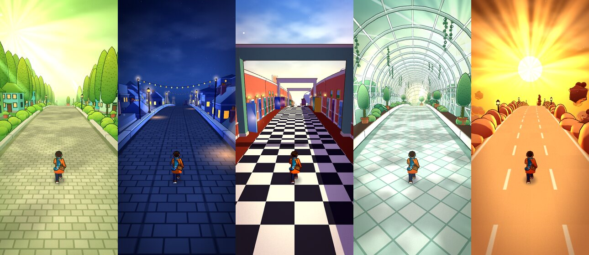
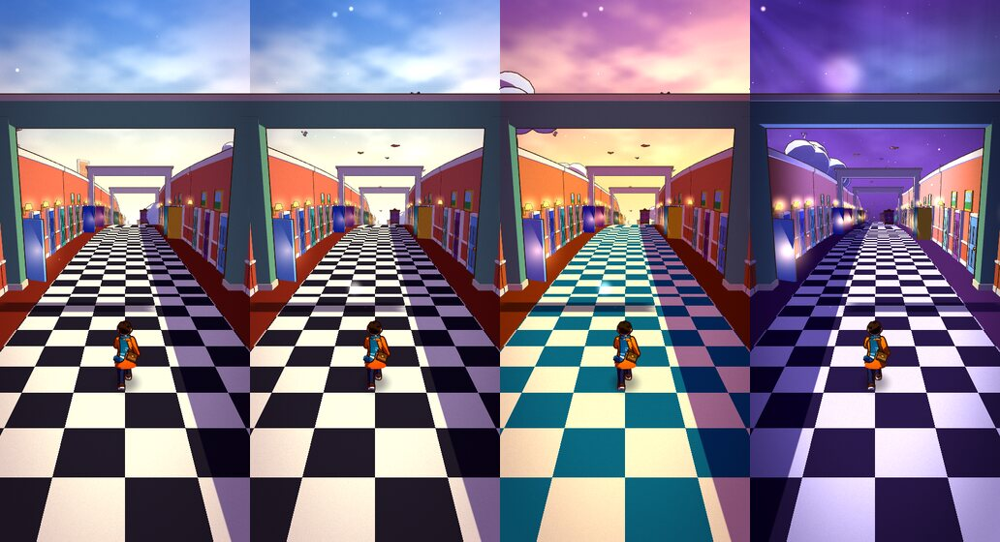
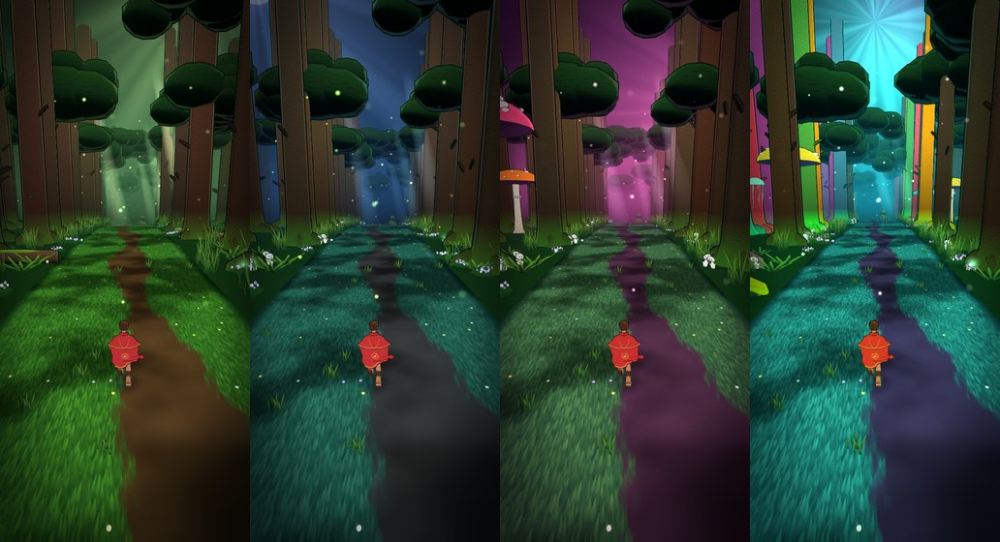
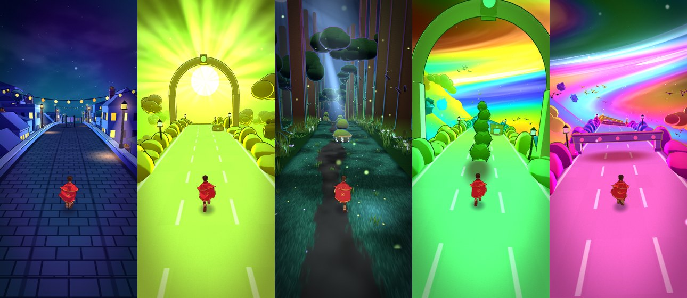
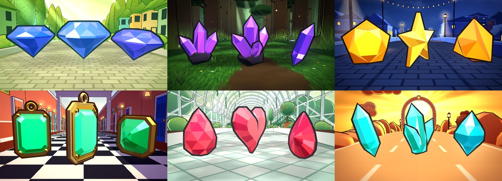
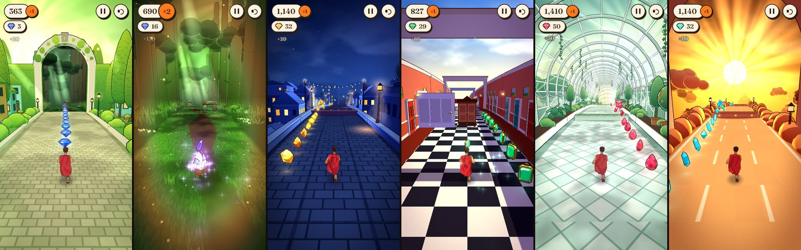
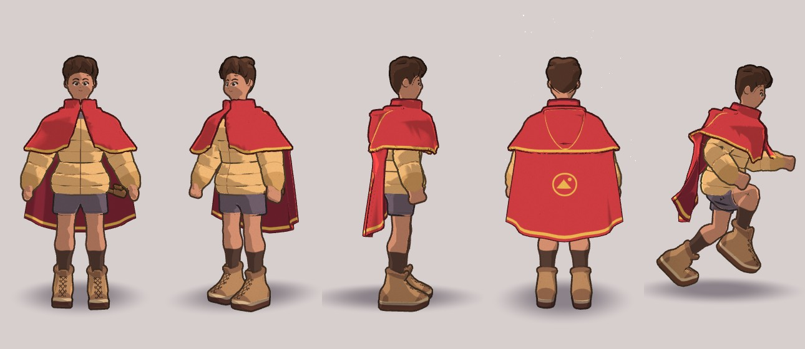

# EndlessRun

An endless runner through worlds within worlds. A young wayfarer in a puffer
jacket and a crimson hooded cape runs into the screen through a storybook world that never stops changing:
scenery unfolds out of the ground like a pop-up book as you approach, and every
half-minute or so a great doorway appears — through it you can already see the
next world, nested inside this one. Run through, and you're in it. Keep
running and the worlds come back around, each time a little stranger — and
once you're deep enough they stop holding their shape: slowly at first, then
roads corkscrew, forests melt, skies swirl like wet paint. Every doorway also raises your score
multiplier, so the strangest stretches are the ones worth the most. And every
world has its own gemstone to collect, laid in runs that swerve round its
walls, arc over its hurdles and lead you through its doorways.

Built for phones first (swipe controls, portrait framing, adaptive resolution
to hold 60 fps), and plays just as well on desktop with a keyboard or mouse.



## The worlds

| # | World | Light | Inspired by |
|---|-------|-------|-------------|
| I | **The Cypress Lane** — towering scribbled cypresses, mossy-roofed houses in mustard, mint and teal, a cobbled lane | soft and glowing: wrapped shading, green-gold haze, sun shafts between the trees, leafy dapple on the cobbles | the green forest illustration (this sets the art style for everything) |
| II | **The Deepwood** — colossal mossy trunks on buttress roots under a canopy that closes overhead, a trodden path through long grass, ferns, wildflowers, glowing mushrooms; the way out is two ancient trees grown into an arch, hung with paper lanterns | deep shade: cool dark shadows, heavy vignette, shafts of light through gaps in the leaves pooling warm on the path, ground mist, fog that swallows the far trunks, fireflies | the marsh, the creek through the meadow and the dark forest stream (Ghibli-style painted backgrounds) |
| III | **The Night Rooftops** — a slate walkway over a sleeping city, warm windows, chimney pots, a crescent moon, strings of little lights | high-contrast night: hard moonlight from ahead rims every silhouette, lamps pour warm cones and pools onto the slates, fog pools in the streets below | the night garden illustration |
| IV | **The Hall of Doors** — a coral corridor open to the sky, a checkerboard floor, doors of every colour, nested door frames, doors floating among the clouds | harsh and surreal, like a de Chirico piazza: raking sun, razor-edged shadows — the sunlit wall's shadow falls across the right of the hall (and across you), each lintel throws a crisp bar | the door-in-the-head illustration |
| V | **The Glasshouse** — a white-ribbed greenhouse tunnel of monstera, ferns, hanging blossom and orange trees | the softest: backlit humid haze, sunbeams through the glazing, drifting leaf-dappled floor | the nested garden illustration |
| VI | **The Sky Road** — a sandstone causeway over amber cloud, floating islands, a huge low sun | harsh backlight: the sun dead ahead turns everything into warm silhouettes with blazing gold rims, rays fan out of the sun, shadows stream back at you | Sky Dancer |

The first lap always nests inward in that order; after that the order shuffles
(never the same world twice in a row). Each doorway is painted the colour of
the world it leads to.

### Coming back around

Every time you return to a world it has changed — the changes layer up, and
past the third return the colours start to drift and the far end of the world
rolls in slow waves:

| | 2nd visit | 3rd visit | 4th visit |
|---|---|---|---|
| Cypress Lane | golden hour, blossom trees, flower beds, petals on the wind | lilac dusk, moon, fireflies, giant flowers over the lane | teal-and-pink dream, aurora, cypresses changing colour |
| Deepwood | firefly night: moonbeams, little white forest spirits watching from the roots, their heads rattling | the toadstool dusk: violet haze, giant glowing toadstools among the trunks, spores drifting up | the dreaming wood: rainbow bark, jellyfish drifting between the trees, aurora through the leaves |
| Night Rooftops | paper sky lanterns drift up, faint aurora | a huge moon, strong aurora | purple night, hot-air balloons |
| Hall of Doors | the books take flight | a tea party at dusk: teal-and-cream floor, teacups and teapots adrift | violet night, the shadows swap sides, clocks float past |
| Glasshouse | butterflies over the beds, pink petals | dusk, rose glass, giant blooms in the beds | bioluminescent night, glowing spores, aurora |
| Sky Road | flocks of birds | a ringed planet in a pink sky | whales swimming through the clouds |





### Dream depth

On top of the per-world looks, every doorway takes you one world *deeper*, and
deep enough, the worlds stop holding their shape. It comes on slowly, in three
movements:

1. **The real worlds.** The first three worlds (about two minutes) are exactly
   as painted.
2. **The morph.** From the fourth, the far distance quietly starts to misbehave:
   props far off breathe, slow swells roll through the far road, and a world
   or two later tall things far away go soft like jelly. Easy to miss at first.
3. **The trip.** Only from the eighth world (about four minutes in, early in
   the second lap) does the dream start to colour things — first a stir in
   the sky, then rings of hue, a turned palette, neon ink and finally a
   corkscrewing road — each effect joining at its own depth and growing over
   several worlds; everything is in by about the eighteenth.

Each stretch of the course is dealt its own seeded *dream recipe* from whatever
has joined by then — a few effects, more of them and stronger the deeper it
lies (once the trip has begun, always at least one of its colours) — so no two
passes through the same world look alike. A recipe blends into the next as you
run up to each doorway, so the world morphs around you on the approach.

| Distortion | Joins in world | Full by | What happens |
|---|---|---|---|
| breathe | 4 | 13 | props in the distance swell and settle like living things |
| waves | 4 | 14 | slow swells roll through the far world |
| melt | 6 | 16 | the far world wobbles like jelly, the tall things most |
| swirl | 8 | 16 | the sky stirs like wet paint, banded in rainbow |
| rings | 9 | 17 | rings of hue roll toward you through the world |
| palette | 10 | 18 | the whole world turns to new hues |
| neon | 11 | 18 | ink lines burn in cycling neon |
| twist | 12 | 19 | the road ahead corkscrews about its own axis |

**The doorway bloom** is there from the very first door: coming through sends
bands of colour out from the centre of the screen (and a swell racing down the
road) — the colours of the world you're entering, its `env.bloom` (the
Deepwood's moss, firefly and lantern; the rooftops' night blue, window gold and
lamp red...), laid over the picture's own light and shade. As the trip takes
over, the bloom turns more and more to rainbow.

Every so often a deeper world comes up *lucid* — as calm as one several doors
shallower, a breather — before it gets strange again. Once the trip is a third
of the way in, the camera starts to sway a little, too.

Two rules keep it fair and readable: every shape distortion grows with distance
from the camera, so the stretch of road you're actually reacting to — and every
obstacle on it — is always exactly where it looks (things far off firm up into
their true shape as they approach); and the runner keeps their own colours
however far the palette shifts, so you never lose yourself. If your system asks
for reduced motion, the shape warps and camera sway are scaled right down (the
colour is left alone). Tunables (including when each effect joins) live in
`CONFIG.dream`.



## Gems



Every world has its own stone, in a colour chosen to stand off that world's
palette, and cut in that world's character:

| World | Gem | Why it sings there | Cuts: everyday · variant · crown |
|---|---|---|---|
| Cypress Lane | **Sapphire** | cornflower blue against the greens and mustards | round brilliant (the gem everyone draws, so the first one you see reads as one) · oval brilliant · twelve-sided royal brilliant |
| Deepwood | **Amethyst** | the one purple thing in the shade, glowing like a spirit-lamp | crystal points growing from a lump of dark stone · a lone double-terminated point · a great geode cluster |
| Night Rooftops | **Citrine** | honey gold against the night blue | pentagon cut stood face-on like a star come down · trillion · a faceted fallen star |
| Hall of Doors | **Emerald** | green, the complement of the coral walls | an heirloom pendant — emerald cut in a gold bezel (the hall's doorknob brass) on a loop · square asscher · a larger pendant in a double rim |
| Glasshouse | **Ruby** | red against all that green and mint, as if the humid air had condensed into gems | briolette dewdrop faceted all over · pear cut · a heart |
| Sky Road | **Aquamarine** | turquoise, the complement of all that amber — a splinter of clear sky | long leaning double-terminated shard · squat sky-diamond · a fan of three splinters |

Each turns slowly and bobs where it hangs, at its own world's pace (the
amethysts drift like the fireflies; the aquamarines ride the biggest swells;
the emeralds barely stir in their still room), and unfolds out of nothing as
it comes in range like everything else. A soft halo and a little pool of light
on the road make them stand off the scene — subtle in daylight, a glowing trail
in the dark worlds. They're painted rather than ray-traced: every facet takes
its own tone between the stone's dark depths and the pale light caught on its
crown, the colour burns brightest through the face turned to you, and facets
that mirror a light into your eye flash white (one light is the world's, one
sits over the camera's shoulder, so they sparkle even in the Deepwood). Like
the runner, a gem keeps its colour however far the dream turns the palette. An
everyday stone is about 0.7 m across — half the runner's height — so a run
reads at a glance on a phone. Run through one and it swells, flashes and flies
into you in a spray of sparkles in its colour.



**Where they go.** Gems are laid in runs along a *ghost route* — the line a
good runner would take through the obstacles ahead, planned row by row as the
obstacles are laid — so every run can be taken, reads at a glance, and plays
with the obstacles instead of ignoring them:

- it **swerves out of a lane** before the wall in it (and, later on, tucks back
  in behind it), the gems drifting across between lanes;
- it **arcs over a hurdle** at the exact height of a jump taken at the right
  moment (so following the arc *is* the jump), with a crown stone at the top;
- it **ducks under a bar** — low gems you take in a slide, a crown waiting on
  the far side;
- it **threads the gap** between walls;
- and it **leads you through a doorway**: the last few gems in this world's
  stone, then — as the same run, its chime still climbing — the first few in
  the next world's, a crown first.

A gem never touches an obstacle or a doorway's frame, never hangs in a lane
so close before a wall that taking it leaves no time to swerve, and a run
only arcs or ducks if the route is settled in its lane in time. Runs ripple —
each gem turns and bobs a beat behind the one before — and mix in the world's
variant cut every few gems so a line never looks stamped out.

**Getting harder.** Early on the route is lazy and kind: short runs with
plenty of empty road between, kept to free lanes, swerving a full second
before anything. As the run goes on (on the same curve as the obstacles) it
swerves later and later (down to about 0.4 s before a wall), takes the hurdles
and bars it used to steer round, wanders across lanes on open road, hangs gems
in the air for jumps you don't strictly need, and the runs come longer and
closer together. The first run of the game pairs a run with each tutorial
obstacle, so the gems teach the jump, the slide and the dodge along with the
hints.

**No penalty.** Missing a gem costs nothing — no streak to break, no points
lost, and the chime keeps climbing from wherever you rejoin a run.

Tunables (spacing, heights, how early runs swerve, when each move unlocks,
points) live in `CONFIG.gems`.

## Score

You score **one point per meter × your depth** — ×1 in the first world, ×2
once through the first doorway, ×3 after the next, and so on — plus a **clear
bonus** of 10 × depth for every obstacle you get past without touching it
(double for full-width rows). So surviving deeper is worth far more than
running further: the multiplier is the badge stamped on the end of the score
pill, and it bumps every time you come through a door. Stumbling costs you that
obstacle's bonus; a Continue keeps your score and multiplier.

**Gems** pay 10 × depth each (a crown stone 30 × depth), with a glassy ting
that climbs the pentatonic scale along the run; take a whole run (three gems
or more) and it pays 5 × its length × depth on top, with a sparkle of notes.
The gem counter sits under the score, its little gem in the colour of the
world you're in, and the pause and crash cards tally the run's gems.

Your best is saved on the device, shown on the title screen, and the moment you
pass it mid-run a *new best!* ribbon pops under the score with a little run of
chimes. The crash card tallies the run against your best. Tunables live in
`CONFIG.score`.

## Controls

| | Touch | Keyboard | Mouse |
|---|---|---|---|
| Jump | swipe up | ↑ / W / Space | drag up |
| Slide | swipe down (in the air: dive and slide on landing) | ↓ / S / Shift | drag down |
| Change lane | swipe left / right | ← → / A D | drag left / right |
| Pause | ⏸ button | Esc / P | ⏸ button |

Swipes fire the moment your finger has travelled far enough — you don't have
to lift it — which is what makes the controls feel instant. A jump pressed just
before landing is buffered.

**Hits:** clipping something from the side, or tripping over a low obstacle /
bumping a high one, makes you *stumble* (ink creeps in from the screen edges
while you're vulnerable). A second hit within ~4.5 s, or running head-on into
a wall, knocks you down. You get one free **Continue** per run (configurable).

**Speed** starts at 12 m/s and eases toward 28 m/s over several minutes.
Obstacles start out roughly 3 seconds apart and close in gradually to about a
second, with the odd longer breather; combinations (two walls, zigzags,
tunnels) unlock as the run goes on. All of it is tunable in `CONFIG.obstacles`.

**Reading obstacles.** Every world draws its obstacles with the same grammar:
*low and solid to the ground* — jump it; *a frame or overhang with clear floor
beneath, its lowest edge on the same duck line in every world* — slide under
it; *tall and solid* — go around it. In the Deepwood that's a creek banked with
stones (jump it — and since it's water, you can't land on it: drop into it and
you trip), a fallen tree propped on a boulder and a stump, its hanging moss
ending on the duck line (slide under it), and giant mossy boulders, one of them
roped and hung with paper streamers like a shrine stone (go around).

## Run it locally

No build step and no dependencies to install — it's plain ES modules with
three.js vendored in `vendor/three`. Any static file server works (browsers
won't load modules from `file://`):

```sh
python3 -m http.server 8000
# then open http://localhost:8000
```

To try it on your phone, serve it on your local network (e.g.
`python3 -m http.server 8000 --bind 0.0.0.0`) and open your computer's IP.

## Publish on GitHub Pages

1. Push this branch / merge it to `main`.
2. In the repository: **Settings → Pages → Build and deployment → Source:
   Deploy from a branch**, branch `main`, folder `/ (root)`.
3. Open `https://<your-user>.github.io/<repo>/` on your phone. It can be added
   to the home screen and launches full-screen.

## Debug flags

Append to the URL:

| Flag | Effect |
|---|---|
| `?debug` | FPS, draw calls, triangles, pixel ratio, distance overlay. **N** skips to just before the next doorway, **G** toggles god mode |
| `?world=rooftops` | start in a given world (`village`, `forest`, `rooftops`, `corridor`, `conservatory`, `causeway`) |
| `?visit=2` | start on a later lap's look (0 = first time through) |
| `?dream=12` | deal every world the dream of the n-th world (0–3 = none, 18+ = the deepest); each world still deals its own recipe |
| `?seed=42` | reproducible layout |
| `?god` | no collisions |
| `?dpr=1.5` | force a pixel ratio (disables adaptive resolution) |
| `?manual` | no render loop; drive frames with `__step(frames, dt)` from the console (used for automated tests) |

## How it holds 60 fps

- **Everything is instanced.** Each prop type (a cypress, a house, a hedge…) is
  one `InstancedMesh`; a world draws in roughly 30–60 draw calls including ink
  outlines. Placements live in plain records and are only re-uploaded when
  chunks stream in/out — steady-state frames do no buffer work. The game logic
  takes well under a millisecond per frame.
- **Procedural generation is cheap here.** The track streams in 16 m chunks
  just ahead of you and recycles them behind, so only ~15 chunks exist at once
  no matter how far you run. A floating origin keeps float precision perfect
  over unlimited distance.
- **Animation happens on the GPU.** The pop-up unfolding, buildings rising,
  doors swinging, foliage swaying, wings and book covers flapping, drifting
  props and the curved-world bend are all done in the vertex shader from
  distance and time — no per-object CPU updates.
- **One skinned runner and a cape.** The wayfarer is a single skinned mesh
  and the cape one more, each with its ink hull — four draw calls, ~22k
  sculpted triangles plus ~9k for the cape. Legs are placed by IK, the body
  rides on spring follow-through, the cape is a 19×19 cloth simulation whose
  surface the GPU rebuilds from a 19×19 texture of particle positions (the
  only thing uploaded per frame), and the curls and hip pouch are springs;
  animation and simulation together take about 1 ms on a desktop (see
  [The runner](#the-runner)).
- **Cheap, painterly shading.** Hand-written toon shader with a per-world
  lighting model: terminator softness and wrap (harsh vs soft worlds), rim /
  back light, low-lying mist, leaf dapple, an analytic wall shadow, colour
  grade and a tinted vignette — no shadow maps, no post-processing passes.
  Light shafts and lamp cones are soft additive volumes; cast shadows are
  decals. Ink lines use the inverted-hull trick.
- **No hitches.** All shaders are compiled during the loading screen; no
  allocations in the hot loop.
- **Gems are cheap too.** A world's three cuts are three instanced batches
  (plus their ink), its halos and ground pools one batch each, and the
  pick-up sparkles a single point cloud whose bursts live in uniforms — nine
  draw calls in all. Spinning, bobbing, rippling and the pick-up flight happen
  in the vertex shader; taking a gem rewrites one small batch once. Planning
  and pick-up cost a few microseconds a frame.
- **Adaptive resolution.** Renders at up to 2× device pixels and steps down in
  0.25 increments if the frame rate dips below ~52 fps.

The doorway effect renders in two passes while a door is in view: the doorway
shape writes a stencil mask and the *next* world draws only inside it; then the
current world draws normally with the doorway "plugged" in the depth buffer,
so the old world continues around the door frame while the new one shows
through it.

## The runner



**Modelled as continuous surfaces, not assembled from parts.**
`tools/runner/build.py` sculpts the character offline the way a sculptor
blocks out a figure: each garment (head, hair, puffer, shorts, legs, boots,
hands, hood and collar, pouch) is one signed-distance field made of volumes blended
smoothly into each other, so shoulders flow into the sleeves, limbs taper and
the shorts wrap the hips. The fields are polygonised (marching cubes),
simplified, and given exact smooth normals from the field; skin weights come
from which volume "owns" each point of the surface, so the mesh bends where the
shapes blend. Proportions follow the reference illustration: about six heads
tall (the head and hair are sculpted in their own space and placed scaled on
the neck), knee a little under a third of the height, high socks and chunky
mid-cut hiking boots with a thick sole and a collar that dips at the front.
Fine linework — quilting seams, laces, the face, trims, the hood's seam — is
not modelled: each vertex carries a few smooth coordinates and the character
shader draws those lines crisply at any distance. Shading is one broad, crisp
shadow shape per surface in a warm shadow tone, a restrained hair highlight
and a thin dark contour tinted by the material under it.

The build writes `assets/runner/runner.json` (skeleton, rig constants, parts)
and `runner.bin` (vertex data), loaded once at boot. To change the character,
edit `build.py` and regenerate (about ten seconds):

```sh
pip install numpy scipy scikit-image fast-simplification
python3 tools/runner/build.py
```

**Animation.** The running legs are placed, not keyed: while a foot is down
the ball of the boot is pinned to the ground and carried back at exactly the
ground speed as the heel peels up over it; in the air the ankle follows a
designed path (heel kicks up under the hips, the knee drives through, the foot
reaches and paws back down), and a two-bone solve turns that into thigh and
knee angles — the knee always bends forward, the pelvis sinks into each
contact, the thighs turn against the pelvis's swing so a planted foot never
twists, and the arms swing against the legs with bent elbows. A 0.6 m leg can
only stay planted for ~0.58 m of ground, which at the game's 12–28 m/s is a few
hundredths of a second: at the starting pace contact has no slip at all; at
higher speeds contact is held for a minimum of ~2.4 frames so the planted pose
reaches the screen, and the leftover slip is straight back along the run inside
those frames (no sinking, floating or sideways skid). Jump and slide are
keyed poses; idle is keyed too but stands on planted feet (IK), easing its
weight from one leg to the other. Poses blend with second-order springs, so
every transition eases in and out.

**Weight and follow-through.** On top of the pose, the torso, head and arms
ride on the pelvis like loose springs, kicked by the pelvis's change of
velocity each frame — the stride's bounce and sway, and the root's lane
changes, jumps, landings and changes of pace (as impulses, so a sudden move
hits equally hard at any frame rate). Every footfall ripples up the spine and
drops the arms a touch; a lane change whips the shoulders across and lets them
swing back through; a take-off folds the body, the flight lets it float open
with the arms rising, and a landing folds it again before it springs up. Arms,
elbows, spine and head also trail their own posed motion on springs, so they
lag and overshoot at every reversal, and the lean into a lane change settles
with a soft overshoot. With each stride the chest turns against the hips and
the shoulders roll forward and back with the arms (the collarbones carry the
puffer's rounded shoulder caps, so the sleeves swing out of the shoulders
rather than hinging under them), while the head counter-turns and stays
steady.

**Fabric.** The cape is one continuous piece of red wool: sewn under a soft
gathered collar (closed at the throat by a little brass toggle, the hood lying
bunched over it at the nape), draped over the shoulders, open round the arms
and hanging to the upper calf behind. Its rest drape is built at load the way
it would fall on the body — each column leaving the collar, curving down over
the shoulder and hanging, its sides swinging in behind the arms — and then let
settle under gravity on the body's own volumes.

It is simulated as a 19×19 particle cloth (`src/game/cloth.js`): stretch,
shear and two ranges of bending constraints (the long ones keep big curves big
instead of crumpling into kinks), and tethers so it never stretches. Every row
has a leash to where the chest would carry it — none at the collar, a few
millimetres under the hood, a few centimetres by the shoulder blades, free from
there down — so the top follows the body exactly and the cloth gains freedom
toward the hem. It is kept off the body by the jacket's own volumes (exported
from the sculpt, ellipsoids for the torso, round capsules for the shoulder
caps and sleeves) and by capsules for the head, legs and boots: limbs push it
aside without flinging it, and the body's volumes always have the last word.
The ground drags it back as it runs under him.

The air does the rest: the headwind streams it back further as the pace rises
(about 40° at the starting pace, toward 60° at full tilt); behind the back the
body's wake weakens and draws it in, so it streams as a tail instead of filling
like a sail; gusts — smooth noise carried down the cape at the wind's pace —
roll broad, irregular pressure waves from the shoulders to the hem, different
under each half; and each free edge catches the air on its own, now and then
curling over to show the lining. The runner's own acceleration reaches the
cloth through a smoothed velocity, so a lane change makes the hem lag the
other way and then follow and settle, a take-off leaves it hanging a beat
before it lifts, and a landing drops it — the same at any frame rate (the step
is fixed at most 1/120 s and the colliders, pins and leash targets slide
through each frame's substeps). A soft breeze sways it when he stands still. A
ceiling over the collar stops it flipping forward over the shoulders or the
head (behind it slopes up, so it can stream up falling from a jump), and a soft
wall in front of the chest keeps it from wrapping round to the front.

The GPU draws a smooth Catmull-Rom surface through the particles with exact
normals (a thin slab: outside, burgundy lining and edges), and the cloth's
curvature, measured per particle and softened, keeps a soft shadow in the
valleys of its folds and waves under any light. Curls lag and bounce on
springs and play in the breeze; the hip pouch swings on a pendulum.

**Third-party assets.** None. Free bases and animation (Kenney, Quaternius /
Poly Pizza, OpenGameArt, Sketchfab, Mixamo, Poly Haven) were considered, but the
environment this was built in could not reach any of those hosts, so nothing
was downloaded or evaluated; the character, rig, animation and shading here are
all original. A suitable base mesh could still be adopted later: the game only
needs a skinned mesh whose bones are named like the ones `build.py` writes.

## Project layout

```
index.html, css/style.css     page shell, overlay UI
src/config.js                 every gameplay / feel / camera tunable
src/main.js                   boot, render loop, adaptive resolution, input wiring
src/core/                     input (swipes + keys), ambient audio, seeded RNG
src/render/                   shaders, geometry kit, instanced batches, textures, particles
src/world/                    world runtime + one file per world (art, lighting, lap
                              variations, layout, obstacles, gem, doorway); whimsy.js holds
                              the shared later-lap props and light volumes, gems.js the
                              gem cuts (faceted lofts, settings)
src/game/                     game loop, player (animation, IK legs, secondary
                              motion, movement), outfit (palette, cape), cloth,
                              runner asset loader, camera, course (world order),
                              chunk streaming, obstacle director, gem director
                              (gems.js: the ghost route and pick-up), portal, dream
                              (depth recipes and the shared warp uniforms)
tools/runner/build.py         offline sculpt of the runner -> assets/runner/
vendor/three/                 three.js r185 (MIT)
```

### Adding a world

Create `src/world/<name>.js` exporting `{ id, name, doorColor, env, visits,
gate, gem, build(b), chunk(ctx), obstacles }` (copy any existing world as a
template) and add it to `src/world/index.js`. `env` sets the palette and the
lighting (`light.soft` / `wrap` for harsh vs soft light, `rim`, `mist`,
`dapple`, `grade`, `skyFx`, …, and `bloom`, the three colours its doorway bloom is made of); `visits` lists partial `env` overrides for
each return. `build` registers prop batches from the geometry kit (`b.toon`,
`b.beam` for light volumes, `b.pool`, `b.shadow`); `chunk` places scenery for
each 16 m chunk and can check `ctx.visit` to add later-lap props; `obstacles`
maps the three gameplay kinds (L = jump over, H = slide under, W = go around)
to your themed props — keep H obstacles' lowest edge at `CONFIG.duckLine`.
An obstacle spec can also bring companion batches drawn with another material
(`with: ['creekWater']`), lower its collision top (`top`), skip its contact
shadow (`flat`), or be water you can't stand on (`wade`). `b.toon(…, { water:
true })` gives a surface the running-water shader, and ground pattern 6 is the
forest's long grass (pass the chunk distance as `p0` so it runs on seamlessly).

`gem` is the world's collectible: `tints` (a few close shades it's picked from,
the first also colouring the HUD), `cuts()` returning its three stones —
everyday, variant, crown — as part lists built from `world/gems.js`
(`brilliant`, `briolette`, `crystalPoint`, `bipyramid`, `star`, `stepCut`,
`outlineCut` with `pearOutline` / `heartOutline`, `bezelParts`; wrap crystal
in `crystal()`, settings in `metal()`, rock in `stone()`, and stand face-on cuts
up with `rx: FACE`), `motion` (`[turn, bob rate, bob height, nod]`), `look`
(`[self-lit, glints, facet hue spread, fire]`) and `glow` / `pool` (halo and
ground-light strength). Pick a colour nothing else in the world is.

## Not in yet (on purpose)

Keys, power-ups, extra characters and most sound effects are left for the
next pass; the ambient soundtrack (and the gems' chimes) is generated live
with Web Audio.
