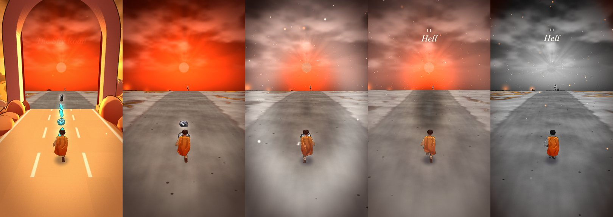
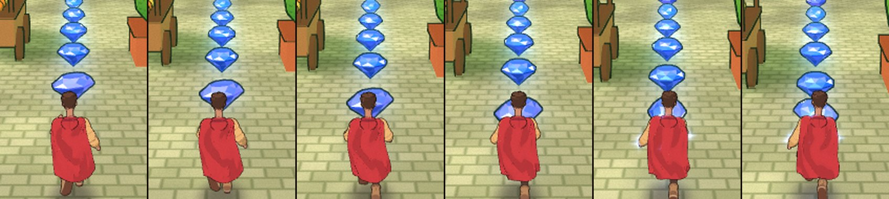
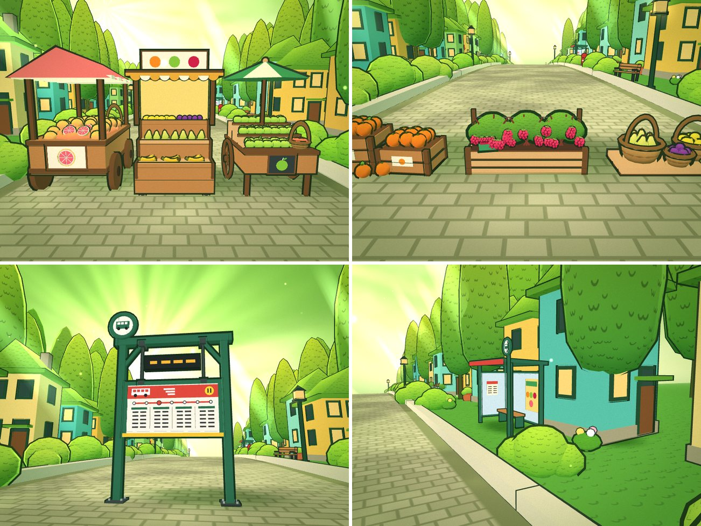
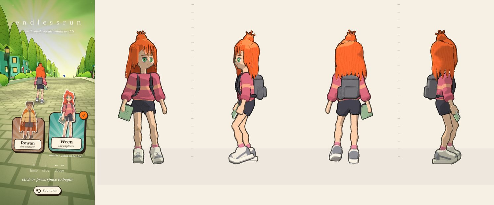
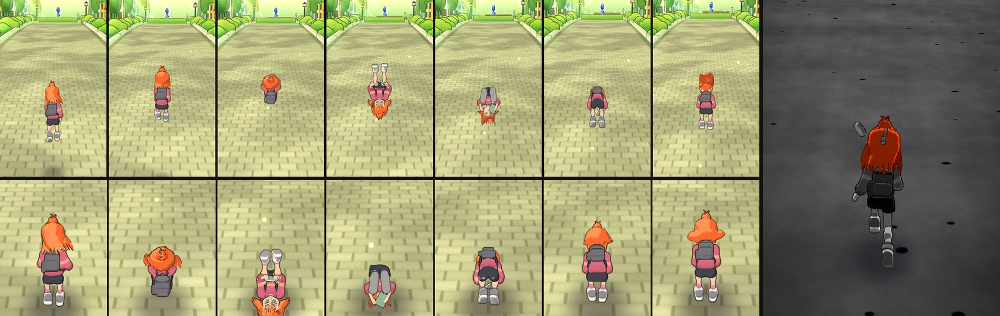

# EndlessRun

An endless runner through worlds within worlds. Pick who runs — Rowan, a young
wayfarer in a puffer jacket and an orange hooded cape, or Wren, a nimble
explorer with a shock of vermilion hair and a backpack that won't stay shut —
and run into the screen through a storybook world that never stops changing:
scenery unfolds out of the ground like a pop-up book as you approach, and every
half-minute or so a great doorway appears — through it you can already see the
next world, nested inside this one. Run through, and you're in it. Keep
running and the worlds come back around, each time a little stranger — and
once you're deep enough they stop holding their shape: slowly at first, then
roads corkscrew, forests melt, skies swirl like wet paint. Every doorway also raises your score
multiplier, so the strangest stretches are the ones worth the most. And every
world has its own gemstone to collect, laid in runs that swerve round its
walls, arc over its hurdles and lead you through its doorways.

Built for phones first (swipe controls, portrait framing, adaptive resolution
to hold 60 fps), and plays just as well on desktop with a keyboard or mouse.


## The worlds

| # | World | Light | Inspired by |
|---|-------|-------|-------------|
| I | **The Cypress Lane** — towering scribbled cypresses, mossy-roofed houses in mustard, mint and teal, a cobbled lane through a lived-in neighbourhood: now and then a greengrocer's or a bakery café on a ground floor, picket fences round front gardens of raspberry canes, market stalls on the verge (apples, grapefruit and oranges at one; watermelons, grapes and pineapples at the other), benches, post boxes, a bike with a basket of apples, the bus stop's shelter; and the market spilling into the road (see [The breather](#the-breather-the-cypress-lane)) | soft and glowing: wrapped shading, green-gold haze, sun shafts between the trees, leafy dapple on the cobbles | the green forest illustration (this sets the art style for everything) |
| II | **The Deepwood** — colossal mossy trunks in deep-furrowed bark on buttress roots under a canopy that closes overhead, a trodden path through long grass (taller still in among the trunks), ferns, wildflowers, glowing mushrooms, campfires left burning on the path and a creek cutting right across it; the way out is two ancient trees grown into an arch, hung with paper lanterns | deep shade: cool dark shadows, heavy vignette, shafts of light through gaps in the leaves pooling warm on the path, ground mist, fog that swallows the far trunks, fireflies | the marsh, the creek through the meadow and the dark forest stream (Ghibli-style painted backgrounds) |
| III | **The Night Rooftops** — a slate walkway over a sleeping city, warm windows, chimney pots, a crescent moon, strings of little lights, washing stirring on the lines strung across it | high-contrast night: hard moonlight from ahead rims every silhouette, lamps pour warm cones and pools onto the slates, fog pools in the streets below | the night garden illustration |
| IV | **The Hall of Doors** — a coral corridor open to the sky, a checkerboard floor, doors of every colour (now and then one stands swung open on nothing but light — each its own colour, a hint of some other world beyond that you never see and never reach — pouring out across the floor), nine different paintings between them, nested door frames, doors floating among the clouds, books fluttering up off the shelves and stacks in the way | harsh and surreal, like a de Chirico piazza: raking sun, razor-edged shadows — the sunlit wall's shadow falls across the right of the hall (and across you), each lintel throws a crisp bar | the door-in-the-head illustration |
| V | **The Glasshouse** — a white-ribbed greenhouse tunnel of monstera, ferns, hanging blossom and orange trees | the softest: backlit humid haze, sunbeams through the glazing, drifting leaf-dappled floor | the nested garden illustration |
| VI | **The Sky Road** — a sandstone causeway over amber cloud, floating islands, a huge low sun | harsh backlight: the sun dead ahead turns everything into warm silhouettes with blazing gold rims, rays fan out of the sun, shadows stream back at you | Sky Dancer |
| VII | **Hell** — fire and brimstone, and above all emptiness, and haunted: a plain of dark ash and cinders out to the edge of the world under a ceiling of smoke and, where the sun should be, a total eclipse — a black disc in a ring of fire (see [The eclipse](#the-eclipse)), a pale road of bone-white ash through it, split by glowing fissures, broken only now and then by black basalt columns, jagged spires, pools and rivers of lava that seethe and splash, and far-off volcanoes throwing up fountains of fire; pale hooded souls drift over the plain, the ribs of colossal dead things arch out of the ash, gibbet cages creak on crooked posts by the road, dead trees claw at the smoke, and dry lightning flickers in it, now and then forking down and lighting everything for an instant; embers rise and ash falls all the time | seen through its doorway it burns red and black; come through and its colour is sapped away down a whirlpool (see [The colour drain](#the-colour-drain)) — black, grey and white, dim and darker still toward the edges, lit hard from the burning horizon, with only the lava, the fire in the rock, the embers, the souls' eyes and the wayfarer's cape (or the explorer's hair) still in colour | fire and brimstone |
| VIII | **The Gallery of Hours** — a gallery of clocks open to the sky, where time has come unstuck: an ivory walk inlaid with brass clock-ticks between colonnades of ivory arches, oversized clock faces whose hands spin every which way — wonkier and wonkier the further you run — great gears turning behind the balustrades, pendulums swinging in the bays, grandfather clocks, armillary spheres turning on pedestals, hourglasses that really run and turn themselves over, pocket watches dangling out of the sky on their chains, and dials, gears, hourglasses and little cogs adrift in a pale heavenly sky | soft and heavenly: high warm light, pale cool shadows, a hazy sky of cloud | the clockwork gallery |

The first lap always nests inward in that order; after that the order shuffles
(never the same world twice in a row). Each doorway is painted the colour of
the world it leads to.

In the Hall of Doors, the nine paintings are dealt from a shuffled deck (every
one hangs before any repeats, never twice side by side, and the order changes
every round). All nine are one instanced batch: every design's triangles are
marked with its index and each instance folds away all but its own in the
vertex shader (toon option `kinds`), so they cost one draw call, not nine. The
doors standing open show nothing beyond them at all — only light, each door its own colour
(sea teal, forest green, night blue, ember red, sunlit gold, rose, violet,
ice: hints of the worlds that might lie beyond), dealt from a deck too so no
two neighbours match. The light fills the doorway edge to edge (it stands
proud of the wall's wainscot and rails, so nothing of the wall shows through
it), the door itself — panelled, in its own colour, its edge catching the
light — stands swung out into the hall on the jamb further down it, so it
never hides the light from down the hall, and the light pours out into the
hall as a soft coloured shaft (an additive beam) and pools on the floor.
The book stacks in the way are bright cloth bindings, their gilt spines
turned to you, a fat volume lying open on one of them.
The books that flutter up off a bookshelf or a stack are an obstacle's
decoration (`extras` on its spec): above head height, a little past it,
nothing to hit — rare the first time through the hall and more each time it
comes round.

### The colour drain

Hell is the one world that takes your colour away. Through its doorway it
looks the way you'd expect — a red sky over black ash, fire on the horizon —
but the moment the runner reaches the doorway (before the camera has followed
them through), instead of the usual burst of colour, the colour is
*sapped* out of the world, sucked away down a plughole in the middle of the
screen: the front is eating in from the corners from the very first frame,
and closes in in spiral arms that creep round as they go, under a dark rim,
streaks of colour dragged in after it, the colour left inside squeezed more
vivid as it's pulled toward the hole — lingering round the edges of the screen
at first, then faster and faster down the hole, a second in all — until
everything is black, grey and white: the sky, the ash, the rock, the gems and
the runner. Only what burns keeps its colour — the lava, the glowing fissures
and the fire in the cracks of the rock, the embers on the wind, the souls'
eyes, the eclipse's ring of fire and its corona — and the wayfarer's orange cape (or the explorer's vermilion hair). The road is kept pale and the rock dark,
ashen on top and veined with fire (and the grey is given a little extra
contrast), so the dark stones and the obstacles still read at a glance.

Leaving, it runs backwards. The world beyond the doorway out is grey too, but
for a hint of its colour, until the last stretch of the run-up — then its
colour wells up out of the middle of the doorway and spirals out to fill it,
sweeping over the runner, so you come through into full colour.

It's one per-world uniform (`uDrain`: how much, the radius from the centre of
the screen inside which the colour still holds out, which way the front is
going, and whether it's moving) applied in the shared colour grade, with
emissive surfaces, the lava material, the ground's glowing cracks, the rock's
fire and the cape (and the explorer's hair) marked to keep their colour — so a world seen through a
doorway can be drained or not independently of the one around it, at no extra
render cost. Any world can ask for it with `env.drain: true`; its timing lives
in `CONFIG.drain`.




### The eclipse

There's no sun over Hell: a total eclipse hangs small and high over the road
ahead instead — a black disc in a ring of fire, hottest and palest at its
inner edge where the last of the light spills past, tongues of flame licking
off it and flickering, and a short corona streaming out round it in wisps. It
all burns, so it keeps its colour when the rest of Hell has drained to grey.
On the third visit the eclipse swells a little, hanging bigger and lower, its
ring burning hotter. (Sky option `env.eclipse: [amount, ring of fire, corona
reach]`; the disc's size is `sun.size`.)


### Hell's fire, and its ghosts

Hell is dark — dimmer than anywhere else, the dark closing in from the edges
of the screen until only the road ahead holds any light (`grade.edge` pulls
the vignette in): a black sky under a ceiling of rolling smoke, lit from
beneath by the fires on the horizon, low smoke over the ash swallowing the
road ahead. Every few seconds there may be a strike of dry lightning — a
flicker in the smoke, sometimes a bolt forking down to the plain — that lights
the whole world for an instant in a cold white light, thrown right out into
the dark at the edges (sky option `skyFx.smoke`; the flash is worked out in
the shader from the time, so every surface agrees on it).

The lava churns: black crust plates rafting on a flow that runs from deep red
through orange to white-yellow where it's hottest, white-hot seams, bubbles
swelling and bursting. And it splashes — every pool, river and fissure throws
up crowns of droplets with a fat blob leaping through the middle, stretched
along their flight and falling back in, and the volcanoes throw up fountains
of fire (toon option `splash`: every droplet's launch point and velocity are
baked into its vertices and its arc is worked out in the vertex shader, so a
whole pool's splashing is one draw call and no CPU work). The fissures' spits
stay low, so a jump over one is never in doubt.

Every rock, beam and shard is textured in the shader (toon option `crust`,
sampled in three planes from world position): basalt pitted, mottled and laid
down in faint strata, charred timber split along its grain into glowing
blocks, obsidian rippled like broken glass with sharp glints and the fire
caught in its faces — each cracked with fire that keeps its colour through the
drain, and dusted with pale ash on whatever faces up, so obstacles read
against the road even in the dark.

And it's haunted: pale hooded souls drift over the plain, alone or in slow
processions, their empty sleeves hanging and two embers for eyes; the ribs of
colossal dead things arch up out of the ash; gibbet cages creak on crooked
posts by the road, swinging slowly on their chains with what's left of
someone inside; and dead trees claw up at the smoke.

### Time coming unstuck

In the Gallery of Hours every clock hand — on the great clocks up on the
arches, the dials adrift in the sky, the grandfather clocks (obstacles
included), the pocket watches dangling on their chains and the clock over the
doorway out — turns at its own pace, either way round. And the further you run
through the gallery, the wonkier they get: lurching back and forth, racing and
stalling, ticking in jerks that snap forward and back, until by the doorway
out they're flailing — purposely disorienting. Each time the gallery comes
round it starts a little wonkier (`env.wonk: [as you come in, by the doorway
out]`, driven by `game.js`; toon option `wonky` — a clock's two hands are one
batch, the hour hand's vertices marked to turn at its own pace).

The hourglasses work (toon and glass option `sand`): their sand runs from the
top bulb to the bottom one — the pile above sinking into the neck, a thin
stream falling, the mound below growing — and when it has run through, the
whole glass turns over on its waist and starts again. Everything but the sand
is the same upside down, so it's back exactly where it began; the glass is
see-through, so you can watch it. The ones in your way turn over within their
own footprint.

### Coming back around

Every time you return to a world it has changed — the changes layer up, and
past the third return the colours start to drift and the far end of the world
rolls in slow waves:

| | 2nd visit | 3rd visit | 4th visit |
|---|---|---|---|
| Cypress Lane | golden hour, blossom trees, flower beds, petals on the wind | lilac dusk, moon, fireflies, giant flowers over the lane | teal-and-pink dream, aurora, cypresses changing colour |
| Deepwood | firefly night: moonbeams, little white forest spirits watching from the roots, their heads rattling | the toadstool dusk: violet haze, giant glowing toadstools among the trunks, spores drifting up | the dreaming wood: rainbow bark, jellyfish drifting between the trees, aurora through the leaves |
| Night Rooftops | paper sky lanterns drift up, faint aurora | a huge moon, strong aurora | purple night, hot-air balloons |
| Hall of Doors | the books take flight | a tea party at dusk: teal-and-cream floor, teacups and teapots adrift | violet night, the shadows swap sides, clocks float past |
| Glasshouse | butterflies over the beds, pink petals | dusk, rose glass, giant blooms in the beds | bioluminescent night, glowing spores, aurora |
| Sky Road | flocks of birds | a ringed planet in a pink sky | whales swimming through the clouds |
| Hell | an ember storm: more fire on the wind, the plain alight | the eclipse swells, its ring of fire burning hotter, ash falling thick | the colours begin to drift |
| Gallery of Hours | golden hour: the gallery turned to amber, long shadows | midnight: a star-sown sky, aurora, the clock faces glowing | the colours begin to drift |


### Dream depth

On top of the per-world looks, every doorway takes you one world *deeper*, and
deep enough, the worlds stop holding their shape. It comes on slowly, in three
movements:

1. **The real worlds.** The first three worlds (about two minutes) are exactly
   as painted.
2. **The morph.** From the fourth, the far distance quietly starts to misbehave:
   props far off breathe, slow swells roll through the far road, and a world
   or two later tall things far away go soft like jelly. Easy to miss at first.
3. **The trip.** Only from the eighth world (about four minutes in, early in
   the second lap) does the dream start to colour things — first a stir in
   the sky, then rings of hue, a turned palette, neon ink and finally a
   corkscrewing road — each effect joining at its own depth and growing over
   several worlds; everything is in by about the eighteenth.

Each stretch of the course is dealt its own seeded *dream recipe* from whatever
has joined by then — a few effects, more of them and stronger the deeper it
lies (once the trip has begun, always at least one of its colours) — so no two
passes through the same world look alike. A recipe blends into the next as you
run up to each doorway, so the world morphs around you on the approach.

| Distortion | Joins in world | Full by | What happens |
|---|---|---|---|
| breathe | 4 | 13 | props in the distance swell and settle like living things |
| waves | 4 | 14 | slow swells roll through the far world |
| melt | 6 | 16 | the far world wobbles like jelly, the tall things most |
| swirl | 8 | 16 | the sky stirs like wet paint, banded in rainbow |
| rings | 9 | 17 | rings of hue roll toward you through the world |
| palette | 10 | 18 | the whole world turns to new hues |
| neon | 11 | 18 | ink lines burn in cycling neon |
| twist | 12 | 19 | the road ahead corkscrews about its own axis |

**The doorway burst** is there from the very first door: coming through
bursts a ring of colour out from the centre of the screen and off its edges in
about a quarter of a second, a bright crest on it and bands of colour trailing
behind that fade as fast as they came — two-thirds of a second in all (and a
swell races down the road) — the colours of the world you're entering, its
`env.bloom` (the Deepwood's moss, firefly and lantern; the rooftops' night
blue, window gold and lamp red...), laid over the picture's own light and
shade. As the trip takes over, the burst turns more and more to rainbow.

Every so often a deeper world comes up *lucid* — as calm as one several doors
shallower, a breather — before it gets strange again. Once the trip is a third
of the way in, the camera starts to sway a little, too.

A few rules keep it fair and readable, however deep it goes. The shape
distortions (the swells, the melt, the corkscrew, the breathing) only start
past the stretch of road you'll cover in the next three seconds — further out
the faster you run (`CONFIG.dream.read`) — and grow from there, so every
obstacle and gem is exactly where it looks from the moment it stands up in the
distance until you reach it (things far off firm up into their true shape
well before they matter). Obstacles never breathe, so a hurdle never swells
into a wall or a wall squashes into a hurdle; and obstacles and gems cut
through the low mist and the distance fog more than the scenery round them
(`uClear`), so they read from far off even in the darkest, haziest worlds.
And the runner keeps their own colours however far the palette shifts, so you
never lose yourself. If your system asks
for reduced motion, the shape warps and camera sway are scaled right down (the
colour is left alone). Tunables (including when each effect joins) live in
`CONFIG.dream`.


## Gems


Every world has its own colour of stone, chosen to stand off that world's
palette — and, the way stones turn up in the ground, a whole family in that
colour: the world's namesake gem in a couple of forms, mixed with three or
four cousins found alongside it, mostly rough, as they come out of the rock:

| World | Colour | Why it sings there | Stones (namesake first) | Crown |
|---|---|---|---|---|
| Cypress Lane | **Sapphire** blue | cornflower blue against the greens and mustards | sapphire, corundum's hexagonal barrel tapering to flat ends · a water-worn sapphire pebble · kyanite, striated blades fanning out of a scrap of pale rock · azurite, deep blue lumps grown together · hauyne, a rough sky-blue nugget | a great barrel with a smaller one grown into its side |
| Deepwood | **Amethyst** purple | the one purple thing in the shade, glowing like a spirit-lamp | amethyst points growing from a lump of dark stone · a lone double-terminated point · lace agate, a lavender pebble laid down in fine wavy layers · fluorite, a cleaved octahedron zoned in rings | a great geode cluster |
| Night Rooftops | **Topaz** gold | honey gold against the night blue | topaz, a lozenge prism under a wedge-and-pyramid tip · a rough topaz nugget · pyrite, brassy cubes grown through each other · citrine, a quartz point smoky at its foot, clearing to gold at the tip · amber, a honey pebble with dark specks caught inside | a great topaz with a second grown from its foot |
| Hall of Doors | **Emerald** green | the complement of the coral walls | an heirloom pendant — emerald cut in a gold bezel (the hall's doorknob brass) on a loop · a square asscher pendant · olivine, bright yellow-green, granular and rough · beryl, emerald's own six-sided prism, striated along its length · malachite, a rounded lump banded in rings of light and dark green | a larger pendant in a double rim |
| Glasshouse | **Ruby** red | red against all that green and mint, like berries of red glass | a chunky rough ruby · a water-worn ruby pebble · garnet, deep wine red, grown as a ball of twelve rhombs · rhodonite, opaque pink seamed with black · zircon, an orange-red four-sided prism pointed at both ends | a ruby crystal in corundum's six-sided plate, stood up to show its face |
| Sky Road | **Aquamarine** turquoise | the complement of all that amber — a splinter of clear sky | a long leaning double-terminated aquamarine shard · a squat sky diamond · turquoise, sky blue in a web of dark matrix · fluorite, pale sea-green octahedra zoned in rings | a fan of three splinters |
| Hell | **Onyx** black | dark stones on pale ash; the onyx's white bands and every stone's pale facet edges and glints make them read once the colour has gone, and they give off a pale smoky light of their own so their halos still show | onyx, a water-worn pebble banded black and white · obsidian, a glassy conchoidal shard · hematite, steel-bright kidney ore · black tourmaline, a long striated prism · smoky quartz, a point · mahogany obsidian, black clouded with rust | three obsidian blades fanned from a lump of basalt |
| Gallery of Hours | **Moonstone** white | cool, pale stones against warm ivory and brass, with a cool blue halo | moonstone, a milky pebble with a blue sheen · white opal, flecked with green-blue fire · clear quartz, a double-terminated point · selenite, a satin striated blade · diamond, a natural octahedron · a pair of pearls, lit as polished rather than faceted | a great diamond held in a brass ring like a watch glass |

The natural stones are made the way real ones are bounded: cleaved out of a
block by flat planes — the faces of a crystal's habit (a sapphire barrel is a
steep hexagonal dipyramid cut off flat at both ends; a ruby plate a hexagonal
prism with alternate edges bevelled by rhombohedral faces; a garnet the twelve
rhombs of a dodecahedron, its corners worn round; fluorite an octahedron;
pyrite a few cubes grown through each other; kyanite long flat blades), or the
fracture surfaces of a nugget or a pebble — each plane tipped a little off
true and a few corners chipped away, so none of them looks machined.

None of them is clean, either. Each stone has its own surface, painted in the
shader in the stone's own space so it turns with it rather than swimming over
it: a faint grain and cloudy mottling through every crystal, specks caught
inside (olivine's granular glitter, the dark flecks in amber), pale cracks
through the rough stones; agate and malachite are laid down in bands that
wander the way real ones do — fine layers in the agate, rings round a centre
in the malachite — and fluorite is zoned in nested shells of deeper and paler
colour following its octahedron; turquoise and rhodonite are seamed with dark
matrix. The opaque stones (azurite, malachite, turquoise, rhodonite, the lace
agate) trade the glassy inner glow for a matt, stony tone and catch fewer,
duller glints, and pyrite is lit as brassy metal. Up close, fine pale lines
pick out the edges where a crystal's faces meet, fading out with distance so a
far run stays clean. Every gem is also picked from a few close shades and
scaled a touch either way.

Each turns slowly and bobs where it hangs, at its own world's pace (the
amethysts drift like the fireflies; the aquamarines ride the biggest swells;
the emeralds barely stir in their still room), and unfolds out of nothing as
it comes in range like everything else. A soft halo and a little pool of light
on the road make them stand off the scene — subtle in daylight, a glowing trail
in the dark worlds. They're painted rather than ray-traced: every facet takes
its own tone between the stone's dark depths and the pale light caught on
top, the colour burns brightest through the face turned to you, and facets
that mirror a light into your eye flash white (one light is the world's, one
sits over the camera's shoulder, so they sparkle even in the Deepwood). Like
the runner, a gem keeps its colour however far the dream turns the palette. An
everyday stone is about 0.7 m across — half the runner's height — so a run
reads at a glance on a phone.

Run through one and it's sucked into you: drawn in faster and faster,
stretching toward you and shrinking to nothing inside the runner's body, over
a quarter of a second, with a few faint motes of its colour spiralling in
after it — held level with you as you run on, so it never trails back toward
the camera, and never pulls your eye off the road.




**Where they go.** Gems are laid in runs along a *ghost route* — the line a
good runner would take through the obstacles ahead, planned row by row as the
obstacles are laid — so every run can be taken, reads at a glance, and plays
with the obstacles instead of ignoring them:

- it **swerves out of a lane** before the wall in it (and, later on, tucks back
  in behind it), the gems drifting across between lanes;
- it **arcs over a hurdle** at the exact height of a jump taken at the right
  moment (so following the arc *is* the jump), with a crown stone at the top;
- it **ducks under a bar** — low gems you take in a slide, a crown waiting on
  the far side;
- it **threads the gap** between walls;
- and it **leads you through a doorway**: the last few gems in this world's
  stone, then — as the same run, its chime still climbing — the first few in
  the next world's, a crown first.

A gem never touches an obstacle or a doorway's frame, never hangs in a lane
so close before a wall that taking it leaves no time to swerve, and a run
only arcs or ducks if the route is settled in its lane in time. Runs ripple —
each gem turns and bobs a beat behind the one before — and each is led by one
stone of the world's family (most often its namesake), with about a third of
its gems drawn from the rest, so a run reads as one find but never looks
stamped out.

**Getting harder.** Early on the route is lazy and kind: short runs with
plenty of empty road between, kept to free lanes, swerving a full second
before anything. As the run goes on (on the same curve as the obstacles) it
swerves later and later (down to about 0.4 s before a wall), takes the hurdles
and bars it used to steer round, wanders across lanes on open road, hangs gems
in the air for jumps you don't strictly need, and the runs come longer and
closer together. The first run of the game pairs a run with each tutorial
obstacle, so the gems teach the jump, the slide and the dodge along with the
hints.

**No penalty.** Missing a gem costs nothing — no streak to break, no points
lost, and the chime keeps climbing from wherever you rejoin a run.

Tunables (spacing, heights, how early runs swerve, when each move unlocks,
how much a run mixes its stones, points) live in `CONFIG.gems`.

## Score

You score **one point per meter × your depth** — ×1 in the first world, ×2
once through the first doorway, ×3 after the next, and so on — plus a **clear
bonus** of 10 × depth for every obstacle you get past without touching it
(double for full-width rows). So surviving deeper is worth far more than
running further: the multiplier is the badge stamped on the end of the score
pill, and it bumps every time you come through a door. Stumbling costs you that
obstacle's bonus; a Continue keeps your score and multiplier.

**Gems** pay 10 × depth each (a crown stone 30 × depth), with a glassy ting
that climbs the pentatonic scale along the run; take a whole run (three gems
or more) and it pays 5 × its length × depth on top, with a sparkle of notes.
The gem counter sits under the score, its little gem in the colour of the
world you're in, and the pause and crash cards tally the run's gems.

Your best is saved on the device, shown on the title screen, and the moment you
pass it mid-run a *new best!* ribbon pops under the score with a little run of
chimes. The crash card tallies the run against your best. Tunables live in
`CONFIG.score`.

## Controls

| | Touch | Keyboard | Mouse |
|---|---|---|---|
| Jump | swipe up | ↑ / W / Space | drag up |
| Slide | swipe down (in the air: dive and slide on landing) | ↓ / S / Shift | drag down |
| Change lane | swipe left / right | ← → / A D | drag left / right |
| Pause | ⏸ button | Esc / P | ⏸ button |

Swipes fire the moment your finger has travelled far enough — you don't have
to lift it — which is what makes the controls feel instant. A jump pressed just
before landing is buffered.

On the title screen, tap a runner's card to pick them (← → / A D, or a
sideways swipe, steps between them); tap anywhere else, swipe up or press
Space / Enter to begin. **Choose runner** on the pause and crash cards goes
back there.

**Hits:** clipping something from the side, or tripping over a low obstacle /
bumping a high one, makes you *stumble* (ink creeps in from the screen edges
while you're vulnerable). A second hit within ~4.5 s, or running head-on into
a wall, knocks you down. You get one free **Continue** per run (configurable).

**Speed** starts at 12 m/s and eases toward 28 m/s over several minutes.
Obstacles start out roughly 3 seconds apart and close in gradually to about a
second, with the odd longer breather; combinations (two walls, zigzags,
tunnels) unlock as the run goes on — except in the Cypress Lane, the breather
world (below). All of it is tunable in `CONFIG.obstacles`.

### The breather: the Cypress Lane

Every time the Cypress Lane comes round it's a breather, however far the run
has got: it's laid at only a share of the run's difficulty, every gap is
stretched a little more, it never deals the hard combinations (zigzags,
tunnels, sweeping walls, hop-then-duck doubles) and lone obstacles come up
more often. It still tightens a little as the run goes on, but late in a run
its obstacles stand about twice as far apart as anywhere else (around 2.3 s
against 1.2 s), and the gem routes take it just as easy
(`CONFIG.obstacles.calm`, switched on by a world's `calm: true`).

Its obstacles are the market spilling into the road, each with its own
silhouette: two stepped crates heaped with oranges, a raised bed of raspberry
canes tied to a wire and hung with ripe raspberries (a punnet of picked ones
on its edge), wicker baskets of pears, lemons and plums with a hand of bananas
propped in front, a low crate of striped watermelons with a slice propped
against it and another melon lying in the road beside it, wooden flats of
punnets — strawberries, blueberries and cherries — with bunches of green and
purple grapes laid along the front, and the old clipped hedge — all low and
solid, jump them;
the bus stop's timetable hung over a lane — two green steel posts on bolted
base plates, braced to a crossbeam, the board hung from it on two rods under a
live "next bus" display, the route's colour and a bus across its head, a strip
map of the stops and columns of departure times, the stop's sign on top of
one post — its yellow kick rail on the duck line and nothing below it but the
road, slide under it (a pergola is the wide one); and the grapefruit cart
under its coral canopy (ruby grapefruit heaped in its bed, cut halves turned
up to show their pink, a cut grapefruit painted on its board), the apple
barrow under a green-and-cream parasol (tiers of green apples, a few red ones
in a basket, an apple chalked on its slate), the summer barrow under a
rose-and-cream parasol (tiers of peaches, limes and pomegranates, a basket of
cherries, a peach chalked on its slate), the tall stepped fruit stand (bananas,
pears, lemons and plums), its teal-valanced twin (pineapples, bunches of
grapes, peaches and pomegranates) and the potted cypress — tall and solid, go
round them. The fruit is storybook-sized, so it reads at a run, and there's
plenty of it — oranges, apples green and red, ruby grapefruit, lemons, limes,
pears, plums, bananas, raspberries, strawberries, blueberries, cherries,
grapes, peaches, pomegranates, pineapples and watermelons, whole and sliced —
so no two stretches of the market look alike. Along the verge the
greengrocer's window is stacked with oranges, limes and peaches under a
pineapple, with apples, grapes and peaches out front and a watermelon by the
door, and the market stalls come in two kinds.




**Reading obstacles.** Every world draws its obstacles with the same grammar:
*low and solid to the ground* — jump it; *a frame or overhang with clear floor
beneath, its lowest edge on the same duck line in every world* — slide under
it; *tall and solid* — go around it. In the Deepwood that's a campfire in a
ring of stones — a teepee of logs, a log-cabin crib under a black pot on a
grate, or a low star fire with a kettle warming beside it, each turned its own
way round, its flames licking and flickering and its light wavering on the
ground (jump it — and you can't land in the fire), or the creek right across
the path, a bright teal ribbon with white riffles and foam along its edges,
framed in pale sand, its near bank kept low so the water shows and its far
bank raised with big stones, reeds and ferns (jump it — and since it's water,
you can't land on it: drop into it and you trip), a fallen tree propped on a boulder and a stump, its hanging moss
ending on the duck line (slide under it), and giant mossy boulders, one of them
roped and hung with paper streamers like a shrine stone (go around). In Hell:
a low basalt ridge, or a lava fissure between crusted lips (jump — you can't
land in the lava), a charred beam on two basalt posts with embers in its cracks
(slide), basalt columns and obsidian shards (go around); a fissure across the
whole road and a long charred beam are the wide ones. In the Gallery of Hours:
a fallen clock hand or a broken section of dial (jump; a fallen minute hand
spans the walk), a brass crossbar hung with pendulums whose bobs end on the
duck line (slide), and grandfather clocks, great hourglasses and clock weights
(go around). All the Gallery's turning and swinging — hands, gears, the great
pendulums — is decoration kept off the walk; the obstacles stay where they
stand (an hourglass in your way turns over within its own footprint, its
pendulum bobs only sway along the run, rising as they swing), so a jump or a
slide is never mistimed by something moving.

### Washing and bark

The washing strung across the Night Rooftops (slide under it) is soft cloth:
each nightshirt, sheet and pair of long johns draped in folds, sagging between
its pegs, its corners drooping and its hem a little uneven, and stirring in the
breeze — swinging gently on its pegs, billowing and fluttering sideways, each
on its own beat, more and more the further it hangs below the line (toon
option `cloth`, worked out in the vertex shader). A swing only ever lifts a
hem, so the gap beneath never closes below the duck line.

Every trunk, buttress root, broken branch, fallen log, stump and campfire log
in the Deepwood is barked (toon option `bark`): rounded ridges between deep
V-shaped furrows that wander along the grain, now and then splitting a ridge
down its middle, the ridges broken across here and there into corky plates of
their own shades, a fibrous streak through it all and pale-green lichen in
patches — easing off to an even tone in the distance, where it would only
shimmer. Wherever a log has been sawn, its end shows growth rings round a pith
a little off-centre, darker heartwood, pale sapwood by the bark, and checks
split in from the rim as it dried.

## Run it locally

No build step and no dependencies to install — it's plain ES modules with
three.js vendored in `vendor/three`. Any static file server works (browsers
won't load modules from `file://`):

```sh
python3 -m http.server 8000
# then open http://localhost:8000
```

To try it on your phone, serve it on your local network (e.g.
`python3 -m http.server 8000 --bind 0.0.0.0`) and open your computer's IP.

## Publish on GitHub Pages

1. Push this branch / merge it to `main`.
2. In the repository: **Settings → Pages → Build and deployment → Source:
   Deploy from a branch**, branch `main`, folder `/ (root)`.
3. Open `https://<your-user>.github.io/<repo>/` on your phone. It can be added
   to the home screen and launches full-screen.

## Debug flags

Append to the URL:

| Flag | Effect |
|---|---|
| `?debug` | FPS, how many frames came late, frame-time p50/p95, script time, draw calls, triangles, pixel ratio, the GPU, distance overlay. **N** skips to just before the next doorway, **G** toggles god mode |
| `?world=rooftops` | start in a given world (`village`, `forest`, `rooftops`, `corridor`, `conservatory`, `causeway`, `hell`, `time`) |
| `?visit=2` | start on a later lap's look (0 = first time through) |
| `?dream=12` | deal every world the dream of the n-th world (0–3 = none, 18+ = the deepest); each world still deals its own recipe |
| `?seed=42` | reproducible layout |
| `?runner=explorer` | who runs (`wayfarer`, `explorer`), over the one remembered |
| `?god` | no collisions |
| `?dpr=1.5` | force a pixel ratio (disables adaptive resolution) |
| `?fps=30` | cap the frame rate (resolution still adapts) |
| `?manual` | no render loop; drive frames with `__step(frames, dt)` from the console (used for automated tests) |

## How it holds 60 fps

- **Everything is instanced.** Each prop type (a cypress, a house, a hedge…) is
  one `InstancedMesh`; a world draws in roughly 40–80 draw calls including ink
  outlines. Placements live in plain records and are only re-uploaded when
  chunks stream in/out — steady-state frames do no buffer work. The game logic
  takes well under a millisecond per frame.
- **Indexed geometry.** `part()` un-indexes each primitive so props can be
  merged, which leaves a sphere's shared vertices as exact copies; while the
  shaders compile at load, every batch's geometry is welded back into an
  index (only bit-identical vertices merge, so it draws exactly the same
  picture), and the GPU shades a third to a half as many vertices.
- **Nothing drawn that can't be seen.** Placements stream in in order of
  distance, so the far end of a batch is the end of its list: props that rise
  or lift into view are flattened or sunk out of sight until the camera nears
  them, and that tail of each batch is left out of the draw. The sky is drawn
  last, on the far plane, so it only shades the pixels nothing else covered.
- **Procedural generation is cheap here.** The track streams in 16 m chunks
  just ahead of you and recycles them behind, so only ~15 chunks exist at once
  no matter how far you run. A floating origin keeps float precision perfect
  over unlimited distance.
- **Animation happens on the GPU.** The pop-up unfolding, buildings rising,
  doors swinging, foliage swaying, wings and book covers flapping, drifting
  props and the curved-world bend are all done in the vertex shader from
  distance and time — no per-object CPU updates.
- **One skinned runner and a cape.** The wayfarer is a single skinned mesh
  and the cape one more, each with its ink hull — four draw calls, ~22k
  sculpted triangles plus ~9k for the cape. Legs are placed by IK, the body
  rides on spring follow-through, the cape is a 19×19 cloth simulation whose
  surface the GPU rebuilds from a 19×19 texture of particle positions (the
  only thing uploaded per frame), and the curls and hip pouch are springs;
  animation and simulation together take about half a millisecond on a
  desktop (see [The runners](#the-runners)). The explorer is the same four
  draw calls (her body, ~25k triangles, and her hair: a 15×12 cloth), costs
  about half as much to simulate, and adds two draw calls for each thing
  flying out of her backpack while it's in the air (at most six). The cloth solver's phases are
  small methods called with integers only: as one big function of nested
  loops V8 kept cycling it in and out of optimisation, running it mostly
  unoptimised and boxing every float it touched (~50 KB of garbage a frame,
  and the GC pauses that come with it); now it allocates nothing.
- **Cheap, painterly shading.** Hand-written toon shader with a per-world
  lighting model: terminator softness and wrap (harsh vs soft worlds), rim /
  back light, low-lying mist, leaf dapple, an analytic wall shadow, colour
  grade and a tinted vignette — no shadow maps, no post-processing passes.
  Light shafts and lamp cones are soft additive volumes; cast shadows are
  decals. Ink lines use the inverted-hull trick.
- **No hitches.** All shaders are compiled during the loading screen, and
  then everything is drawn once under it, so every world's buffers and
  textures are on the GPU and every program has been used before the run
  starts (otherwise each world uploads its geometry the first time its
  doorway comes into view); no allocations in the hot loop.
- **Gems are cheap too.** All of a world's stones share one geometry —
  every kind is in it, its triangles marked with their kind — and each kind
  present draws its own range of it, instanced; plus its ink, its halos and
  ground pools one batch each, and the pick-up motes a single point cloud
  whose bursts live in uniforms: a few draw calls in all, however many kinds
  of stone a world has.
  Each kind's surface is a handful of numbers in a uniform array. Spinning, bobbing, rippling and being sucked into the
  runner happen in the vertex shader; taking a gem rewrites one small batch once. Planning
  and pick-up cost a few microseconds a frame.
- **Frame timing** (`src/core/pacer.js`). Every animation frame the browser
  gives is drawn, at whatever rate it runs (60, 90, 120 Hz; Safari keeps
  pages near 60 on ProMotion screens unless told otherwise, near 30 in Low
  Power Mode). A frame on the usual cadence advances the simulation by
  exactly the usual interval (the median of recent ones), so rAF's timestamp
  jitter never reaches the motion; a late frame advances by the time that
  really passed, once, with no running average dragging behind it (which
  ran the game fast for a quarter of a second after every dropped frame).
  Jumps and lane changes are integrated exactly, so they follow the same
  path at any frame rate.
- **Adaptive resolution** (`src/core/quality.js`). Renders at up to 2× device
  pixels; averaged over ~1.5 s, frames slower than ~50 fps step it down a
  notch (0.25), and on a fast screen with room to spare it steps up once.
  If stepping down doesn't make frames any quicker (the browser holding the
  rate down, or a bottleneck that isn't pixels) the resolution is put back.
  It never changes the frame rate. What it settles on is remembered on the
  device; the next session starts a notch above it. Resizes happen at most
  once a frame and only when the size really changed.
- **No strobing at speed.** At 28 m/s the road moves further in a frame than
  its cobbles or slates are deep, and a crisp line across the road seems to
  strobe or crawl backwards; the ground's lines across the run are smeared
  over half the frame's travel (as a camera's shutter would) and the forest's
  grass softens, so they read as speed instead. `CONFIG.motionBlur` sets the
  shutter (0 turns it off).

The doorway effect renders in two passes while a door is in view: the doorway
shape writes a stencil mask and the *next* world draws only inside it; then the
current world draws normally with the doorway "plugged" in the depth buffer,
so the old world continues around the door frame while the new one shows
through it.

## The runners

Two runners, chosen on the title screen. Each is sculpted offline
(`tools/runner/`), skinned to the same skeleton and driven by the same core —
lanes, jumps, slides, the IK running legs, weight and follow-through
(`src/game/player.js`) — and each dresses it, hangs a simulated sheet off it
and moves in their own way (`wayfarer.js`, `explorer.js`; who they are, their
card and how to make them live in `characters.js`).

| | Rowan, the wayfarer | Wren, the explorer |
|---|---|---|
| Look | puffer, cargo shorts, hiking boots, an orange hooded cape | oversized rose sweater, charcoal shorts, chunky trainers, long vermilion hair, a backpack, her sketchbook |
| Simulated | the cape (19×19 cloth) | her long hair (15×12 cloth), the bun, fringe and side locks on springs, the backpack bouncing, things spilling out of it |
| Lanes | spring 32/s, a steady lean | spring 40/s — snappier — a side-skip with a hop, arms out, a deeper lean |
| Jump | a plain arc; a stride leap, arms out like wings | the same apex and airtime, popped quicker and hung at the top; a split leap, a tucked front flip or a corkscrew twist |
| Slide | feet first, leaning back | a forward roll |
| Run | a sure, bounding stride | a quicker, lighter, narrower one, more lean, less bounce |

### Choosing who runs



The title screen deals a card for each runner: their front view, cut out of
their reference sheet (`tools/characters/<id>-sheet.jpg`, cut by
`tools/characters/cards.py` into `assets/characters/<id>.webp`) and stood up
out of a card washed in their colours like a pop-up book — a paper keyline and
an ink shadow round the figure, a sunburst behind, their name on a paper plate.
The one you've picked stands taller, bobs, and wears an orange seal; picking
one swaps the live runner on the road behind the cards (every runner is built,
and their shaders compiled, at boot, so it's instant), and they say hello —
a gust catches Rowan's cape, Wren's backpack pops and a page flutters out. On
a tall screen the title camera stands back so the runner shows above the
cards; on a wide one the cards stand to the right. The pick is remembered
(`localStorage`).

### The explorer



`tools/runner/explorer.py` sculpts her to her reference sheet the same way
`build.py` sculpts him (it borrows its primitives, meshing, skinning and
export): about five heads tall, the head big and round with huge green eyes
(drawn by the shader: a gold ring round the pupil, two catch-lights, a heavy
upper lash line flicking out at the corner, thick brows lifting toward the
middle); a close cap of hair under a messy bun with wisps escaping it, a long
fringe falling to her brows in fine points and a lock either side framing her
face; an oversized rose sweater with a peach band across the chest and round
the upper sleeves, ribbed collar and hem, its sleeves shoved up past the
elbows into bunched rolls; the hem of a peach tee under it; charcoal shorts
with a rolled hem and pockets; long thin legs with a plaster on her right
knee; pink socks slouched in rolls over chunky cream trainers with grey
panels, heel counters and laces; a small grey backpack (zips round its lid
and front pocket, a mesh bottle pocket) on webbing straps with buckles at the
chest; and her green spiral sketchbook, a doodled cat on its cover, gripped in
her right hand.

**Her hair is simulated the way his cape is** (`cloth.js`, the same solver):
a sheet growing from under the bun round the back of her head, its roots
pinned to the head, the rows over her scalp leashed to it and the rest free,
kept off her head, neck, shoulders, arms, sweater and backpack by their own
volumes. It's lighter in the air than wool and quicker to answer every push:
it streams back in the headwind, swings out and lags across a lane change,
flies up through a jump and slaps down on landing, bounces with every stride
(it's carried with only a third of the head's bob) and sways in the breeze
when she stands. The GPU draws it as a slab full at the crown and thinning to
the tips, strands drawn down its length; toward its ends it parts into
pointed locks of uneven length, each edged in ink. The bun, the fringe and the
two face-framing locks bounce on their own springs. Her hair keeps its colour
through Hell's drain, as his cape does.

**The backpack** rides on a bone off her chest, bouncing, nodding and swaying
on springs with each footfall and lane change. Every so often — on a timer
while she runs (every 6–13 s), on one landing in five, in a burst when she
stumbles or crashes, now and then while she stands about, and when you pick her
— its lid pops open and something flies out (`src/game/spill.js`): a page torn
from her sketchbook (ruled, a doodled hill under a sun), a folded map (a river,
woods, a dotted way to an X), a magnifying glass, a compass, a pencil, a brass
key, a spyglass, a sticking plaster, a pressed leaf. They're small models
drawn with the runners' own shader, thrown up and back from the pack's mouth at
her own speed and left behind in the world: the flat ones catch the still air
on their faces — gliding edge-on, dropping slowly face-down, turning over and
over — while the heavy ones arc, bounce and skid; they fall away past the
camera. At most six fly at once (two draw calls each; none at rest).

**She plays lighter.** Lanes are a quicker spring (40/s against 32/s) and she
side-skips into them — a little hop off the outside foot, legs spreading toward
the move, arms flung out for balance, a hard lean. Her jump has exactly his
apex and airtime, so every gap is as fair, but it's shaped differently: she
pops up faster, gravity eases off within 3.2 m/s of the top so she hangs
there, then she drops (the arc is solved piecewise and exactly, the same at any
frame rate) — and in the air she does a trick, dealt from a shuffled deck so
the same one never comes twice running: a split leap (one leg reaching out
straight in front, the other stretched behind, arms flung up), a tucked front
flip about her hips, or a corkscrew twist about her own axis, legs together,
arms pulled in. Her slide is a forward roll: a dive into a tight tuck, over
her back and backpack (riding up over it so she never sinks into the road),
and up onto her feet. A spin cut short — a fast-fall, landing early, jumping
out of a roll — whips round to finish quickly rather than snapping back. She
runs at a quicker cadence on a narrower track with more lean and less bounce,
her free arm swinging lightly and the one with the sketchbook held closer;
she lands in a quick soft crouch with her arms out.

Her simulation costs about half his per frame (the hair grid is smaller than
the cape's); her mesh is about 25k triangles to his 23k.

To change either runner, edit their script and regenerate (about 15 and 35
seconds), then look at them turned round like their reference sheet in
`tools/runner/view.html?runner=explorer` (also `&pose=idle|run|jump|slide|bind`,
`&t=` seconds into it, `&trick=leap|flip|twist`, `&jt=` seconds into the jump
or roll, `&views=front,left,back,right,three`, `&zoom=`, `&y=`):

```sh
pip install numpy scipy scikit-image fast-simplification pillow
python3 tools/runner/build.py      # the wayfarer -> assets/runner/
python3 tools/runner/explorer.py   # the explorer -> assets/explorer/
python3 tools/characters/cards.py  # the title screen's cards
```

### The wayfarer


**Modelled as continuous surfaces, not assembled from parts.**
`tools/runner/build.py` sculpts the character offline the way a sculptor
blocks out a figure: each garment (head, hair, puffer, shorts, legs, boots,
hands, hood and collar, pouch) is one signed-distance field made of volumes blended
smoothly into each other, so shoulders flow into the sleeves, limbs taper and
the shorts wrap the hips. The fields are polygonised (marching cubes),
simplified, and given exact smooth normals from the field; skin weights come
from which volume "owns" each point of the surface, so the mesh bends where the
shapes blend. Proportions follow the reference illustration: about six heads
tall (the head and hair are sculpted in their own space and placed scaled,
seated low on a short neck), the head broad enough — about 0.45 of the padded
shoulders' width — to hold its own against the puffer, knee a little under a
third of the height, high socks and chunky
mid-cut hiking boots with a thick sole and a collar that dips at the front.
The face is young and broad — full cheeks, a soft jaw that tucks under into
the neck, a small rounded chin, the eyes sitting low in the head the way a
child's do — and the puffer's padded stand-up collar, open at the throat over
the tee, seats the short neck in the jacket. The hair is short and tousled: a
thin cap over the skull and, over it, clumps laid from the crown down toward
the hairline in three loose rings, each its own length and lean with its tip
curling out (seeded, so they're irregular but stable), which breaks the
outline into an uneven scallop and lets the fringe fall over the forehead in
points. The eyes are drawn relaxed: big warm-brown irises nearly filling the
opening, the upper lid lowered a little over them, soft brows resting low.
Fine linework — quilting seams, laces, the face, trims, the hood's seam — is
not modelled: each vertex carries a few smooth coordinates and the character
shader draws those lines crisply at any distance. Shading is one broad, crisp
shadow shape per surface in a warm shadow tone, a restrained hair highlight
and a thin dark contour tinted by the material under it.

The build writes `assets/runner/runner.json` (skeleton, rig constants, parts)
and `runner.bin` (vertex data), loaded once at boot. To change the character,
edit `build.py` and regenerate (about ten seconds):

```sh
pip install numpy scipy scikit-image fast-simplification
python3 tools/runner/build.py
```

**Animation.** The running legs are placed, not keyed: while a foot is down
the ball of the boot is pinned to the ground and carried back at exactly the
ground speed as the heel peels up over it; in the air the ankle follows a
designed path (heel kicks up under the hips, the knee drives through, the foot
reaches and paws back down), and a two-bone solve turns that into thigh and
knee angles — the knee always bends forward, the pelvis sinks into each
contact, the thighs turn against the pelvis's swing so a planted foot never
twists, and the arms swing against the legs with bent elbows. A 0.6 m leg can
only stay planted for ~0.58 m of ground, which at the game's 12–28 m/s is a few
hundredths of a second: at the starting pace contact has no slip at all; at
higher speeds contact is held for a minimum of ~2.4 frames so the planted pose
reaches the screen, and the leftover slip is straight back along the run inside
those frames (no sinking, floating or sideways skid). Jump and slide are
keyed poses; idle is keyed too but stands on planted feet (IK), easing its
weight from one leg to the other. Poses blend with second-order springs, so
every transition eases in and out.

**Weight and follow-through.** On top of the pose, the torso, head and arms
ride on the pelvis like loose springs, kicked by the pelvis's change of
velocity each frame — the stride's bounce and sway, and the root's lane
changes, jumps, landings and changes of pace (as impulses, so a sudden move
hits equally hard at any frame rate). Every footfall ripples up the spine and
drops the arms a touch; a lane change whips the shoulders across and lets them
swing back through; a take-off folds the body, the flight lets it float open
with the arms rising, and a landing folds it again before it springs up. Arms,
elbows, spine and head also trail their own posed motion on springs, so they
lag and overshoot at every reversal, and the lean into a lane change settles
with a soft overshoot. With each stride the chest turns against the hips and
the shoulders roll forward and back with the arms (the collarbones carry the
puffer's rounded shoulder caps, so the sleeves swing out of the shoulders
rather than hinging under them), while the head counter-turns and stays
steady.

**Fabric.** The cape is one continuous piece of orange wool — light at the
collar, deepening toward the hem, with a burnt-orange lining: sewn under a soft
gathered collar (closed at the throat by a little brass toggle, the hood lying
bunched over it at the nape), draped over the shoulders, open round the arms
and hanging to the upper calf behind. Its rest drape is built at load the way
it would fall on the body — each column leaving the collar, curving down over
the shoulder and hanging, its sides swinging in behind the arms — and then let
settle under gravity on the body's own volumes.

It is simulated as a 19×19 particle cloth (`src/game/cloth.js`): stretch,
shear and two ranges of bending constraints (the long ones keep big curves big
instead of crumpling into kinks), and tethers so it never stretches. Every row
has a leash to where the chest would carry it — none at the collar, a few
millimetres under the hood, a few centimetres by the shoulder blades, free from
there down — so the top follows the body exactly and the cloth gains freedom
toward the hem. It is kept off the body by the jacket's own volumes (exported
from the sculpt, ellipsoids for the torso, round capsules for the shoulder
caps and sleeves) and by capsules for the head, legs and boots: limbs push it
aside without flinging it, and the body's volumes always have the last word.
The ground drags it back as it runs under him.

The air does the rest: the headwind streams it back further as the pace rises
(about 40° at the starting pace, toward 60° at full tilt); behind the back the
body's wake weakens and draws it in, so it streams as a tail instead of filling
like a sail; gusts — smooth noise carried down the cape at the wind's pace —
roll broad, irregular pressure waves from the shoulders to the hem, different
under each half; and each free edge catches the air on its own, now and then
curling over to show the lining. The runner's own acceleration reaches the
cloth through a smoothed velocity, so a lane change makes the hem lag the
other way and then follow and settle, a take-off leaves it hanging a beat
before it lifts, and a landing drops it — the same at any frame rate (the step
is fixed at most 1/120 s and the colliders, pins and leash targets slide
through each frame's substeps). A soft breeze sways it when he stands still. A
ceiling over the collar stops it flipping forward over the shoulders or the
head (behind it slopes up, so it can stream up falling from a jump), and a soft
wall in front of the chest keeps it from wrapping round to the front.

The GPU draws a smooth Catmull-Rom surface through the particles with exact
normals (a thin slab: outside, burnt-orange lining and edges), and the cloth's
curvature, measured per particle and softened, keeps a soft shadow in the
valleys of its folds and waves under any light. Curls lag and bounce on
springs and play in the breeze; the hip pouch swings on a pendulum.

**Third-party assets.** None. Free bases and animation (Kenney, Quaternius /
Poly Pizza, OpenGameArt, Sketchfab, Mixamo, Poly Haven) were considered, but the
environment this was built in could not reach any of those hosts, so nothing
was downloaded or evaluated; the character, rig, animation and shading here are
all original. A suitable base mesh could still be adopted later: the game only
needs a skinned mesh whose bones are named like the ones `build.py` writes.

## Project layout

```
index.html, css/style.css     page shell, overlay UI
src/config.js                 every gameplay / feel / camera tunable
src/main.js                   boot, render loop, adaptive resolution, input wiring
src/core/                     input (swipes + keys), ambient audio, seeded RNG
src/render/                   shaders, geometry kit, instanced batches, textures, particles
src/world/                    world runtime + one file per world (art, lighting, lap
                              variations, layout, obstacles, gem, doorway); whimsy.js holds
                              the shared later-lap props and light volumes, gems.js the
                              gem kit (cleaved crystal habits, lofts, settings),
                              lane-art.js the Cypress Lane's fruit, market obstacles,
                              timetable and street furniture
src/game/                     game loop, player (the runners' shared core:
                              animation, IK legs, secondary motion, movement),
                              characters (who you can pick), wayfarer and
                              outfit (his palette, cape, pouch, poses), explorer
                              (her palette, hair, backpack, moves) and spill
                              (what flies out of it), kit (body geometry, sheet
                              surfaces and colliders), cloth, runner asset
                              loader, camera, course (world order),
                              chunk streaming, obstacle director, gem director
                              (gems.js: the ghost route and pick-up), portal, dream
                              (depth recipes and the shared warp uniforms)
tools/runner/build.py         offline sculpt of the wayfarer -> assets/runner/
tools/runner/explorer.py      offline sculpt of the explorer -> assets/explorer/
tools/runner/view.html        a runner turned round like their reference sheet
tools/characters/             the reference sheets and the cut-out of the
                              title screen's cards -> assets/characters/
vendor/three/                 three.js r185 (MIT)
```

### Adding a world

Create `src/world/<name>.js` exporting `{ id, name, doorColor, env, visits,
gate, gem, build(b), chunk(ctx), obstacles }` (copy any existing world as a
template) and add it to `src/world/index.js`. `env` sets the palette and the
lighting (`light.soft` / `wrap` for harsh vs soft light, `rim`, `mist`,
`dapple`, `grade`, `skyFx`, …, and `bloom`, the three colours its doorway bloom is made of); `visits` lists partial `env` overrides for
each return. `build` registers prop batches from the geometry kit (`b.toon`,
`b.beam` for light volumes, `b.pool`, `b.shadow`); `chunk` places scenery for
each 16 m chunk and can check `ctx.visit` to add later-lap props; `obstacles`
maps the three gameplay kinds (L = jump over, H = slide under, W = go around)
to your themed props — keep H obstacles' lowest edge at `CONFIG.duckLine`.
An obstacle spec can also bring companion batches drawn with another material
(`with: ['creekWideWater']`), lower its collision top (`top`), skip its contact
shadow (`flat`), or be water you can't stand on (`wade`). `b.toon(…, { water:
true })` gives a surface the running-water shader, and ground pattern 6 is the
forest's long grass, 7 Hell's ash (fissures glowing beyond the road) and 8 the
Gallery's ivory slabs with their brass clock-tick bezel (for all three, pass the
chunk distance as `p0` so they run on seamlessly). `b.toon(…, { lava: true })`
gives a surface the molten-rock material (it lights itself and keeps its colour
through a drain), and `b.toon(…, { turn: [spinZ, swingX, swingRate, spinY] })`
turns a prop in the vertex shader — gears and clock hands spinning about their
face, pendulums swinging from their origin (`p0` offsets a spinner's phase);
add `wonky: true` and its hands come unstuck with `env.wonk`. `crust: [glow,
ash, scale]` textures rock, charred wood and obsidian (each part picks its kind
with its `mark` flag: 0, 0.5, 1), `splash: true` makes a part list of droplets
from `splashGeo` leap and fall, and `sand: [seconds, waist, depth, floor]`
(on a toon and its `b.glass`) makes an hourglass run and turn over.
`flame: true` makes a prop's fully self-lit parts lick and flicker like fire
(each tongue's beat in its `uv.x`, how far up it in `uv.y`); `cloth: [sway,
rate, line height, drop]` makes washing stir in the breeze (each garment's
beat in its `uv.x`, `uv.y` 1 for what moves); `bark: true` barks every part
whose `mark` is 0.4 (lay its uv out with `asBark` in `forest.js`) and draws
growth rings on any cylinder cap marked 0.3; and `b.pool(…, {
color, flicker })` gives a pool of light its own colour, wavering like
firelight. A world with `calm: true` is a breather (see above),
`env.eclipse` puts a total eclipse in place of the sun, and `grade.edge:
[start, full]` reshapes the vignette (0 the centre of the screen, 1 the
corners; Hell pulls it right in).
`env.drain` makes the world drain of colour once you're in it, `skyFx.smoke`
lays a ceiling of smoke with dry lightning in it over the sky, and
`env.particles2` adds a second layer of motes (Hell's falling ash under its
rising embers). `gateExtras` entries can be `[name, x, y, dz]` to stand
something on the gate (the Gallery's clock hands).

`gem` is the world's collectible: a `name`, a `color` (the HUD's little gem),
its `stones` — each `{ name, weight, tints, parts(), texture }`, `weight`
being how often it leads or joins a run and `tints` a few close shades it's
picked from — and a `crown` for the prize spots, up to eight kinds in all.
`parts()` returns a part list built from `world/gems.js`: natural forms
cleaved by planes (`barrel`, `tabular`, `topazPrism`, `point`, `hexPrism`,
`tetragonal`, `dodecahedron`, `octahedron`, `cube`, `blade`, `nugget` for
rough stones and pebbles, `lumps` for stones grown in rounded clusters, or
`cleave` with your own planes, `around` making rings of them), lofted ones
(`crystalPoint`, `bipyramid`, `stepCut`) and `bezelParts`; wrap crystal in
`crystal()`, settings in `metal()`, rock in `stone()`, and stand face-on ones
up with `rx: FACE`. `texture` is the stone's surface, every key optional:
`mottle`, `speckle`, `veins` (cracks, pale unless `veinColor` makes them dark
matrix), `bands` with `bandFreq`, `wander` and `rings` (`'round'` or
`'nested'`) in a `second` colour, `opaque`, `rough`, `metal`, `glints` and
`scale`. Then `motion` (`[turn, bob rate, bob height, nod]`), `look`
(`[self-lit, glints, facet hue spread, fire]`) and `glow` / `pool` (halo and
ground-light strength). Pick a colour nothing else in the world is. For stones
too dark (or pale) to glow in their own colour, `light` gives the halo, the
light on the road and the motes they leave a colour of their own.

## Not in yet (on purpose)

Keys, power-ups, more runners and most sound effects are left for the
next pass; the ambient soundtrack (and the gems' chimes) is generated live
with Web Audio.
