# EndlessRun

An endless runner through worlds within worlds. Pick who runs — Rowan, a tall
wayfarer in a puffer jacket and an orange hooded cape who charges along like a
bruiser; Wren, a nimble
explorer with a shock of vermilion hair and a backpack that won't stay shut; or
Alder, an incredibly old man in a flowing teal robe and orange spectacles, bent
double, a beard down to his belt, who hobbles along on his long twisted walking
stick every bit as fast as the young ones; or Bramble, a little brown rabbit in
a yellow bucket hat and big round glasses, an olive satchel on his hip — the
smallest of them and the one who jumps highest, flipping, rolling and now and
then floating down on whatever he pulls out of his satchel —
and run into the screen through a storybook world that never stops changing:
scenery unfolds out of the ground like a pop-up book as you approach, and every
half-minute or so a great doorway appears — through it you can already see the
next world, nested inside this one. Run through, and you're in it. Keep
running and the worlds come back around, each time a little stranger — and
once you're deep enough they stop holding their shape: slowly at first, then
roads corkscrew, forests melt, skies swirl like wet paint. Every doorway you
come through is counted on a little orange door by your score, and makes the
road, and every obstacle you clear, worth more — so the strangest stretches
are the ones worth the most. And every world has its own gemstone to collect
(the Kelp Deep's are pearls), laid in runs that swerve round its walls, arc
over its hurdles and lead you through its doorways — and at the end of the
run, you can exchange your haul for a big bonus (see [Score](#score)). And you never
run alone: pick who runs with you. Sorrel, a red fox, runs at your side —
ranging ahead, dropping back, shooting out between your legs, riding on your
shoulder, once in a while chasing her own tail, and now and then snapping a
gem out of the air for you (see [The fox](#the-fox)). Or Iris, a wind
dragon — iridescent scales, deer's antlers, a feathered mane and plume —
flies beside you, flowing after her own head like a ribbon in the wind,
swimming through the air, sailing over carts and slipping under beams, now
and then loop-the-looping or corkscrewing ahead, and always keeping out of
your way (see [The dragon](#the-dragon)).

Built for phones first (swipe controls, portrait framing, adaptive resolution
to hold 60 fps), and plays just as well on desktop with a keyboard or mouse.

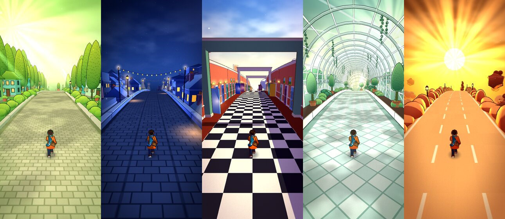

## The worlds

| # | World | Light | Inspired by |
|---|-------|-------|-------------|
| I | **The Cypress Lane** — towering scribbled cypresses, mossy-roofed houses in mustard, mint and teal, a cobbled lane through a lived-in neighbourhood: now and then a greengrocer's or a bakery café on a ground floor, picket fences round front gardens of raspberry canes, market stalls on the verge (apples, grapefruit and oranges at one; watermelons, grapes and pineapples at the other), benches, post boxes, a bike with a basket of apples, the bus stop's shelter; and the market spilling into the road (see [The breather](#the-breather-the-cypress-lane)) | soft and glowing: wrapped shading, green-gold haze, sun shafts between the trees, leafy dapple on the cobbles | the green forest illustration (this sets the art style for everything) |
| II | **The Deepwood** — colossal mossy trunks in deep-furrowed bark on buttress roots under a canopy that closes overhead, a trodden path through long grass (taller still in among the trunks), ferns, wildflowers, glowing mushrooms, campfires left burning on the path and a creek cutting right across it; the way out is two ancient trees grown into an arch, hung with paper lanterns | deep shade: cool dark shadows, heavy vignette, shafts of light through gaps in the leaves pooling warm on the path, ground mist, fog that swallows the far trunks, fireflies | the marsh, the creek through the meadow and the dark forest stream (Ghibli-style painted backgrounds) |
| III | **The Night Rooftops** — a slate walkway over a sleeping city, warm windows, chimney pots, a crescent moon, strings of little lights, washing stirring on the lines strung across it | high-contrast night: hard moonlight from ahead rims every silhouette, lamps pour warm cones and pools onto the slates, fog pools in the streets below | the night garden illustration |
| IV | **The Hall of Doors** — a coral corridor open to the sky, a checkerboard floor, doors of every colour (now and then one stands swung open on nothing but light — each its own colour, a hint of some other world beyond that you never see and never reach — pouring out across the floor), nine different paintings between them, nested door frames, doors floating among the clouds, books fluttering up off the shelves and stacks in the way | harsh and surreal, like a de Chirico piazza: raking sun, razor-edged shadows — the sunlit wall's shadow falls across the right of the hall (and across you), each lintel throws a crisp bar | the door-in-the-head illustration |
| V | **The Glasshouse** — a white-ribbed greenhouse tunnel run wild: beds crowded with zinnias and spilling over their edges, ferns and monstera, ivy up the ribs, baskets hung from brackets and on long chains from the roof, shelves of pots against the glass, potted cypress and orange trees, and here and there a Venus flytrap left to grow far too big (see [The Glasshouse, run wild](#the-glasshouse-run-wild)) | the softest: backlit humid haze, sunbeams through the glazing, drifting leaf-dappled floor | the nested garden illustration; greenhouses packed to the roof with plants, and a field of zinnias |
| VI | **The Sky Road** — a sandstone causeway over amber cloud, floating islands, a huge low sun | harsh backlight: the sun dead ahead turns everything into warm silhouettes with blazing gold rims, rays fan out of the sun, shadows stream back at you | Sky Dancer |
| VII | **Hell** — fire and brimstone, and above all emptiness, and haunted: a plain of dark ash and cinders out to the edge of the world under a ceiling of smoke and, where the sun should be, a total eclipse — a black disc in a ring of fire (see [The eclipse](#the-eclipse)), a pale road of bone-white ash through it, split by glowing fissures, broken only now and then by black basalt columns, jagged spires, pools and rivers of lava that seethe and splash, and far-off volcanoes throwing up fountains of fire; pale hooded souls drift over the plain, the ribs of colossal dead things arch out of the ash, gibbet cages creak on crooked posts by the road, dead trees claw at the smoke, and dry lightning flickers in it, now and then forking down and lighting everything for an instant; embers rise and ash falls all the time | seen through its doorway it burns red and black; come through and its colour is sapped away down a whirlpool (see [The colour drain](#the-colour-drain)) — black, grey and white, dim and darker still toward the edges, lit hard from the burning horizon, with only the lava, the fire in the rock, the embers, the souls' eyes and the wayfarer's cape (or the explorer's hair) still in colour | fire and brimstone |
| VIII | **The Gallery of Hours** — a gallery of clocks open to the sky, where time has come unstuck and its sands are running out: a walk of sand between colonnades of ivory arches, drifted high against the balustrades and spilling in across the walk, threads of sand falling from the cornice onto piles that heap up and slump (see [The sands of time](#the-sands-of-time)), your footprints left behind you, and the sea lapping in through the doorway out when it leads under the sea; oversized clock faces whose hands spin every which way — wonkier and wonkier the further you run — great gears turning behind the balustrades, pendulums swinging in the bays, grandfather clocks, armillary spheres turning on pedestals, hourglasses that really run and turn themselves over, pocket watches dangling out of the sky on their chains, and dials, gears, hourglasses and little cogs adrift in a pale heavenly sky | soft and heavenly: high warm light, pale cool shadows, a hazy sky of cloud | the clockwork gallery |
| IX | **The Kelp Deep** — the last world, under the sea: a path of pale sand rippled by the current over the ocean floor, strewn with shells and starfish, between banks of coral — brain coral, staghorn, table coral, lacy sea fans, tube sponges and anemones waving in the current — forests of kelp towering up toward the light, and far off, great stacks and arches of rock furred with weed fading into the teal; schools of silver fish stream alongside, dark shoals turn in the distance, bait balls mill, jellyfish pulse and drift trailing their arms, turtles and manta rays glide by, columns of bubbles rise from the reef — and whales cross the path (see [Under the sea](#under-the-sea)) | light from far overhead through a rippling surface: shafts of it slanting down, a net of caustics wavering over everything (the runner too), teal and green at the top of the screen sinking to deep blue at the bottom | the kelp forest, the whale beneath the waves, the jellyfish, the reef in gouache |

The first lap always nests inward in that order; after that the order shuffles
(never the same world twice in a row). Each doorway is painted the colour of
the world it leads to.

In the Hall of Doors, the nine paintings are dealt from a shuffled deck (every
one hangs before any repeats, never twice side by side, and the order changes
every round). All nine are one instanced batch: every design's triangles are
marked with its index and each instance folds away all but its own in the
vertex shader (toon option `kinds`), so they cost one draw call, not nine. The
doors standing open show nothing beyond them at all — only light, each door its own colour
(sea teal, forest green, night blue, ember red, sunlit gold, rose, violet,
ice: hints of the worlds that might lie beyond), dealt from a deck too so no
two neighbours match. The light fills the doorway edge to edge (it stands
proud of the wall's wainscot and rails, so nothing of the wall shows through
it), the door itself — panelled, in its own colour, its edge catching the
light — stands swung out into the hall on the jamb further down it, so it
never hides the light from down the hall, and the light pours out into the
hall as a soft coloured shaft (an additive beam) and pools on the floor.
The book stacks in the way are bright cloth bindings, their gilt spines
turned to you, a fat volume lying open on one of them.
The books that flutter up off a bookshelf or a stack are an obstacle's
decoration (`extras` on its spec): above head height, a little past it,
nothing to hit — rare the first time through the hall and more each time it
comes round.

### The colour drain

Hell is the one world that takes your colour away. Through its doorway it
looks the way you'd expect — a red sky over black ash, fire on the horizon —
but the moment the runner reaches the doorway (before the camera has followed
them through), instead of the usual burst of colour, the colour is
*sapped* out of the world, sucked away down a plughole in the middle of the
screen: the front is eating in from the corners from the very first frame,
and closes in in spiral arms that creep round as they go, under a dark rim,
streaks of colour dragged in after it, the colour left inside squeezed more
vivid as it's pulled toward the hole — lingering round the edges of the screen
at first, then faster and faster down the hole, a second in all — until
everything is black, grey and white: the sky, the ash, the rock, the gems and
the runner. Only what burns keeps its colour — the lava, the glowing fissures
and the fire in the cracks of the rock, the embers on the wind, the souls'
eyes, the eclipse's ring of fire and its corona — and the wayfarer's orange cape (or the explorer's vermilion hair). The road is kept pale and the rock dark,
ashen on top and veined with fire (and the grey is given a little extra
contrast), so the dark stones and the obstacles still read at a glance.

Leaving, it runs backwards. The world beyond the doorway out is grey too, but
for a hint of its colour, until the last stretch of the run-up — then its
colour wells up out of the middle of the doorway and spirals out to fill it,
sweeping over the runner, so you come through into full colour.

It's one per-world uniform (`uDrain`: how much, the radius from the centre of
the screen inside which the colour still holds out, which way the front is
going, and whether it's moving) applied in the shared colour grade, with
emissive surfaces, the lava material, the ground's glowing cracks, the rock's
fire and the cape (and the explorer's hair) marked to keep their colour — so a world seen through a
doorway can be drained or not independently of the one around it, at no extra
render cost. Any world can ask for it with `env.drain: true`; its timing lives
in `CONFIG.drain`.

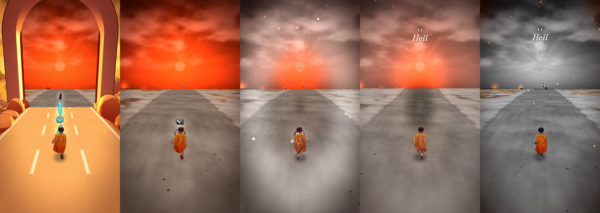


### The eclipse

There's no sun over Hell: a total eclipse hangs small and high over the road
ahead instead — a black disc in a ring of fire, hottest and palest at its
inner edge where the last of the light spills past, tongues of flame licking
off it and flickering, and a short corona streaming out round it in wisps. It
all burns, so it keeps its colour when the rest of Hell has drained to grey.
On the third visit the eclipse swells a little, hanging bigger and lower, its
ring burning hotter. (Sky option `env.eclipse: [amount, ring of fire, corona
reach]`; the disc's size is `sun.size`.)


### Hell's fire, and its ghosts

Hell is dark — dimmer than anywhere else, the dark closing in from the edges
of the screen until only the road ahead holds any light (`grade.edge` pulls
the vignette in): a black sky under a ceiling of rolling smoke, lit from
beneath by the fires on the horizon, low smoke over the ash swallowing the
road ahead. Every few seconds there may be a strike of dry lightning — a
flicker in the smoke, sometimes a bolt forking down to the plain — that lights
the whole world for an instant in a cold white light, thrown right out into
the dark at the edges (sky option `skyFx.smoke`; the flash is worked out in
the shader from the time, so every surface agrees on it).

The lava churns: black crust plates rafting on a flow that runs from deep red
through orange to white-yellow where it's hottest, white-hot seams, bubbles
swelling and bursting. And it splashes — every pool, river and fissure throws
up crowns of droplets with a fat blob leaping through the middle, stretched
along their flight and falling back in, and the volcanoes throw up fountains
of fire (toon option `splash`: every droplet's launch point and velocity are
baked into its vertices and its arc is worked out in the vertex shader, so a
whole pool's splashing is one draw call and no CPU work). The fissures' spits
stay low, so a jump over one is never in doubt.

Every rock, beam and shard is textured in the shader (toon option `crust`,
sampled in three planes from world position): basalt pitted, mottled and laid
down in faint strata, charred timber split along its grain into glowing
blocks, obsidian rippled like broken glass with sharp glints and the fire
caught in its faces — each cracked with fire that keeps its colour through the
drain, and dusted with pale ash on whatever faces up, so obstacles read
against the road even in the dark.

And it's haunted: pale hooded souls drift over the plain, alone or in slow
processions, their empty sleeves hanging and two embers for eyes; the ribs of
colossal dead things arch up out of the ash; gibbet cages creak on crooked
posts by the road, swinging slowly on their chains with what's left of
someone inside; and dead trees claw up at the smoke.

### Time coming unstuck

In the Gallery of Hours every clock hand — on the great clocks up on the
arches, the dials adrift in the sky, the grandfather clocks (obstacles
included), the pocket watches dangling on their chains and the clock over the
doorway out — turns at its own pace, either way round. And the further you run
through the gallery, the wonkier they get: lurching back and forth, racing and
stalling, ticking in jerks that snap forward and back, until by the doorway
out they're flailing — purposely disorienting. Each time the gallery comes
round it starts a little wonkier (`env.wonk: [as you come in, by the doorway
out]`, driven by `game.js`; toon option `wonky` — a clock's two hands are one
batch, the hour hand's vertices marked to turn at its own pace).

The hourglasses work (toon and glass option `sand`): their sand runs from the
top bulb to the bottom one — the pile above sinking into the neck, a thin
stream falling, the mound below growing — and when it has run through, the
whole glass turns over on its waist and starts again. Everything but the sand
is the same upside down, so it's back exactly where it began; the glass is
see-through, so you can watch it. The ones in your way turn over within their
own footprint.

### The sands of time

The Gallery's walk is sand, and it won't keep still.

**Drifts and piles.** Sand has drifted in off both sides, banked high
against the balustrades (half burying them, and the grandfather clocks
standing in the bays) and spilling in across the walk in tongues of loose,
paler sand with a soft lip at their edge — far into the lanes in some
places, hardly past the drift in others. Every so many arches a thread of
sand falls from the cornice and heaps up a pile against the balustrade;
when it runs out (its tail falling after it), the pile gives way all at
once and slumps out across the floor toward the walk, then settles into the
drift while the next one grows. Grains trickle down the drifts' faces, and
pour when a pile slumps; wind ripples creep across the packed sand, the
drift's crest creeps slowly along the walk, and wisps of fine sand blow
across it in gusts. The lanes themselves are never raised, so obstacles,
gems and shadows stand exactly where they always do.

**Footprints.** The runner leaves footprints: the wayfarer a hiking boot's
lugs, the explorer a trainer's wavy tread (drawn a third over life size, so
they read from the camera), each pressed in where the foot was planted, the
ball and toes dug in deepest, a rim of sand squeezed up round it, its walls
lit and shaded by the world's light — and the elder (in his old boots: the
lugs again) a line of round holes beside them where his walking stick
struck, and the bunny a rabbit's print, a long sole and three round toes. A
landing presses both feet in at once, deeper; a slide ploughs a
furrow with the sand heaped up at its end.

**The surf.** When the doorway out leads under the sea, the sea pours in
through it as its doors swing open and laps up the beach in front of it
(modelled on a hand-animated shoreline): wave after wave rolls up the sand —
fast, slowing as it runs out of push — and draws back, each reaching its
own way up the beach, its front rolling along in lobes. A band of white foam
leads it, opening behind into lace — rounded holes of teal water, each with
a shadowed crescent on the side toward the light where the foam stands
proud of it — that thins and breaks up toward the open water. It leaves the
sand darker where it has been, glistening as the backwash bares it, washes
footprints away, and flattens the drifts in front of the doorway. Run
through it and you splash: drops and spray at every footfall, the water
churned white round your legs and a wake trailing behind you.

How it's done: the floor is one strip per chunk, fine where the sand heaps
up and coarse down the flat middle, shaped in the vertex shader from track
coordinates (`sandHeight`: the drift's foot, its crest and the piles are
noise and hashes of where along the walk you are, so they need no CPU work
and run on seamlessly from chunk to chunk), its normal from the slope; the
threads are one instanced batch that works out from the same hashes whether
there's a pile under its arch and when it's pouring. The sand's pattern,
the footprints and the surf are ground pattern 10. The footprints are a
ring of twelve in uniforms, written by `src/game/sands.js` from the
stride's phase and the runner's toe bones; the waves are worked out there
too (so the runner knows when they're in the water) and handed over as a
handful of numbers — the front, how far this wave reached, the wet line,
how far the foam has been carried — while the foam's cells are worked out
per pixel (and not at all out in open water). The splashes are the
runner's own dust points, flavoured as water.


### Under the sea

The Kelp Deep is under water, and the water is a look, not a drag: the runner
runs as fast as anywhere.

**The splash.** Coming in through its doorway, the screen is splashed with
water. The instant the camera comes through, a wall of water hits the lens —
the picture swims behind it, white water flashing across, flung out in
streaks from where it hit — then the sheet slides off down the screen, faster
and faster, its front a rounded, bright, wavering lip, the picture soft and
tinted beneath it; and behind it, left on the glass, drops big and small hang
a moment and then streak away down the screen, stretching as they speed up,
each one a little lens (the world upside down in it, a glint on top, a dark
edge) with a wet trail beaded with tiny drops behind it. A second and a half
in all, and a rush of water with a deep whump and bubbles burbling after
(`src/game/splash.js`). It's drawn over the finished frame — the frame is
copied into a texture and one full-screen pass refracts it through the water
— only while a splash is running, so it costs nothing the rest of the time
(and the adaptive resolution ignores it). Into the Kelp Deep the splash is the
doorway's burst; only the swell races ahead, like a wave. Any world can ask
for it with `env.splash: true`.

**The water.** Overhead, the sky is the underside of the surface: a ceiling
of light rippling far above, brightest round the sun, shafts of light
fanning down from it (and long soft shafts slanting through the water, light
pooling where they land); everything that faces up — the sand, the coral, the
whale's back, the runner — is played over by a net of caustics, thin bright
lines wavering and drifting, brightest where they cross (`env.sea`). The
water darkens and cools down the screen, teal and green at the top sinking
through to deep blue at the bottom (`env.deep`, worked out in the colour
grade from where each pixel is on the screen). Marine snow drifts, and
bubbles rise through it (`particles.ring` draws motes as bubbles). The kelp
sways in the current, a wave running up it from its holdfast; the seagrass
and the anemones' tentacles wave (toon option `current`).

**The runner in the water** (`src/game/bubbles.js`). Bubbles stream off
them as they run and come in little breaths from their mouth; each footfall
puffs up sand and a few bubbles; a jump leaves a burst at their feet and a
trail behind, a landing a ring of sand and bubbles, a slide a churn of both,
a lane change a little swirl on the side they leave, and a stumble a cloud;
diving in through the doorway, a burst. They're thrown from the runner and
left in the water: carried along in their wake a moment, then slowed and
rising, wobbling and swelling, until they fall behind. And all the while the
water swirls round them: tiny bubbles and streaks spiralling round their
legs, arms and body and peeling off behind them, worked out on the GPU from
the runner's position alone. The sand is the explorer's dust, lit by the
road it comes off.

**The treasure chest.** Every so often (each chest on its own clock, every
4.6 s, toon option `lid`) something inside a sunken chest pushes: its lid
rattles, pops open on its hinge with an overshoot — treasure heaped to the
brim inside, gold glowing and pearls on it — and a gush of bubbles pours out,
wobbling and swelling as they rise faster and faster, while a few gold coins
flip up out of it and fall back in; then it drops shut and bounces. No two
pops are quite alike: most fling it wide, some only burp it open and let a few
bubbles out, now and then it stays shut. It's all in the vertex shader — the
lid, each bubble and each coin carry what they are (`role`), the bubbles and
coins where they start and their own beat — so a chest costs nothing on the
CPU; it's heard, though (a muffled clunk and a glug, quieter the further off),
because `lidPop` in `game.js` keeps the same time. Once you're close, it's held
shut (the bubbles still seep out round the lid), so what you jump is always
the chest you saw.

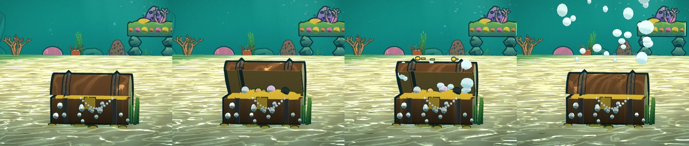

**Its creatures.** A school of fish is one instance: every fish its own
vertices, each carrying where it swims in the school and its own beat, and
the vertex shader sends it along a snaking stream (shrinking away at the ends
of the loop, so its wrapping round never shows) or round a milling ball,
turned the way it's heading with its tail beating — a whole school in one
draw call (toon option `school`; the same shape rising up a column makes the
bubbles from vents in the reef). The jellyfish's bell squeezes and relaxes, a
quick beat and a slow ease back, its rim pulling in hardest, while its
ruffled arms and long tentacles trail and ripple a beat behind, and it lifts
on every beat (toon option `jelly`). Mantas and turtles beat their wings and
flippers, and now and then a whale swims by far off, its tail beating.

**The whale.** The marquee obstacle: a humpback crossing the path, the one
you dive under. It's built tail to snout across the road — long pale-bellied
flippers out past the road on its head's side, its flukes out past it on the
other, knobbly tubercles on its head, pleats down its throat (toon option
`pleats`), dark above and pale beneath — with its belly held level on the
duck line right across all three lanes and its back below the camera's eye.
It swims in from one side as you come and is right over the road the moment
you reach it, however fast you run: it glides sideways a fixed share of
every metre between you (toon option `cross`, driven by the runner's position
in the vertex shader), so it's never early or late; its shadow glides across
the sand with it. Only its tail half beats up and down, and only out past
the road, so the gap beneath it never changes, and it sings as it comes — a
long low moan a few seconds before it reaches the road (an obstacle's `call`).

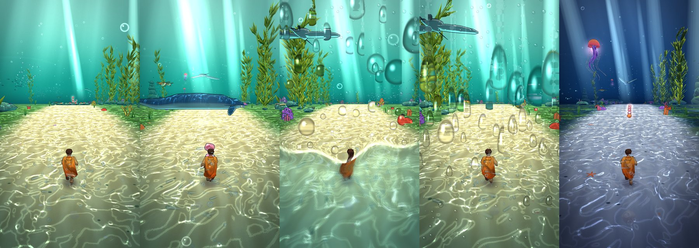

### Coming back around

Every time you return to a world it has changed — the changes layer up, and
past the third return the colours start to drift and the far end of the world
rolls in slow waves:

| | 2nd visit | 3rd visit | 4th visit |
|---|---|---|---|
| Cypress Lane | golden hour, blossom trees, flower beds, petals on the wind | lilac dusk, moon, fireflies, giant flowers over the lane | teal-and-pink dream, aurora, cypresses changing colour |
| Deepwood | firefly night: moonbeams, little white forest spirits watching from the roots, their heads rattling | the toadstool dusk: violet haze, giant glowing toadstools among the trunks, spores drifting up | the dreaming wood: rainbow bark, jellyfish drifting between the trees, aurora through the leaves |
| Night Rooftops | paper sky lanterns drift up, faint aurora | a huge moon, strong aurora | purple night, hot-air balloons |
| Hall of Doors | the books take flight | a tea party at dusk: teal-and-cream floor, teacups and teapots adrift | violet night, the shadows swap sides, clocks float past |
| Glasshouse | butterflies over the beds, pink petals | dusk, rose glass, giant blooms in the beds | bioluminescent night, glowing spores, aurora |
| Sky Road | flocks of birds | a ringed planet in a pink sky | whales swimming through the clouds |
| Hell | an ember storm: more fire on the wind, the plain alight | the eclipse swells, its ring of fire burning hotter, ash falling thick | the colours begin to drift |
| Gallery of Hours | golden hour: the gallery turned to amber, long shadows | midnight: a star-sown sky, aurora, the clock faces glowing | the colours begin to drift |
| Kelp Deep | the twilight reef: blue dusk, the light from above fading, jellyfish glowing everywhere, plankton lit up in the water | the deep at midnight: almost no light from above, the anemones, jellyfish and plankton glowing | the colours begin to drift |

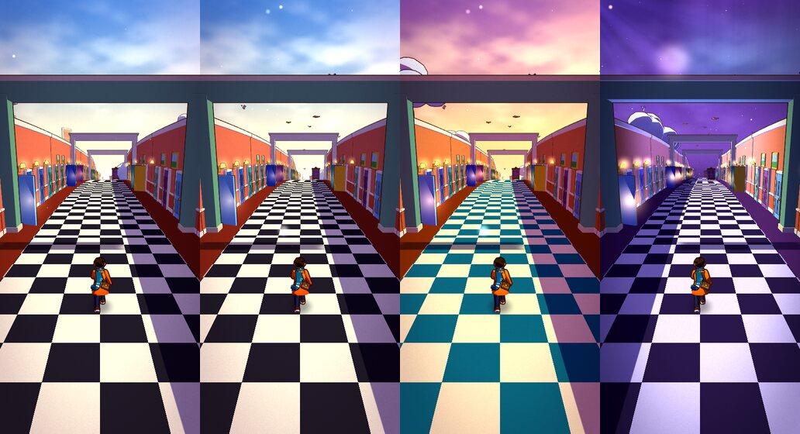

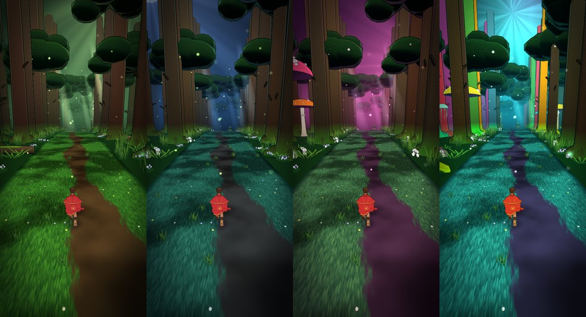

### Dream depth

On top of the per-world looks, every doorway takes you one world *deeper*, and
deep enough, the worlds stop holding their shape. It comes on slowly, in three
movements:

1. **The real worlds.** The first three worlds (about two minutes) are exactly
   as painted.
2. **The morph.** From the fourth, the far distance quietly starts to misbehave:
   props far off breathe, slow swells roll through the far road, and a world
   or two later tall things far away go soft like jelly. Easy to miss at first.
3. **The trip.** Only from the eighth world (about four minutes in, early in
   the second lap) does the dream start to colour things — first a stir in
   the sky, then rings of hue, a turned palette, neon ink and finally a
   corkscrewing road — each effect joining at its own depth and growing over
   several worlds; everything is in by about the eighteenth.

Each stretch of the course is dealt its own seeded *dream recipe* from whatever
has joined by then — a few effects, more of them and stronger the deeper it
lies (once the trip has begun, always at least one of its colours) — so no two
passes through the same world look alike. A recipe blends into the next as you
run up to each doorway, so the world morphs around you on the approach.

| Distortion | Joins in world | Full by | What happens |
|---|---|---|---|
| breathe | 4 | 13 | props in the distance swell and settle like living things |
| waves | 4 | 14 | slow swells roll through the far world |
| melt | 6 | 16 | the far world wobbles like jelly, the tall things most |
| swirl | 8 | 16 | the sky stirs like wet paint, banded in rainbow |
| rings | 9 | 17 | rings of hue roll toward you through the world |
| palette | 10 | 18 | the whole world turns to new hues |
| neon | 11 | 18 | ink lines burn in cycling neon |
| twist | 12 | 19 | the road ahead corkscrews about its own axis |

**The doorway burst** is there from the very first door: coming through
bursts a ring of colour out from the centre of the screen and off its edges in
about a quarter of a second, a bright crest on it and bands of colour trailing
behind that fade as fast as they came — two-thirds of a second in all (and a
swell races down the road) — the colours of the world you're entering, its
`env.bloom` (the Deepwood's moss, firefly and lantern; the rooftops' night
blue, window gold and lamp red...), laid over the picture's own light and
shade. As the trip takes over, the burst turns more and more to rainbow.

Every so often a deeper world comes up *lucid* — as calm as one several doors
shallower, a breather — before it gets strange again. Once the trip is a third
of the way in, the camera starts to sway a little, too.

A few rules keep it fair and readable, however deep it goes. The shape
distortions (the swells, the melt, the corkscrew, the breathing) only start
past the stretch of road you'll cover in the next three seconds — further out
the faster you run (`CONFIG.dream.read`) — and grow from there, so every
obstacle and gem is exactly where it looks from the moment it stands up in the
distance until you reach it (things far off firm up into their true shape
well before they matter). Obstacles never breathe, so a hurdle never swells
into a wall or a wall squashes into a hurdle; and obstacles and gems cut
through the low mist and the distance fog more than the scenery round them
(`uClear`), so they read from far off even in the darkest, haziest worlds.
And the runner keeps their own colours however far the palette shifts, so you
never lose yourself. If your system asks
for reduced motion, the shape warps and camera sway are scaled right down (the
colour is left alone). Tunables (including when each effect joins) live in
`CONFIG.dream`.

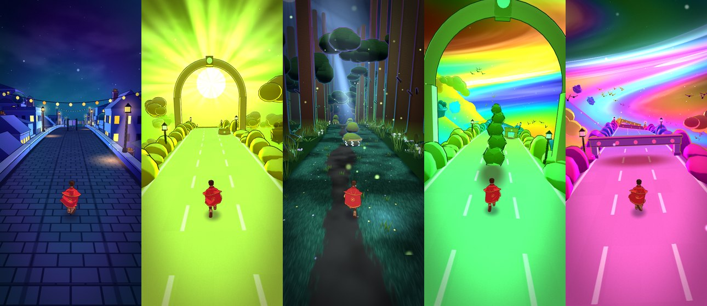

## Gems

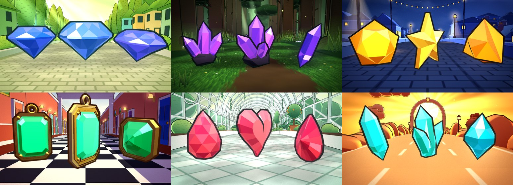

Every world has its own colour of stone, chosen to stand off that world's
palette — and, the way stones turn up in the ground, a whole family in that
colour: the world's namesake gem in a couple of forms, mixed with three or
four cousins found alongside it, mostly rough, as they come out of the rock:

| World | Colour | Why it sings there | Stones (namesake first) | Crown |
|---|---|---|---|---|
| Cypress Lane | **Sapphire** blue | cornflower blue against the greens and mustards | sapphire, corundum's hexagonal barrel tapering to flat ends · a water-worn sapphire pebble · kyanite, striated blades fanning out of a scrap of pale rock · azurite, deep blue lumps grown together · hauyne, a rough sky-blue nugget | a great barrel with a smaller one grown into its side |
| Deepwood | **Amethyst** purple | the one purple thing in the shade, glowing like a spirit-lamp | amethyst points growing from a lump of dark stone · a lone double-terminated point · lace agate, a lavender pebble laid down in fine wavy layers · fluorite, a cleaved octahedron zoned in rings | a great geode cluster |
| Night Rooftops | **Topaz** gold | honey gold against the night blue | topaz, a lozenge prism under a wedge-and-pyramid tip · a rough topaz nugget · pyrite, brassy cubes grown through each other · citrine, a quartz point smoky at its foot, clearing to gold at the tip · amber, a honey pebble with dark specks caught inside | a great topaz with a second grown from its foot |
| Hall of Doors | **Emerald** green | the complement of the coral walls | an heirloom pendant — emerald cut in a gold bezel (the hall's doorknob brass) on a loop · a square asscher pendant · olivine, bright yellow-green, granular and rough · beryl, emerald's own six-sided prism, striated along its length · malachite, a rounded lump banded in rings of light and dark green | a larger pendant in a double rim |
| Glasshouse | **Ruby** red | red against all that green and mint, like berries of red glass | a chunky rough ruby · a water-worn ruby pebble · garnet, deep wine red, grown as a ball of twelve rhombs · rhodonite, opaque pink seamed with black · zircon, an orange-red four-sided prism pointed at both ends | a ruby crystal in corundum's six-sided plate, stood up to show its face |
| Sky Road | **Aquamarine** turquoise | the complement of all that amber — a splinter of clear sky | a long leaning double-terminated aquamarine shard · a squat sky diamond · turquoise, sky blue in a web of dark matrix · fluorite, pale sea-green octahedra zoned in rings | a fan of three splinters |
| Hell | **Onyx** black | dark stones on pale ash; the onyx's white bands and every stone's pale facet edges and glints make them read once the colour has gone, and they give off a pale smoky light of their own so their halos still show | onyx, a water-worn pebble banded black and white · obsidian, a glassy conchoidal shard · hematite, steel-bright kidney ore · black tourmaline, a long striated prism · smoky quartz, a point · mahogany obsidian, black clouded with rust | three obsidian blades fanned from a lump of basalt |
| Gallery of Hours | **Moonstone** white | cool, pale stones against warm ivory and brass, with a cool blue halo | moonstone, a milky pebble with a blue sheen · white opal, flecked with green-blue fire · clear quartz, a double-terminated point · selenite, a satin striated blade · diamond, a natural octahedron · a pair of pearls, lit as polished rather than faceted | a great diamond held in a brass ring like a watch glass |
| Kelp Deep | **Pearls**, iridescent, in every shade | lustrous and soft against all that teal and green, and the one gem the sea makes itself; the counter wears a pearl here | Akoya, white with a rosé glow · golden South Sea · pink freshwater, a button pearl with a blue-lavender sheen · Tahitian, peacock black shot with green and blue · a silver-grey drop · a cream baroque · a circled champagne pearl (see [Pearls](#pearls)) | a great pearl in an open scallop shell |

### Pearls

The Kelp Deep's gems are all pearls, and a pearl isn't cut: it's lit in its
own branch of the gem shader (a stone kind with `nacre`). Its body keeps its
own colour, brighter where it faces up to the light and deepening toward its
edge; over it lies the *orient* — light thrown back from layer on layer of
nacre and interfering into pink, green, gold and peacock blue — banded round
it between the glint and the rim. The nacre's thickness wanders through the
pearl (fixed in its own space, so the colours slide over it as it turns), the
orient shifts the body's hue at its own brightness, and each kind leans
toward its own overtone (its `second` colour: rosé on the Akoyas, peach on the
golds, blue-lavender on the pinks, green on the Tahitians). On top, a broad
soft sheen in those colours and a crisp white window glint. Dark pearls show
their orient brightest, as real ones do. They're smooth — the baroque and the
circled pearls are spheres pushed out of round, their normals worked out
from the surface itself so there's no seam — and white in the geometry: each
pearl's shade is its instance colour, picked between its kind's few close
tints, so no two in a run quite match.

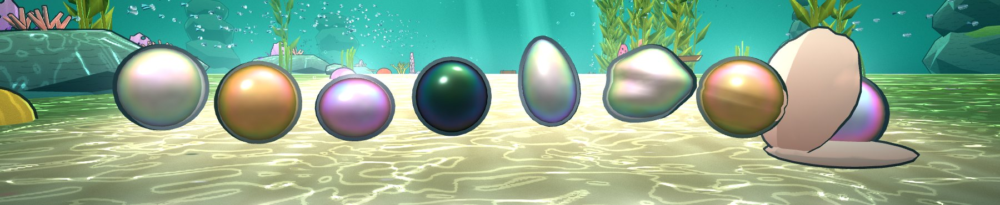

The natural stones are made the way real ones are bounded: cleaved out of a
block by flat planes — the faces of a crystal's habit (a sapphire barrel is a
steep hexagonal dipyramid cut off flat at both ends; a ruby plate a hexagonal
prism with alternate edges bevelled by rhombohedral faces; a garnet the twelve
rhombs of a dodecahedron, its corners worn round; fluorite an octahedron;
pyrite a few cubes grown through each other; kyanite long flat blades), or the
fracture surfaces of a nugget or a pebble — each plane tipped a little off
true and a few corners chipped away, so none of them looks machined.

None of them is clean, either. Each stone has its own surface, painted in the
shader in the stone's own space so it turns with it rather than swimming over
it: a faint grain and cloudy mottling through every crystal, specks caught
inside (olivine's granular glitter, the dark flecks in amber), pale cracks
through the rough stones; agate and malachite are laid down in bands that
wander the way real ones do — fine layers in the agate, rings round a centre
in the malachite — and fluorite is zoned in nested shells of deeper and paler
colour following its octahedron; turquoise and rhodonite are seamed with dark
matrix. The opaque stones (azurite, malachite, turquoise, rhodonite, the lace
agate) trade the glassy inner glow for a matt, stony tone and catch fewer,
duller glints, and pyrite is lit as brassy metal. Up close, fine pale lines
pick out the edges where a crystal's faces meet, fading out with distance so a
far run stays clean. Every gem is also picked from a few close shades and
scaled a touch either way.

Each turns slowly and bobs where it hangs, at its own world's pace (the
amethysts drift like the fireflies; the aquamarines ride the biggest swells;
the emeralds barely stir in their still room), and unfolds out of nothing as
it comes in range like everything else. A soft halo and a little pool of light
on the road make them stand off the scene — subtle in daylight, a glowing trail
in the dark worlds. They're painted rather than ray-traced: every facet takes
its own tone between the stone's dark depths and the pale light caught on
top, the colour burns brightest through the face turned to you, and facets
that mirror a light into your eye flash white (one light is the world's, one
sits over the camera's shoulder, so they sparkle even in the Deepwood). Like
the runner, a gem keeps its colour however far the dream turns the palette. An
everyday stone is about 0.7 m across — half the runner's height — so a run
reads at a glance on a phone.

Run through one and it's sucked into you: drawn in faster and faster,
stretching toward you and shrinking to nothing inside the runner's body, over
a quarter of a second, with a few faint motes of its colour spiralling in
after it — held level with you as you run on, so it never trails back toward
the camera, and never pulls your eye off the road.

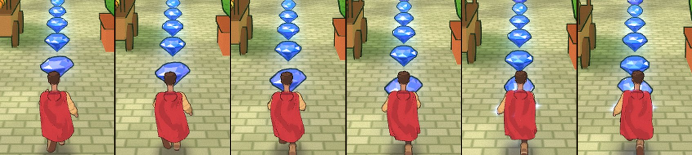

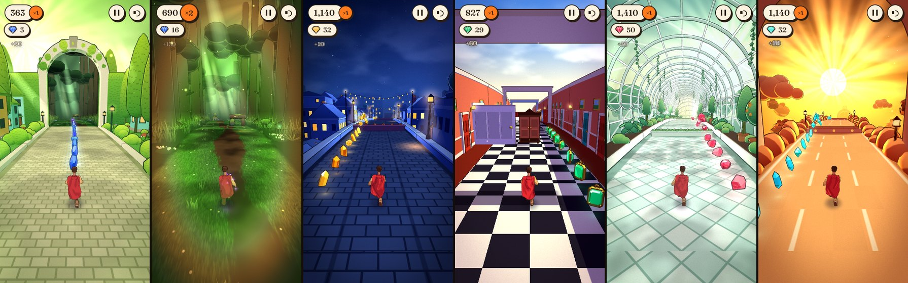

**Where they go.** Gems are laid in runs along a *ghost route* — the line a
good runner would take through the obstacles ahead, planned row by row as the
obstacles are laid — so every run can be taken, reads at a glance, and plays
with the obstacles instead of ignoring them:

- it **swerves out of a lane** before the wall in it (and, later on, tucks back
  in behind it), the gems drifting across between lanes;
- it **arcs over a hurdle** at the exact height of a jump taken at the right
  moment (so following the arc *is* the jump), with a crown stone at the top;
- it **ducks under a bar** — low gems you take in a slide, a crown waiting on
  the far side;
- it **threads the gap** between walls;
- and it **leads you through a doorway**: the last few gems in this world's
  stone, then — as the same run, its chime still climbing — the first few in
  the next world's, a crown first.

A gem never touches an obstacle or a doorway's frame, never hangs in a lane
so close before a wall that taking it leaves no time to swerve, and a run
only arcs or ducks if the route is settled in its lane in time. Runs ripple —
each gem turns and bobs a beat behind the one before — and each is led by one
stone of the world's family (most often its namesake), with about a third of
its gems drawn from the rest, so a run reads as one find but never looks
stamped out.

**Getting harder.** Early on the route is lazy and kind: short runs with
plenty of empty road between, kept to free lanes, swerving a full second
before anything. As the run goes on (on the same curve as the obstacles) it
swerves later and later (down to about 0.4 s before a wall), takes the hurdles
and bars it used to steer round, wanders across lanes on open road, hangs gems
in the air for jumps you don't strictly need, and the runs come longer and
closer together. The first run of the game pairs a run with each tutorial
obstacle, so the gems teach the jump, the slide and the dodge along with the
hints.

**No penalty.** Missing a gem costs nothing — no streak to break, no points
lost, and the chime keeps climbing from wherever you rejoin a run.

Tunables (spacing, heights, how early runs swerve, when each move unlocks,
how much a run mixes its stones, points) live in `CONFIG.gems`.

## Score

The little orange doorway stamped on the end of the score pill counts the
**worlds you've come through** — 0 in the first, 1 once through the first
doorway, and so on — and bumps every time you come through another. Each one
makes the run worth more: you score **one point per meter × your depth** (1
in the first world, 2 in the second, …), and every obstacle you get past
without touching it pays a **clear bonus** that climbs faster still with every
world: 10, 25, 45, 70, 100, 135, 175, 220, 270… (`clear` × depth × (1 +
`grow` × worlds come through), to the nearest 5; double for full-width rows).
So surviving deeper is worth far more than running further. Stumbling costs
you that obstacle's bonus; a Continue keeps your score and your count.

**Gems** pay 10 × depth each (a crown stone 30 × depth), with a glassy ting
that climbs the pentatonic scale along the run; take a whole run (three gems
or more) and it pays 5 × its length × depth on top, with a sparkle of notes.
The gem counter sits under the score, its little gem in the colour of the
world you're in (a pearl, in the Kelp Deep), and the pause card tallies the
gems in hand and what they're worth.

**The exchange.** Every gem also banks a *worth* as you take it — and the
later and deeper you find it, the more it's worth: 10 × (1 + ½ × the worlds
you'd come through) × (1 + ¾ × how far through its world it was), a crown
stone three times that. So a gem at the very start of the run is worth 10, one
at the far end of the first world 17, and one at the far end of the ninth 87.
When you crash, the card offers to **exchange** the gems in hand for that many
points, plus a haul bonus for a big pile (up to ×1.5 at 400 gems): tap it and
the gem count drains away as the score counts up, to a tumble of tings. In all
it comes to about two fifths again on top of what the run scored. Exchange
and Continue, and you carry on with none in hand (the next crash offers
whatever you've found since); Continue without exchanging and your haul rides
on, growing. Whatever's still in hand when you leave the card for good is
exchanged anyway, so a haul is never lost. (Later on, gems will buy things;
for now, they're points.) Tunables live in `CONFIG.gems.exchange`.

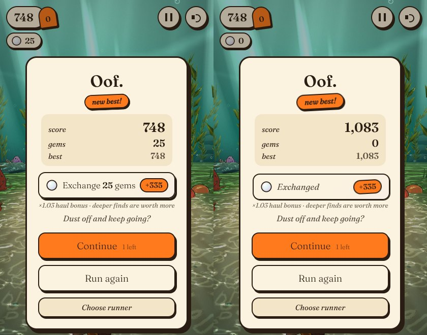

Your best is saved on the device, shown on the title screen, and the moment you
pass it mid-run a *new best!* ribbon pops under the score with a little run of
chimes. The crash card tallies the run against your best. Tunables live in
`CONFIG.score`.

## Controls

| | Touch | Keyboard | Mouse |
|---|---|---|---|
| Jump | swipe up | ↑ / W / Space | drag up |
| Slide | swipe down (in the air: dive and slide on landing) | ↓ / S / Shift | drag down |
| Change lane | swipe left / right | ← → / A D | drag left / right |
| Pause | ⏸ button | Esc / P | ⏸ button |

Swipes fire the moment your finger has travelled far enough — you don't have
to lift it — which is what makes the controls feel instant. A jump pressed just
before landing is buffered.

On the title screen, tap a runner's card to pick them (← → / A D, or a
sideways swipe, steps between them); tap anywhere else, swipe up or press
Space / Enter to begin. **Choose runner** on the pause and crash cards goes
back there.

**Hits:** clipping something from the side, or tripping over a low obstacle /
bumping a high one, makes you *stumble* (ink creeps in from the screen edges
while you're vulnerable). A second hit within ~4.5 s, or running head-on into
a wall, knocks you down. You get one free **Continue** per run (configurable).

**Speed** starts at 12 m/s and eases toward 28 m/s over several minutes.
Obstacles start out roughly 3 seconds apart and close in gradually to about a
second, with the odd longer breather; combinations (two walls, zigzags,
tunnels) unlock as the run goes on — except in the Cypress Lane, the breather
world (below). All of it is tunable in `CONFIG.obstacles`.

### The breather: the Cypress Lane

Every time the Cypress Lane comes round it's a breather, however far the run
has got: it's laid at only a share of the run's difficulty, every gap is
stretched a little more, it never deals the hard combinations (zigzags,
tunnels, sweeping walls, hop-then-duck doubles) and lone obstacles come up
more often. It still tightens a little as the run goes on, but late in a run
its obstacles stand about twice as far apart as anywhere else (around 2.3 s
against 1.2 s), and the gem routes take it just as easy
(`CONFIG.obstacles.calm`, switched on by a world's `calm: true`).

Its obstacles are the market spilling into the road, each with its own
silhouette: two stepped crates heaped with oranges, a raised bed of raspberry
canes tied to a wire and hung with ripe raspberries (a punnet of picked ones
on its edge), wicker baskets of pears, lemons and plums with a hand of bananas
propped in front, a low crate of striped watermelons with a slice propped
against it and another melon lying in the road beside it, wooden flats of
punnets — strawberries, blueberries and cherries — with bunches of green and
purple grapes laid along the front, and the old clipped hedge — all low and
solid, jump them;
the bus stop's timetable hung over a lane — two green steel posts on bolted
base plates, braced to a crossbeam, the board hung from it on two rods under a
live "next bus" display, the route's colour and a bus across its head, a strip
map of the stops and columns of departure times, the stop's sign on top of
one post — its yellow kick rail on the duck line and nothing below it but the
road, slide under it (a pergola is the wide one); and the grapefruit cart
under its coral canopy (ruby grapefruit heaped in its bed, cut halves turned
up to show their pink, a cut grapefruit painted on its board), the apple
barrow under a green-and-cream parasol (tiers of green apples, a few red ones
in a basket, an apple chalked on its slate), the summer barrow under a
rose-and-cream parasol (tiers of peaches, limes and pomegranates, a basket of
cherries, a peach chalked on its slate), the tall stepped fruit stand (bananas,
pears, lemons and plums), its teal-valanced twin (pineapples, bunches of
grapes, peaches and pomegranates) and the potted cypress — tall and solid, go
round them. The fruit is storybook-sized, so it reads at a run, and there's
plenty of it — oranges, apples green and red, ruby grapefruit, lemons, limes,
pears, plums, bananas, raspberries, strawberries, blueberries, cherries,
grapes, peaches, pomegranates, pineapples and watermelons, whole and sliced —
so no two stretches of the market look alike. Along the verge the
greengrocer's window is stacked with oranges, limes and peaches under a
pineapple, with apples, grapes and peaches out front and a watermelon by the
door, and the market stalls come in two kinds.

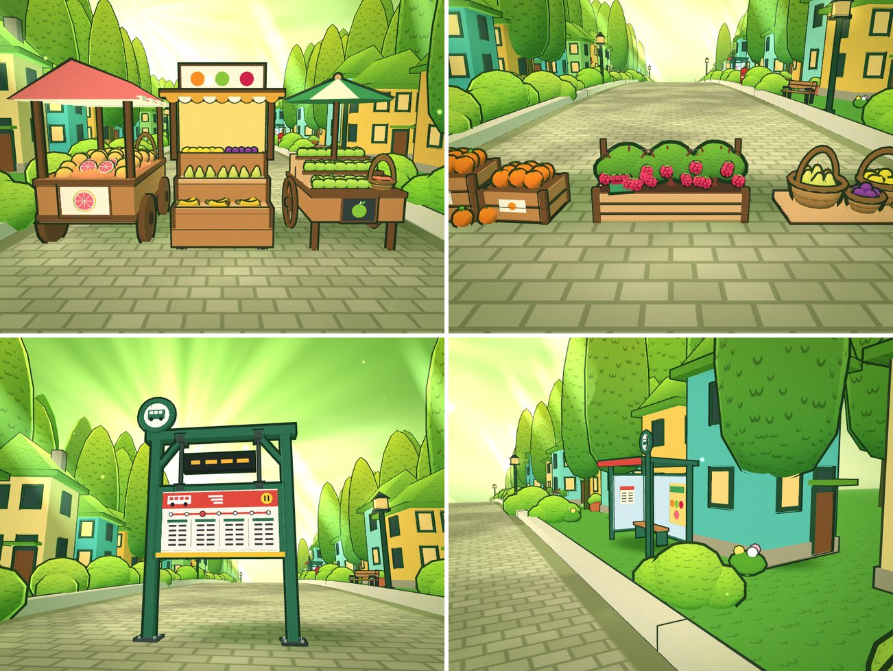


**Reading obstacles.** Every world draws its obstacles with the same grammar:
*low and solid to the ground* — jump it; *a frame or overhang with clear floor
beneath, its lowest edge on the same duck line in every world* — slide under
it; *tall and solid* — go around it. In the Deepwood that's a campfire in a
ring of stones — a teepee of logs, a log-cabin crib under a black pot on a
grate, or a low star fire with a kettle warming beside it, each turned its own
way round, its flames licking and flickering and its light wavering on the
ground (jump it — and you can't land in the fire), or the creek right across
the path, a bright teal ribbon with white riffles and foam along its edges,
framed in pale sand, its near bank kept low so the water shows and its far
bank raised with big stones, reeds and ferns (jump it — and since it's water,
you can't land on it: drop into it and you trip), a fallen tree propped on a boulder and a stump, its hanging moss
ending on the duck line (slide under it), and giant mossy boulders, one of them
roped and hung with paper streamers like a shrine stone (go around). In Hell:
a low basalt ridge, or a lava fissure between crusted lips (jump — you can't
land in the lava), a charred beam on two basalt posts with embers in its cracks
(slide), basalt columns and obsidian shards (go around); a fissure across the
whole road and a long charred beam are the wide ones. In the Gallery of Hours:
a fallen clock hand or a broken section of dial (jump; a fallen minute hand
spans the walk), a brass crossbar hung with pendulums whose bobs end on the
duck line (slide), and grandfather clocks, great hourglasses and clock weights
(go around). All the Gallery's turning and swinging — hands, gears, the great
pendulums — is decoration kept off the walk; the obstacles stay where they
stand (an hourglass in your way turns over within its own footprint, its
pendulum bobs only sway along the run, rising as they swing), so a jump or a
slide is never mistimed by something moving. In the Kelp Deep: a dome of brain
coral, a giant clam gaping on the sand or a sunken treasure chest, gold
glowing through its sprung lid and a string of pearls caught under it (jump;
it pops open now and then, see [Under the sea](#under-the-sea); a ridge of
reef across the whole path),
an arch of rock crusted with coral, a fringe of it along its face (slide), a
thicket of kelp, a tower of rock crowded with coral and a great violet sea
fan (go around) — and the whale crossing the path (slide; see
[Under the sea](#under-the-sea)).

### Washing and bark

The washing strung across the Night Rooftops (slide under it) is soft cloth:
each nightshirt, sheet and pair of long johns draped in folds, sagging between
its pegs, its corners drooping and its hem a little uneven, and stirring in the
breeze — swinging gently on its pegs, billowing and fluttering sideways, each
on its own beat, more and more the further it hangs below the line (toon
option `cloth`, worked out in the vertex shader). A swing only ever lifts a
hem, so the gap beneath never closes below the duck line.

Every trunk, buttress root, broken branch, fallen log, stump and campfire log
in the Deepwood is barked (toon option `bark`): rounded ridges between deep
V-shaped furrows that wander along the grain, now and then splitting a ridge
down its middle, the ridges broken across here and there into corky plates of
their own shades, a fibrous streak through it all and pale-green lichen in
patches — easing off to an even tone in the distance, where it would only
shimmer. Wherever a log has been sawn, its end shows growth rings round a pith
a little off-centre, darker heartwood, pale sapwood by the bark, and checks
split in from the rim as it dried.

### The Glasshouse, run wild


The Glasshouse is packed to the glass. Its planter beds are crowded end to end
with zinnias — pinks, corals, peach, gold, cream and plum, held up on their
stems over jostling mounds of leaves — with leaves tumbling over the front of
every planter, and ferns, monstera and potted cypress standing up out of it
all. Ivy climbs some of the ribs from the beds to the arch; others carry an
iron bracket with a basket hung off it, and more baskets hang high over the
beds on long chains from the roof, each trailing stems and in flower. Slatted
shelves of little pots (ferns, trailing pothos, zinnias, tiny flytraps) stand
against the glass. And here and there in the beds is a Venus flytrap that's
been left to grow: a rosette of traps on leafy stalks, each gaping, its
wine-dark mouth fringed with pale teeth, a few clamped shut, white blossom on
tall stalks over it all. (No true reds in any of it: those belong to the
rubies, so they still stand out against all the green.)

The obstacles grow too. The pot rows, planters and hanging baskets come into
flower each its own way (a cluster of zinnias, of a colour of its own, on
some of the pots and none on others: `extras` on the obstacle's spec), and
their leaves take a tint each, a little yellower or bluer. There's a long low
trough of young flytraps to jump, and a wall: a Venus flytrap grown in a great
pot till it fills the lane, its traps up over your head, gaping at you.

There's a great deal of it, so it's cheap: every petal and leaf is a handful
of triangles, and all the small greenery grows up out of the beds as you come
(and the baskets and vines let down from the roof) — toon anim mode 2, which
also means the far stretch, lost in the haze anyway, isn't drawn at all. It
costs about what the Cypress Lane does.

## Run it locally

No build step and no dependencies to install — it's plain ES modules with
three.js vendored in `vendor/three`. Any static file server works (browsers
won't load modules from `file://`):

```sh
python3 -m http.server 8000
# then open http://localhost:8000
```

To try it on your phone, serve it on your local network (e.g.
`python3 -m http.server 8000 --bind 0.0.0.0`) and open your computer's IP.

## Publish on GitHub Pages

1. Push this branch / merge it to `main`.
2. In the repository: **Settings → Pages → Build and deployment → Source:
   Deploy from a branch**, branch `main`, folder `/ (root)`.
3. Open `https://<your-user>.github.io/<repo>/` on your phone. It can be added
   to the home screen and launches full-screen.

## Debug flags

Append to the URL:

| Flag | Effect |
|---|---|
| `?debug` | FPS, how many frames came late, frame-time p50/p95, script time, draw calls, triangles, pixel ratio, the GPU, distance overlay. **N** skips to just before the next doorway, **G** toggles god mode |
| `?world=rooftops` | start in a given world (`village`, `forest`, `rooftops`, `corridor`, `conservatory`, `causeway`, `hell`, `time`, `ocean`) |
| `?visit=2` | start on a later lap's look (0 = first time through) |
| `?dream=12` | deal every world the dream of the n-th world (0–3 = none, 18+ = the deepest); each world still deals its own recipe |
| `?seed=42` | reproducible layout |
| `?runner=explorer` | who runs (`wayfarer`, `explorer`, `elder`, `bunny`), over the one remembered |
| `?companion=dragon` | who runs with you (`fox`, the default, or `dragon`), over the one remembered; `none` runs alone |
| `?god` | no collisions |
| `?dpr=1.5` | force a pixel ratio (disables adaptive resolution) |
| `?fps=30` | cap the frame rate (resolution still adapts) |
| `?manual` | no render loop; drive frames with `__step(frames, dt)` from the console (used for automated tests) |

## How it holds 60 fps

- **Everything is instanced.** Each prop type (a cypress, a house, a hedge…) is
  one `InstancedMesh`; a world draws in roughly 40–80 draw calls including ink
  outlines. Placements live in plain records and are only re-uploaded when
  chunks stream in/out — steady-state frames do no buffer work. The game logic
  takes well under a millisecond per frame.
- **Indexed geometry.** `part()` un-indexes each primitive so props can be
  merged, which leaves a sphere's shared vertices as exact copies; while the
  shaders compile at load, every batch's geometry is welded back into an
  index (only bit-identical vertices merge, so it draws exactly the same
  picture), and the GPU shades a third to a half as many vertices.
- **Nothing drawn that can't be seen.** Placements stream in in order of
  distance, so the far end of a batch is the end of its list: props that rise
  or lift into view are flattened or sunk out of sight until the camera nears
  them, and that tail of each batch is left out of the draw. The sky is drawn
  last, on the far plane, so it only shades the pixels nothing else covered.
- **Procedural generation is cheap here.** The track streams in 16 m chunks
  just ahead of you and recycles them behind, so only ~15 chunks exist at once
  no matter how far you run. A floating origin keeps float precision perfect
  over unlimited distance.
- **Animation happens on the GPU.** The pop-up unfolding, buildings rising,
  doors swinging, foliage swaying, wings and book covers flapping, drifting
  props and the curved-world bend are all done in the vertex shader from
  distance and time — no per-object CPU updates.
- **A fox for four draw calls.** Sorrel is one skinned mesh (~15k
  triangles), its ink hull, a layer of fur and a shadow decal: the fur is
  four copies of the furred part of her surface in one buffer (~49k
  triangles), so it costs one draw call however many layers there are. Her
  gallop, legs, tail, ears and mind take about 0.05 ms a frame; nothing she
  does allocates.
- **One skinned runner and a cape.** The wayfarer is a single skinned mesh
  and the cape one more, each with its ink hull — four draw calls, ~22k
  sculpted triangles plus ~9k for the cape. Legs are placed by IK, the body
  rides on spring follow-through, the cape is a 19×19 cloth simulation whose
  surface the GPU rebuilds from a 19×19 texture of particle positions (the
  only thing uploaded per frame), and the curls and hip pouch are springs;
  animation and simulation together take about half a millisecond on a
  desktop (see [The runners](#the-runners)). The explorer is the same four
  draw calls (her body, ~25k triangles, and her hair: a 15×12 cloth), costs
  about half as much to simulate, and adds two draw calls for each thing
  flying out of her backpack while it's in the air (at most six). Each
  adds one more for dust while there's any in the air (his boots' puffs, her
  slides'): forty at most, thrown into preallocated slots, so it makes no
  garbage. The cloth solver's phases are
  small methods called with integers only: as one big function of nested
  loops V8 kept cycling it in and out of optimisation, running it mostly
  unoptimised and boxing every float it touched (~50 KB of garbage a frame,
  and the GC pauses that come with it); now it allocates nothing.
- **Cheap, painterly shading.** Hand-written toon shader with a per-world
  lighting model: terminator softness and wrap (harsh vs soft worlds), rim /
  back light, low-lying mist, leaf dapple, an analytic wall shadow, colour
  grade and a tinted vignette — no shadow maps, no post-processing passes.
  Light shafts and lamp cones are soft additive volumes; cast shadows are
  decals. Ink lines use the inverted-hull trick.
- **No hitches.** All shaders are compiled during the loading screen, and
  then everything is drawn once under it, so every world's buffers and
  textures are on the GPU and every program has been used before the run
  starts (otherwise each world uploads its geometry the first time its
  doorway comes into view); no allocations in the hot loop.
- **Gems are cheap too.** All of a world's stones share one geometry —
  every kind is in it, its triangles marked with their kind — and each kind
  present draws its own range of it, instanced; plus its ink, its halos and
  ground pools one batch each, and the pick-up motes a single point cloud
  whose bursts live in uniforms: a few draw calls in all, however many kinds
  of stone a world has.
  Each kind's surface is a handful of numbers in a uniform array. Spinning, bobbing, rippling and being sucked into the
  runner happen in the vertex shader; taking a gem rewrites one small batch once. Planning
  and pick-up cost a few microseconds a frame.
- **Under the sea, cheaply.** The Kelp Deep draws about as much as the
  Cypress Lane or the Deepwood. Its scenery kelp is flat leaves shaded down
  their midribs and drawn without ink (a fifth of the triangles of rounded
  ones); each school of fish, bait ball and column of bubbles is one
  instance whose fish all swim in the vertex shader; the whale's crossing,
  the kelp's sway and the jellyfish's pulse are all vertex-shader work. The
  caustics are three lookups into the shared noise texture (every other world
  skips them on a uniform). The runner's bubbles are a hundred points written
  by the CPU and its swirl a fixed buffer worked out on the GPU (one draw
  call each, none out of the water). The splash's extra full-screen pass runs
  only for its second and a half.
- **Sand that moves, for one draw call.** The Gallery's drifts and piles are
  heaped in the vertex shader of its floor strip (2.4k triangles a chunk, fine
  only where the sand heaps up: about 50k more on screen than the flat ivory
  floor had), and its threads of sand are one more draw call; nothing about
  them is worked out on the CPU. The footprints are twelve slots of a uniform
  array, and the ground only loops over them in the few metres round the
  runner; the surf's cells of foam are worked out per pixel only where there
  is lace, and only while a doorway into the sea is near.
- **Frame timing** (`src/core/pacer.js`). Every animation frame the browser
  gives is drawn, at whatever rate it runs (60, 90, 120 Hz; Safari keeps
  pages near 60 on ProMotion screens unless told otherwise, near 30 in Low
  Power Mode). A frame on the usual cadence advances the simulation by
  exactly the usual interval (the median of recent ones), so rAF's timestamp
  jitter never reaches the motion; a late frame advances by the time that
  really passed, once, with no running average dragging behind it (which
  ran the game fast for a quarter of a second after every dropped frame).
  Jumps and lane changes are integrated exactly, so they follow the same
  path at any frame rate.
- **Adaptive resolution** (`src/core/quality.js`). Renders at up to 2× device
  pixels; averaged over ~1.5 s, frames slower than ~50 fps — or more than
  one frame in ten dropped (a 60 Hz phone dropping a frame every half second
  averages 55 fps and stutters all the while) — step it down a notch (0.25),
  and on a fast screen with room to spare it steps up once. If stepping down
  doesn't make frames any quicker or drop fewer (the browser holding the
  rate down, or a bottleneck that isn't pixels) the resolution is put back.
  It never changes the frame rate. What it settles on is remembered on the
  device; the next session starts a notch above it. Resizes happen at most
  once a frame, only when the size really changed, in a single reallocation
  (`setDrawingBufferSize`), and always at the top of a frame before it's
  drawn — resizing a canvas clears it, and one resized after the frame was
  drawn showed a blank, black frame (a flicker every time the resolution
  changed). The splash's copy of the frame is allocated under the loading
  screen, not the instant the first one hits; the score's digits are
  redrawn twenty times a second, not every frame.
- **No strobing at speed.** At 28 m/s the road moves further in a frame than
  its cobbles or slates are deep, and a crisp line across the road seems to
  strobe or crawl backwards; the ground's lines across the run are smeared
  over half the frame's travel (as a camera's shutter would) and the forest's
  grass softens, so they read as speed instead. `CONFIG.motionBlur` sets the
  shutter (0 turns it off).

The doorway effect renders in two passes while a door is in view: the doorway
shape writes a stencil mask and the *next* world draws only inside it; then the
current world draws normally with the doorway "plugged" in the depth buffer,
so the old world continues around the door frame while the new one shows
through it.

## The runners

Four runners, chosen on the title screen. Each is sculpted offline
(`tools/runner/`), skinned to the same skeleton and driven by the same core —
lanes, jumps, slides, the IK running legs, weight and follow-through
(`src/game/player.js`) — and each dresses it, hangs simulated sheets off it
and moves in their own way (`wayfarer.js`, `explorer.js`, `elder.js`,
`bunny.js`; who they are, their card and how to make them live in
`characters.js`).

| | Rowan, the wayfarer | Wren, the explorer | Alder, the elder | Bramble, the tumbler |
|---|---|---|---|---|
| Look | puffer, cargo shorts, hiking boots, an orange hooded cape | oversized rose sweater, charcoal shorts, chunky trainers, long vermilion hair, a backpack, her sketchbook | a flowing teal robe open over a sea-green under-robe, its hood down, wide bell sleeves, a brown sash under his pot belly; large orange spectacles, a long hooked nose, big ears, wispy white hair; brown leggings and old cuffed boots; a long twisted walking stick | a short, bipedal brown rabbit, a faded cream muzzle, cheeks and chin, buck teeth, big round dark glasses; big ears pink inside, one upright and one bent over, through a yellow bucket hat; a cream short-sleeved shirt, brown suspenders on brass clips, billowy rust trousers gathered at the ankles; big bare rabbit feet, a fluffy tail; an olive satchel slung across him |
| Build | a tall bruiser, ~1.73 m to the top of his hair: long legs, a long torso, his head small for his frame | slight, about five heads tall, ~1.64 m to the top of her bun | the tallest: ~2.0 m and eight heads tall stood up straight — which he never is: bent at the waist, he still tops 1.8 m; rail thin but for his pot belly | the smallest by far: ~1.1 m to the crown of his hat (~1.35 m to the tip of his upright ear), about five heads tall, compact and a little rounded, short legs on big feet |
| Simulated | the cape (19×19 cloth), a puff of dust off every push-off | her long hair (15×12 cloth), the bun, fringe and side locks on springs, the backpack bouncing, things spilling out of it, dust off her slides | his long, full beard (11×16 cloth) and the skirt of his robe (19×11); the bell sleeves, his wisps and brows on springs; his stick planted in the road, his arm solved to reach it; dust off its tip, and now and then a poof of sparks off its knob in the colours of his gems | no sheets: his ears on springs (laid back by the headwind, the bent one flopping at its fold, twitching), his hat's brim, his tail wagging in quick flicks, his satchel bouncing on his hip and its flap lifting; whiskers; what he floats on (an umbrella, a balloon, a dandelion), dandelion seeds and dust |
| Lanes | spring 32/s, a steady lean | spring 40/s — snappier — a side-skip with a hop, arms out, a deeper lean | spring 34/s: he plants his stick on the far side and shoves himself off it, a hop, his free hand flung out | spring 38/s: a quick sideways hop, knees tucked, arms out |
| Jump | a plain arc; a stride leap, arms out like wings | the same apex and airtime, popped quicker and hung at the top; a split leap, a tucked back flip, a corkscrew twist or a front handspring | the plain arc, and two vaults: off the stick planted ahead, his knees tucked up as it sweeps back under him — or now and then a pole vault, up into a wobbly handstand right on top of it and over | the same airtime but the highest apex of all (2.3 m to the others' 1.6); a rabbit's bound stretched out flat and twisted side-on, a long float down (a whole second) hanging from something out of his satchel that floats away when he lets it go, or a webster side flip — each to a side picked at random |
| Landing | a stomp: a slow, heavy bounce, deep into his knees and back up once; a ring of dust, a thud through the camera | on springs: a quick crouch, then bouncing up onto her toes, arms flicking out, and a smaller bounce after | frail: the stick comes down first and takes his weight; his knees buckle deep and he wobbles back up in a couple of bounces | a precision landing on springs: down onto the balls of his big feet, arms swung forward, and straight back up onto his toes, ears bouncing |
| Slide | feet first, leaning back | a baseball slide on her hip, leading with the other leg each time, the sketchbook held up out of the dirt; often a cloud of dust | a squat right down on his heels, folded over his knees, dragging his stick behind him like a skid in a trail of dust | a dive roll: arms reaching for the road, tucked into a ball, over once and up into a crouch, in a little cloud of dust |
| Run | a bruiser's charge: hunched, head down, crouched low on bent knees, stomping along wide-footed with the knees driven high, rocking side to side, the elbows out and the arms pumping round in big loops | a quicker, lighter, narrower one, more lean, less bounce | a quick, short-stepping, shuffling hobble, toes out, bent double, limping on his bad left leg and lurching onto his stick as it strikes the road every stride, his free hand in the small of his back — though now and then he swings it up onto his shoulder and just walks | two, and every few seconds he changes from one to the other: bolt upright with his head thrown back and his fists pumping at his chest on quick little steps; or flung forward, arms swinging long and straight, in big bounding strides |

### Choosing who runs

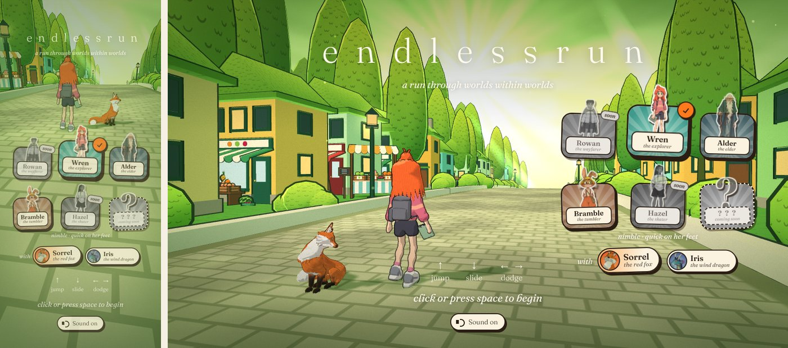

The title screen deals a card for each runner, in a grid two by two: their
front view, cut out of their reference sheet (`tools/characters/<id>-sheet.jpg`,
cut by `tools/characters/cards.py` into `assets/characters/<id>.webp`) and
stood up out of a card washed in their colours like a pop-up book — a paper
keyline and an ink shadow round the figure, a sunburst behind, their name on a
paper plate — each popping up a little out of its card into the gap above it.
The one you've picked stands taller, bobs and wears an orange seal, and a line
about them sits under the grid. Picking one swaps the live runner on the road
behind the cards (every runner is built, and their shaders compiled, at boot,
so it's instant), and they say hello — a gust catches Rowan's cape, Wren's
backpack pops and a page flutters out, Alder lifts his stick and thumps it
down in a poof of sparks as a gust takes his beard, Bramble gives a happy
little hop, ears springing up, tail going like anything. The arrow keys (or a
sideways swipe) step through them in turn. On a tall screen the title camera
stands back and looks down the road so the runner shows above the grid (the
taller the screen, the further down it looks: the grid takes more of a
phone's height; on short ones the cards are smaller); on a wide one the grid
stands to the right. The pick is remembered (`localStorage`).

Under the cards, a badge for each companion picks who runs with you: their
portrait (rendered from their own sculpt and shader by
`tools/characters/faces.js` into `assets/characters/<id>-face.webp`) in a
round window washed in their colours, their name and what they are. Picking
one swaps the companion beside the runner (both are built and compiled at
boot, as the runners are) and they say hello — the fox hops, the dragon
twirls up into the air round where she stood and settles back on her hind
legs. That pick is remembered too.

### The explorer

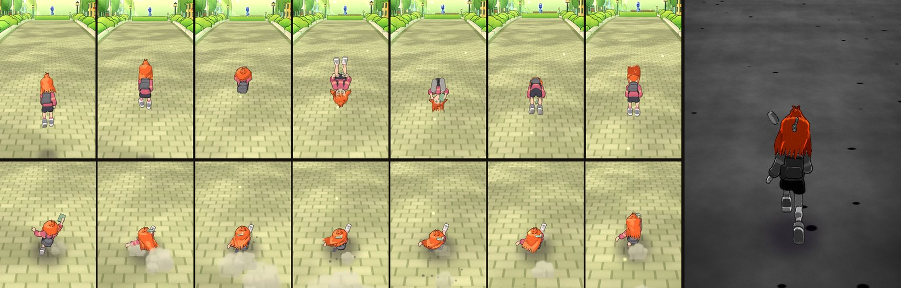

`tools/runner/explorer.py` sculpts her to her reference sheet the same way
`build.py` sculpts him (it borrows its primitives, meshing, skinning and
export): about five heads tall, the head big and round with huge green eyes
(drawn by the shader: a gold ring round the pupil, two catch-lights, a heavy
upper lash line flicking out at the corner, thick brows lifting toward the
middle); a close cap of hair under a messy bun with wisps escaping it, a long
fringe falling to her brows in fine points and a lock either side framing her
face; an oversized rose sweater with a peach band across the chest and round
the upper sleeves, ribbed collar and hem, its sleeves shoved up past the
elbows into bunched rolls; the hem of a peach tee under it; charcoal shorts
with a rolled hem and pockets; long thin legs with a plaster on her right
knee; pink socks slouched in rolls over chunky cream trainers with grey
panels, heel counters and laces; a small grey backpack (zips round its lid
and front pocket, a mesh bottle pocket) on webbing straps with buckles at the
chest; and her green spiral sketchbook, a doodled cat on its cover, gripped in
her right hand.

**Her hair is simulated the way his cape is** (`cloth.js`, the same solver):
a sheet growing from under the bun round the back of her head, its roots
pinned to the head, the rows over her scalp leashed to it and the rest free,
kept off her head, neck, shoulders, arms, sweater and backpack by their own
volumes. It's lighter in the air than wool and quicker to answer every push:
it streams back in the headwind, swings out and lags across a lane change,
flies up through a jump and slaps down on landing, bounces with every stride
(it's carried with only a third of the head's bob) and sways in the breeze
when she stands. The GPU draws it as a slab full at the crown and thinning to
the tips, strands drawn down its length; toward its ends it parts into
pointed locks of uneven length, each edged in ink. The bun, the fringe and the
two face-framing locks bounce on their own springs. Her hair keeps its colour
through Hell's drain, as his cape does.

**The backpack** rides on a bone off her chest, bouncing, nodding and swaying
on springs with each footfall and lane change. Every so often — on a timer
while she runs (every 6–13 s), on one landing in five, in a burst when she
stumbles or crashes, now and then while she stands about, and when you pick her
— its lid pops open and something flies out (`src/game/spill.js`): a page torn
from her sketchbook (ruled, a doodled hill under a sun), a folded map (a river,
woods, a dotted way to an X), a magnifying glass, a compass, a pencil, a brass
key, a spyglass, a sticking plaster, a pressed leaf. They're small models
drawn with the runners' own shader, thrown up and back from the pack's mouth at
her own speed and left behind in the world: the flat ones catch the still air
on their faces — gliding edge-on, dropping slowly face-down, turning over and
over — while the heavy ones arc, bounce and skid; they fall away past the
camera. At most six fly at once (two draw calls each; none at rest).

**She plays lighter.** Lanes are a quicker spring (40/s against 32/s) and she
side-skips into them — a little hop off the outside foot, legs spreading toward
the move, arms flung out for balance, a hard lean. Her jump has exactly his
apex and airtime, so every gap is as fair, but it's shaped differently: she
pops up faster, gravity eases off within 3.2 m/s of the top so she hangs
there, then she drops (the arc is solved piecewise and exactly, the same at any
frame rate) — and in the air she does a trick, dealt from a shuffled deck so
the same one never comes twice running: a split leap (one leg reaching out
straight in front, the other stretched behind, arms flung up), a tucked back
flip about her hips, a corkscrew twist about her own axis, legs together,
arms pulled in, or a front handspring. A spin cut short — a fast-fall,
landing early — whips round to finish quickly rather than snapping back.

The handspring turns her forward, head first, over the top of the arc. She
dives, arms sweeping up past her ears and the back leg kicking up behind,
and goes over in a split; at the top she springs off the air as if it were
a floor — her elbows fold deep, flaring out, and her body sinks toward her
hands, then they snap straight and she pops up off them — her back arches
as her legs whip down under her, and she comes round upright with her arms
high in a V, legs reaching for the road. Its shape is keyed on how far round
she has turned rather than on time, so it stays in step with the turn even
when a fast-fall hurries it, and the turn itself runs like a body's would:
slowing through the stretched-out handstand, quickening as she folds to snap
down.

Her slide is a baseball slide: down on her hip, the lead leg out straight with
its heel on the road and the toe up, the other folded under its knee, leaning
back with her chin up, her free hand trailing on the road and the sketchbook
held up high out of the dirt; she rattles over the road and pops back up onto
her feet as it ends. She leads with the other leg each time (mirrored, all but
the arms: the book always stays up). About two slides in three — and every
one she drops straight into out of the air — kick up dust
(`src/game/dust.js`): as she hits the road, puffs burst out either side of her
heel and hip with grit flung up off the heel, then a trail of puffs streams
from her hip as she skids. They're thrown with a share of her speed and left
behind in the world, so the still air stops them and she slides on out of the
cloud; each blooms and thins away like a painted cloud — a lumpy edge, lit from
above, the colour of the road it came off — and they're lit, fogged and graded
with the world (grey in Hell). One draw call while there's dust in the air,
none otherwise.

She
runs at a quicker cadence on a narrower track with more lean and less bounce,
her free arm swinging lightly and the one with the sketchbook held closer.
She lands on springs: a quick soft crouch with her arms out, then straight
back up out of it onto her toes — a little stretch, chin up, arms flicking up
and out — then a smaller dip and a smaller bounce as it rings out.

Her simulation costs about half his per frame (the hair grid is smaller than
the cape's); her mesh is about 25k triangles to his 23k.

To change a runner, edit their script and regenerate (about 15, 35, 65 and
85 seconds), then look at them turned round like their reference sheet in
`tools/runner/view.html?runner=explorer` (also `&pose=idle|run|jump|slide|bind`,
`&t=` seconds into it, `&trick=leap|flip|twist|handspring` (the elder's
`hop|pole`, the bunny's `leap|float|webster`, and `&item=umbrella|balloon|dandelion`
for what he floats on), `&jt=` seconds into the jump or slide, `&side=1|-1`
the slide's lead leg, `&carry=1` the elder picking up his stick as soon as he
can, `&style=pump|reach` the bunny keeping to one of his two runs, `&speed=`
how fast they run (m/s, 14 if not given; 12–28 in the game),
`&views=front,left,back,right,three`, `&zoom=`, `&y=`):

```sh
pip install numpy scipy scikit-image fast-simplification pillow
python3 tools/runner/build.py      # the wayfarer -> assets/runner/
python3 tools/runner/explorer.py   # the explorer -> assets/explorer/
python3 tools/runner/elder.py      # the elder -> assets/elder/
python3 tools/runner/bunny.py      # the bunny -> assets/bunny/
python3 tools/characters/cards.py  # the title screen's cards (or name some: cards.py bunny)
```

### The wayfarer

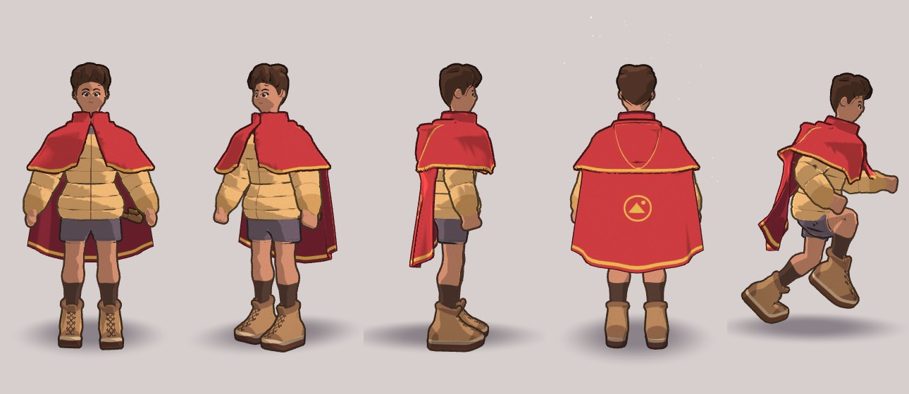

**Modelled as continuous surfaces, not assembled from parts.**
`tools/runner/build.py` sculpts the character offline the way a sculptor
blocks out a figure: each garment (head, hair, puffer, shorts, legs, boots,
hands, hood and collar, pouch) is one signed-distance field made of volumes blended
smoothly into each other, so shoulders flow into the sleeves, limbs taper and
the shorts wrap the hips. The fields are polygonised (marching cubes),
simplified, and given exact smooth normals from the field; skin weights come
from which volume "owns" each point of the surface, so the mesh bends where the
shapes blend. Proportions follow the reference illustration: about six heads
tall (the head and hair are sculpted in their own space and placed scaled,
seated low on a short neck), the head broad enough — about 0.45 of the padded
shoulders' width — to hold its own against the puffer, knee a little under a
third of the height, high socks and chunky
mid-cut hiking boots with a thick sole and a collar that dips at the front.
The face is young and broad — full cheeks, a soft jaw that tucks under into
the neck, a small rounded chin, the eyes sitting low in the head the way a
child's do — and the puffer's padded stand-up collar, open at the throat over
the tee, seats the short neck in the jacket. The hair is short and tousled: a
thin cap over the skull and, over it, clumps laid from the crown down toward
the hairline in three loose rings, each its own length and lean with its tip
curling out (seeded, so they're irregular but stable), which breaks the
outline into an uneven scallop and lets the fringe fall over the forehead in
points. The eyes are drawn relaxed: big warm-brown irises nearly filling the
opening, the upper lid lowered a little over them, soft brows resting low.
Fine linework — quilting seams, laces, the face, trims, the hood's seam — is
not modelled: each vertex carries a few smooth coordinates and the character
shader draws those lines crisply at any distance. Shading is one broad, crisp
shadow shape per surface in a warm shadow tone, a restrained hair highlight
and a thin dark contour tinted by the material under it.

**Drawn out tall.** Sculpted, he stands about 1.57 m; the build then draws
him out into a tall bruiser of about 1.73 m — his legs a quarter longer, his
torso (and the arms hanging beside it) a sixth longer — while his boots and
head keep their sculpted size, so his head is small for his frame. It's a
smooth remap of height alone (`STRETCH` in `build.py`): every garment's field
is read back through it, so the surfaces stretch without losing a line of the
sculpt (the quilting, socks and hems all follow), and the skeleton and every
rig constant the game reads are carried through it too — the cape's drape is
laid out by the sculpt's heights and stretched the same way (`rig.stretch`).
He runs like the bruiser he's drawn as — a charge (`GAIT`, `CHARGE` and
`ROCK` in `wayfarer.js`): hunched over, his shoulders hunched up round his
neck and his head down between them, eyes on the road, nodding into each
stomp; crouched low on bent knees at a slow, heavy cadence, each knee driven
up high and swung out round the other leg and each boot coming down hard
well out to its side; his whole body rocking from side to side over the foot
that's coming down (the hips' share of it laid on before the feet are
placed, so a planted boot stays put), the hips swinging and the shoulders
driving round against them. His arms pump round in a big loop with the
elbows out: the fist punches forward low across his belly, then the arm
swings back out wide and up, the elbow high behind him and the fist up by
his ear, and comes round and down to punch again, the shoulder rolling with
it. (The loop's shoulder angles were solved from where the elbow and fist
should go, so it reads the same from any side.) With the fox riding on his
shoulder he keeps the arm under her down, in a small pump, and swings it up
again once she hops off. Every time a boot
drives off the road it kicks up a puff of dust behind it — two, more often
than not, bigger as the pace builds — thrown with a share of his speed so it
blooms at his heel before the still air stops it and he runs on out of it
(none over water). He lands with a stomp: down deep into his knees, feet
splaying, his body folding over them and his head nodding, the impact
throwing his arms down and back and squashing him, then driving back up out
of it once; a ring of dust bursts out low from his boots, and the camera dips
with the thud.

The build writes `assets/runner/runner.json` (skeleton, rig constants, parts)
and `runner.bin` (vertex data), loaded once at boot. To change the character,
edit `build.py` and regenerate (about fifteen seconds):

```sh
pip install numpy scipy scikit-image fast-simplification
python3 tools/runner/build.py
```

**Animation.** The running legs are placed, not keyed: while a foot is down
the ball of the boot is pinned to the ground and carried back at exactly the
ground speed as the heel peels up over it; in the air the ankle follows a
designed path (heel kicks up under the hips, the knee drives through, the foot
reaches and paws back down), and a two-bone solve turns that into thigh and
knee angles — the knee always bends forward, the pelvis sinks into each
contact, the thighs turn against the pelvis's swing so a planted foot never
twists, and the arms swing against the legs with bent elbows. The thigh's
splay out to the side is solved exactly while the leg reaches or stands, so a
planted foot never skids; as the knee folds up in the swing the ankle comes
to sit right behind the hip, where no splay can move it sideways, and an
exact solve there flung the thigh out ~64° and back, side to side, for a frame
or two every stride (the legs' occasional "spasm") — so the lever it's solved
with is held at 0.8 of the leg, and the tucked foot gives up a centimetre or
two sideways instead. A leg can only stay planted for about its own length of
ground (his 0.68 m legs ~0.67 m), which at the game's 12–28 m/s is a few
hundredths of a second: at the starting pace contact has no slip at all; at
higher speeds contact is held for a minimum of ~2.4 frames so the planted pose
reaches the screen, and the leftover slip is straight back along the run inside
those frames (no sinking, floating or sideways skid). Jump and slide are
keyed poses; idle is keyed too but stands on planted feet (IK), easing its
weight from one leg to the other. Poses blend with second-order springs, so
every transition eases in and out — and nothing jumps while a pose still
shows: a jump or slide taken straight off the last one eases out of it over
a sixth of a second instead of snapping to the new lead leg or trick, the
jump poses (shaped by the climb and fall) hold their landing shape as they
fade out instead of snapping back to their take-off, and a fast-fall's
plunge eases into them over a few frames.

**Weight and follow-through.** On top of the pose, the torso, head and arms
ride on the pelvis like loose springs, kicked by the pelvis's change of
velocity each frame — the stride's bounce and sway, and the root's lane
changes, jumps, landings and changes of pace (as impulses, so a sudden move
hits equally hard at any frame rate). Every footfall ripples up the spine and
drops the arms a touch; a lane change whips the shoulders across and lets them
swing back through; a take-off folds the body, the flight lets it float open
with the arms rising, and a landing folds it again before it springs up. The
landing's own bounce is each runner's (`FEEL.land`): the impulse response of
a damped spring, solved exactly from the moment of touchdown and scaled by
how hard they came down (a fast-fall slams in harder) — how quick it is and
how long it rings on is their personality (his heavy and settled, hers quick
and springy), and their poses shape the dip and the rebound. Arms,
elbows, spine and head also trail their own posed motion on springs, so they
lag and overshoot at every reversal, and the lean into a lane change settles
with a soft overshoot. With each stride the chest turns against the hips and
the shoulders roll forward and back with the arms (the collarbones carry the
puffer's rounded shoulder caps, so the sleeves swing out of the shoulders
rather than hinging under them), while the head counter-turns and stays
steady.

**Fabric.** The cape is one continuous piece of orange wool — light at the
collar, deepening toward the hem, with a burnt-orange lining: sewn under a soft
gathered collar (closed at the throat by a little brass toggle, the hood lying
bunched over it at the nape), draped over the shoulders, open round the arms
and hanging to the upper calf behind. Its rest drape is built at load the way
it would fall on the body — each column leaving the collar, curving down over
the shoulder and hanging, its sides swinging in behind the arms — and then let
settle under gravity on the body's own volumes.

It is simulated as a 19×19 particle cloth (`src/game/cloth.js`): stretch,
shear and two ranges of bending constraints (the long ones keep big curves big
instead of crumpling into kinks), and tethers so it never stretches. Every row
has a leash to where the chest would carry it — none at the collar, a few
millimetres under the hood, a few centimetres by the shoulder blades, free from
there down — so the top follows the body exactly and the cloth gains freedom
toward the hem. It is kept off the body by the jacket's own volumes (exported
from the sculpt, ellipsoids for the torso, round capsules for the shoulder
caps and sleeves) and by capsules for the head, legs and boots: limbs push it
aside without flinging it, and the body's volumes always have the last word.
The ground drags it back as it runs under him.

The air does the rest: the headwind streams it back further as the pace rises
(about 40° at the starting pace, toward 60° at full tilt); behind the back the
body's wake weakens and draws it in, so it streams as a tail instead of filling
like a sail; gusts — smooth noise carried down the cape at the wind's pace —
roll broad, irregular pressure waves from the shoulders to the hem, different
under each half; and each free edge catches the air on its own, now and then
curling over to show the lining. The runner's own acceleration reaches the
cloth through a smoothed velocity, so a lane change makes the hem lag the
other way and then follow and settle, a take-off leaves it hanging a beat
before it lifts, and a landing drops it — the same at any frame rate (the step
is fixed at most 1/120 s and the colliders, pins and leash targets slide
through each frame's substeps). A soft breeze sways it when he stands still. A
ceiling over the collar stops it flipping forward over the shoulders or the
head (behind it slopes up, so it can stream up falling from a jump), and a soft
wall in front of the chest keeps it from wrapping round to the front.

The GPU draws a smooth Catmull-Rom surface through the particles with exact
normals (a thin slab: outside, burnt-orange lining and edges), and the cloth's
curvature, measured per particle and softened, keeps a soft shadow in the
valleys of its folds and waves under any light. Curls lag and bounce on
springs and play in the breeze; the hip pouch swings on a pendulum.

**Third-party assets.** None. Free bases and animation (Kenney, Quaternius /
Poly Pizza, OpenGameArt, Sketchfab, Mixamo, Poly Haven) were considered, but the
environment this was built in could not reach any of those hosts, so nothing
was downloaded or evaluated; the character, rig, animation and shading here are
all original. A suitable base mesh could still be adopted later: the game only
needs a skinned mesh whose bones are named like the ones `build.py` writes.

### The elder

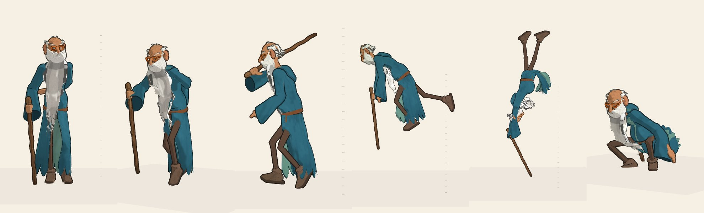

`tools/runner/elder.py` sculpts him to his reference sheet
(`tools/characters/elder-sheet.jpg`) with `build.py`'s kit, as `explorer.py`
does her: an incredibly old man, about two metres and eight heads tall stood
up straight — the tallest of the runners — though he is sculpted upright only
to be bent: the game folds him at the waist, rounds his upper back over and
cranes his neck forward, his head tipped back up to see where he's going, so
that even stooped he tops 1.8 m. He's rail thin but for a round pot belly,
long in the leg and long in the arm. His face is long and lean — a high domed
crown, bony cheekbones over hollow cheeks, a heavy brow — with a long hooked
nose (a hump on the bridge, a heavy tip drooping over his moustache) and big
ears standing right out from his head, their bowls hollowed out; his short
wispy white hair grows round the back and sides of a bald crown, combed back
behind the ears and falling past the skull to his nape in locks whose ends
wisp out, a couple of flyaways over the ears and a few long strands lifting
off the top. Bushy white brows spring up and out over large orange
spectacles — thick rectangular rims with rounded corners, a bridge arched
over his nose, the arms running back over his ears. The shader draws his
face (small, deep-set, kindly pale blue-grey eyes under heavy drooping lids,
the fold of skin over them, bags under them and crow's feet fanning from
their corners, three long lines across his forehead), weathers his tan (warm
and uneven, darker in its creases, flushed on the tip of his nose, his
cheekbones and in the bowls of his ears) and spots his crown. A drooping
moustache runs into the beard sculpted over his jaw and up his cheeks to the
sideburns. His robe is a deep, worn teal — washed like a watercolour in soft
blotches and streaks — open down the front over a sea-green under-robe (its
edge turned back along the V), its hood down in bunched folds on his back,
its wide bell sleeves cut on a slant so they hang in a long point; a brown
sash wound round under his belly and knotted at his hip, its ends hanging;
brown leggings and old soft boots with long rounded toes and turned-down
cuffs. In his right fist is his walking stick: long, gnarled and twisted,
kinking this way and that, its grain spiralling round it, a knotted knob at
the top, dark with the road's dirt at its foot and worn pale where he holds
it. His card on the title screen is cut from the sheet's front view.

**His beard is simulated** (`cloth.js`, the same solver as the cape and
Wren's hair): incredibly long — nearly a metre of it, down past his belt —
and full. What grows on his face is sculpted big and bushy: standing well
out from the jaw and the chin, up the cheeks to the sideburns, full jowls of
it either side, its surface broken into tufts, the moustache drooping down
into it. The rest is a sheet, 11×16, rooted along the underside of his jaw
inside the sculpted beard, its rows under the chin leashed to the head and
the rest free, kept off his chest, belly, arms and legs by their own
volumes. It swells out wider than his face below the chin into a full spade
and draws in to a point; the GPU draws it as a slab fullest right under the
chin (about eleven centimetres deep there) and rounded across, thinning
toward the tips, in wavy clumps with strands down them, its sides broken
into tufts and its end parting into seven pointed locks of uneven length.
It's light and answers every push: it streams back in the headwind, swings
out across a lane change, sways in the breeze when he stands; at the top of
a jump it flops up (a push up through its lower half, and the air under it
as he falls), and it slaps down when he lands. It goes round him rather
than plastering over him: once he's running, the headwind parts round his
body (`spread` in the cloth's wind: a push away from the middle in
proportion to how far off it the cloth is), so the beard slides off his
belly to one side and streams back past his hip, where you can see it from
behind — and takes the other side when a lane change throws it across.
And every so often (7–15 s) a gust flicks it right up over his shoulder to
tap him on the back: for about a second it's steered (`flickStep`), each
part of it drawn toward its own place along a path — out wide past his arm,
up over the top of his shoulder, then down onto his upper back, the tip
furthest — while the body's own volumes route it round him; then it's let
go, and the wind slides it back off.

**So is the skirt of his robe** — a second sheet, 19×11, sewn round his
waist under the sash and open down the front like the cape, falling to
mid-shin in soft folds round the back, its lining sea-green, its hem ragged
in long uneven points. It's heavier than the beard: it streams back less and
swings more, kicked about by his legs. The bell sleeves hang from their
forearms on springs, toward the ground and lagging every swing; his wisps of
hair and his brows bounce. (One runner can now have more than one sheet: the
character materials take a list.)

**The stick is planted in the world, not carried through it.** Each stride
(at the left foot's mid-stance — a stick goes with the opposite foot) it
strikes the road beside his right foot, ahead of him, and stays there while
he hobbles past it, for as much road as it can stay planted for, never less
than a few hundredths of a second (as his feet do: `stickRun`); then it
swings through in an arc to strike ahead again, his hand swinging with it.
Most strikes kick up a little puff of dust off its tip, and on the Gallery's
sands each leaves a hole beside his footprints (a fourth kind of print). His
right hand goes where the stick puts it (`staffStep`): each pose says where
the stick's tip is — on the road, or hanging from where the hand would be —
the weights blend them, the stick's top is set where the arm can grip it,
turned about its own length so his wrist is on the side toward his shoulder,
and the hand on it is placed exactly as it holds the stick in the sculpt;
then the arm is solved to reach it, a two-bone solve with the elbow out and
back (`solveArm`). If it can't reach, the stick comes up off the road with
the hand. When he's knocked flat the stick just goes where his hand goes.

**He moves like it.** His run is a quick, short-stepping hobble — the
quickest cadence of the three, short low steps shuffling over the road with
the knees bent and the toes turned out, bent well over at the waist, his
free hand tucked into the small of his back — and a limp: his left leg is
the bad one, the stick in his right hand taking its weight. He's quick off
it and lingers on the good one (each stride's clock is warped, `HOBBLE`, to
run fast through the left foot's stance and slow through the right's, each
leg's planted stretch laid at the pace its clock runs there so neither foot
skids), the bad leg dragging through stiff and a little wide; every stance
on it comes down heavily onto the stick — the hips dropping and rolling
toward it (laid on before the feet are placed, so a planted foot stays on
the road), the body ducking forward over it with a nod of the head — and he
rises up again over the good leg. Every so often (9–19 s,
when he's running clear) he picks the stick up and swings it onto his
shoulder — the knob end in his hand in front, the rest angled up and back
over it — and just walks for a second or two, a little straighter, chin up,
his free arm swinging, before quickly putting it back down (anything that
needs it — a lane change, a jump, a slide — puts it down at once). A lane change: he plants
the stick on the far side of him — swinging it across in front of himself to
plant it on his left to go right — and shoves himself off it, the stick
staying put in the road as he goes (it slides back no faster than 7 m/s: at
full tilt it would be gone in a frame), with a hop, a hard lean and his free
hand flung out. His jump has the plain arc, as fair as anyone's, and he
vaults it one of two ways. Mostly he hops it: the stick planted ahead as he
goes up, pushing up off it bent over it with one leg kicked back, then both
knees tucked high and to the side as the stick sweeps back under him like a
pendulum, then swung forward to meet the road with both feet. But now and
then (never twice running, and never more than three hops between) he pole
vaults it: he reaches for the stick planted ahead with both hands (his left
arm solved onto it just under his right), dives up onto it, arms over his
head and legs kicking up behind, and swings right up into a handstand on
top of it — upside down, the stick standing straight down from his hands to
the road, legs in a V, his beard falling over his face and his robe over his
chest, wobbling a little (he is very old) — in a poof of sparks; then he
pushes off, lets go, whips his legs over and comes round to land. The whole
body turns forward once about a point 0.8 m up (`spinTo`), the turn slowing
right down through the handstand so it shows, and the pose is keyed on how
far round he is (`POLE`), so a fast-fall or an early landing just hurries it
round; the stick is planted under him on the road until the push-off,
sliding along with him (he's far too fast for it to stay put). He lands frail — the stick comes down first,
just ahead, and takes his weight, his knees buckle deep, he folds over it
and wobbles back up in a couple of bounces. His slide is a squat right down
on his heels, folded over his knees, robe pooling, his free arm out for
balance and his stick dragged along the road behind him like a skid,
trailing dust off its tip; then he hauls himself back up. Standing on the
title screen he leans on his stick with his other hand in the small of his
back, breathing, looking about.

**And the stick sparks.** Every few seconds a little poof of sparks comes off
its knob (`sparks.js`): eight or so twinkling four-pointed glints, each with
a white-hot heart and rays in its colour, flung out every which way and left
behind in the world as he runs on, drifting down as they wink out. Their
colours are the gems he's been picking up — the last six — or, before he's
taken any, this world's own stones; and now and then a gem he takes sets off
a sympathetic little spark in its own colour. They're drawn additively, and
keep their colour through a drain. A pole vault's handstand and being picked
on the title screen set off a bigger poof.

Through Hell's drain his robe and his orange spectacles keep their colour.
His simulation costs about what the wayfarer's does per frame (two sheets
and a beard larger than Wren's hair; the arms' solves are a handful of vector
sums); his mesh is about 26k triangles.

### The bunny

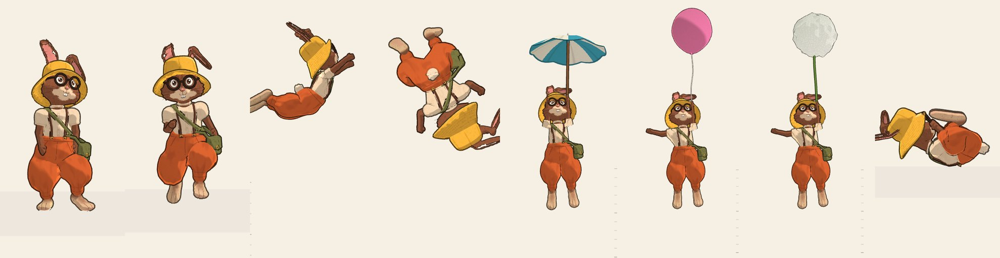

`tools/runner/bunny.py` sculpts him to his reference sheet
(`tools/characters/bunny-sheet.jpg`) with `build.py`'s kit, as the others are:
a short, bipedal rabbit, compact and a little rounded, about five heads tall
and only ~1.1 m to the crown of his hat — the smallest of the runners by far —
his head big for his body, on short legs and big feet. Warm brown fur, painted
in short strokes by a BUNNY branch of the character shader, faded into a
cream muzzle, lower cheeks and chin in tufts; full cheeks with tufts of fur
sticking out of them; a puffy split muzzle, a small pink nose and two buck
teeth under the little 'w' of his mouth; big round eyes with dark brown
irises and two catch-lights each, brows springing up over them, behind
oversized round dark-rimmed glasses whose arms run back along his head. His
ears are big, brown outside and pink inside (a dish scooped out of the front
of each, the pink fading to a rim of fur round it): his right stands up,
bending a little toward its tip; his left rises, turns its face out to his
side as it goes, and is bent right over partway up so the rest of it flops
out and down — they come up through the crown of a bright yellow bucket hat,
worn tipped back, its brim drooping at the sides and back, its crown sewn in
six panels and its brim in rings of stitching. A cream short-sleeved shirt
with a pointed collar and a row of buttons; dark brown suspenders, stitched
down their edges, on brass clips; billowy rust-orange trousers, high in the
waist, ballooning round his hips and thighs and gathered into cuffs at the
ankles (a fly, slant pockets, puckers fanning up out of the cuffs); big bare
rabbit feet, tan with three plump toes and pinker pads; a fluffy cream tail.
Slung across him from his right shoulder, its strap lying over his shirt, an
olive-green satchel rides on his left hip: a rounded box with a flap over its
top and front, stitched round, fastened with a little brass buckle. Six fine
whiskers sweep out from his muzzle (thin ribbons on his head, kept about a
pixel wide however far off he is, fainter instead, so they never shimmer
away: `VS_WHISKER`). His card is cut from the sheet's front view. His hat and
his trousers keep their colour through Hell's drain.

**He's a tumbler, and he moves like one.** He has two runs (`STYLES`), on
quick little legs with his big feet turned out a little, and every few
seconds he changes from one to the other — always with his feet on the road
(if the time comes round in the air or in a roll, he changes as he comes
out of it, so often as he lands), easing over a couple of strides from one
into the other, legs, arms, lean and cadence all at once, without missing a
step:

- **the pump** — bolt upright, leaning back a little with his chest puffed
  out and his head thrown right back, nose to the sky; his fists pumping
  tight in front of his chest with the elbows tucked in; quick little steps
  (the quickest cadence of any runner), his heels kicking right up under his
  seat and his knees coming up in front;
- **the reach** — flung forward in a strong lean, eyes on the road, reaching
  out long: his arms nearly straight, swinging right up in front of him and
  flung back behind, hands open; long, bounding strides at a slower cadence,
  the back leg kicked out long behind him and the front foot reaching well
  out ahead.

Either way the headwind lays his ears back. A lane change is a quick sideways hop, knees
tucked, arms out. He lands on springs — a precision landing, down deep onto
the balls of his feet folded over his knees with his arms swung forward for
balance, then straight back up onto his toes, ears bouncing, and a smaller
bounce after — with a puff of dust off a hard one. His slide is a dive roll:
he dives at the road with his arms reaching for it, tucks into a ball, chin
to his chest, rolls over once and comes up into a crouch on his big feet and
away, in a little cloud of dust (the roll turns him about the middle of the
ball he's tucked into, and he's lifted off the road wherever his big head or
hat would go under it as they come round; his ears are swept flat back along
him while he rolls). Standing on the title screen he has his hands in his
pockets, rocking up onto his toes and back, his head cocked, looking about.

**He jumps the highest.** Every runner's jump takes the same time
(`CONFIG.jump.time`), so every gap is as fair whoever you are — but his goes
up to 2.3 m where the others' go to 1.6 (every gem laid on a jump's arc is
still in his reach on the way up and the way down); only his float keeps him
up longer. He has three, dealt from a shuffled deck so the same one never
comes twice running, each to one side or the other at random:

- **the bound** — a rabbit's leap, as in the sheet's drawings: he springs off
  both feet and stretches right out through the air, his whole body tipped
  forward flat over the top, arms reaching ahead, legs trailing long behind
  with the toes pointed, ears laid back, then swings his legs through under
  him to land (keyed on how far through the jump he is: `LEAP`) — and he
  twists side-on into it, to his left or his right (`TWIST`): from behind,
  flying flat out toward you he'd be all hat and feet, turned to the side
  you see the whole stretch of him; he unwinds to face the way he's going
  before he lands;
- **the float** — as he springs up, knees tucked, his left hand dives into the
  satchel (its flap flies up) and pulls something out (`src/game/props.js`):
  a big umbrella in teal and cream panels, furled as it comes out and
  springing open as he thrusts it overhead (both hands on its crook); a
  balloon on a string, blown up as he lifts it, a different colour each time;
  or a giant dandelion clock, grown out of nothing on its long stem. He
  hangs from it as he drifts down, legs dangling and pedalling gently,
  swinging a little under it, the air coming up past him lifting his ears.
  It's a real float: a pop straight up to the top in a quarter of a second,
  then a long drift down, gravity giving way to a steady sinking speed — a
  whole second in the air, half as long again as any jump (`FLOAT`; solved
  exactly, piece by piece, the same at any frame rate: `solveFloat`), and he
  comes down soft. Each thing lets him down its own way: the umbrella
  catches the air at once, a steady parachute's pace; the balloon holds him
  up at the top, buoyant, and only gathers speed toward the end; the
  dandelion's in between. Since it keeps him up longer, he only reaches for
  the satchel when the road's clear that far ahead (`Game.roadClear`: never
  coming down onto a bar or a wall nobody could have seen coming) — else he
  does something else, and floats another time. A few seeds stream off the
  dandelion all the way down (`src/game/seeds.js`, each a tuft of fine white
  hairs on a stalk, the seed a brown spindle at its foot, rocking down slowly
  and left hanging in the air as he runs on). When he lands he lets it go,
  and it floats away, each its own way (`Props.update`): the **balloon**
  rises straight up and away, quicker as it goes, swaying on its string like
  a pendulum, shrinking into the sky; the **umbrella** is caught by a gust —
  up it goes, tumbling end over end and twirling round its shaft, its canopy
  fluttering, sailing out over the edge of the road and then sinking,
  rocking, as the gust lets it down; the **dandelion** (with a puff of seeds
  as he lets go) drifts lazily up, rocking side to side like a feather and
  turning, shedding its seeds in a stream behind it till its head is bald —
  and then its bare stalk tips over and sinks away. Each drifts back from him
  slowly at first, as if carried a moment in the rush of air behind him, so
  you see it go. A fast-fall drops him out of the float on plain gravity (and
  he lets it go at once). Never the same thing twice running;
- **the webster side flip** — off one foot, the other leg kicking up and out
  to throw him over, arms flung up; tucked tight over the top, knees to his
  chest; opening out, arms wide, to land on the leg he kicked with. He turns a
  whole sideways somersault about the line he's running along (toward the
  foot he took off from, so the kick leads it over), quickest through the
  tuck, so from the chase camera it reads clearly (keyed on how far round
  he's turned: `WEB`).

**His secondary motion is all springs** (he has no cloth): his ears ride on
the shared runner's hair springs (`hairSim`: laid back by the headwind,
bounced by every footfall), and on top of those the bent one flops at its
fold and unfolds a little when he's excited, and now and then one twitches;
his hat's brim flaps; his fluffy tail wags in quick little flicks — in bursts
(more often while he stands), always a little while he runs — bobbing with
each stride and flicking up as he springs; the satchel hangs from its strap
on his hip, bouncing with every stride, swinging out with a lane change and
flying up through a jump. On the Gallery's sand he leaves a rabbit's print —
a long sole and three round toes. He's small enough that the fox doesn't ride
on his shoulder or shoot through his legs (`small`). His mesh is about 28k
triangles; his simulation costs a handful of springs.

## The fox


Sorrel is a red fox, and she runs with you whoever you pick. You don't steer
her — she has a mind of her own (`src/game/companion.js`) — and she's almost
all for show: faster than you and knowing it, playful, a little cunning,
forever doing something. The one thing she does for you is fetch: now and
then she spots a gem you'd have missed, races over to it, springs up and
snaps it out of the air, and tosses it back to you.

**Sculpted like the runners.** `tools/runner/fox.py` builds her the way
`build.py` builds Rowan (it borrows its primitives, meshing, skinning and
export): one continuous coat — the deep chest and tucked-up waist of a
runner; a round head with a high, full brow and a fine muzzle, not too long,
ending in a button nose; puffed cheeks with a ruff flaring out and back off
each of them in a fan of pointed tufts, red up by the ear and white round
under the jaw, like the triangles of fur in a drawing of a fox; a cowlick
standing up between her ears; a full ruff down the throat ending in points on
her chest; slender legs with feathered elbows and breeches, neat paws — with
her jaw, her ears (big, pointed, cupped forward, with tufts of white fur
standing out of them) and her tail as their own surfaces. The tail is a
great brush, swelling from a slim root to its fullest two-thirds of the way
along and drawn out to a point, and clumped all over in shingles of fur, each
lying toward the tip and breaking off in a point, so its outline is ragged
the way fur is. She's skinned to a quadruped's skeleton: hips, spine, chest,
neck, head, jaw and ears, four legs of three joints each, and eight bones down
the tail. Each vertex carries how far inside the white it lies, how dark it
runs, how far along the tail it is and how long its fur grows there, and the
shader does the rest. To change her, edit the script and regenerate (about
twenty seconds), then look at her in `tools/runner/fox.html` — turned round
(`?pose=stand|sit|ride|run|leap|pounce|hop|whirl`, `&views=left,front,back,
three`, `&v=` the pace, `&t=` how long into it) or as a film strip of her
moving (`&strip=12&every=2`: twelve frames, two frames apart at 60 a second;
`&from=` where it starts), the jumps and the whirl driven as the game drives
them:

```sh
python3 tools/runner/fox.py   # -> assets/fox/
```

**Painted, and furry.** The character shader's fox (`FOX` in `CHAR_DETAIL`)
brushes her coat in long strokes laid along the lie of the fur — deeper on her
back, lighter where it catches the sun, a warm tone on the fur facing the
light — and tears the white of her lips, cheeks, throat and tail tip into
points where it meets the red, tufts of white running out into it and of red
into the white. Her stockings run dark from the elbows and hocks down to
black paws; the backs of her ears are black, their insides cream. Her eyes
are big and round, only a little almond, tipped up toward her ears under a
dark rim: amber round a big dark pupil (a fox's slit, opened wide), with a
big catch-light up toward the ear and a little one below, and the dark tear
line running down the side of her muzzle from the inner corner; she blinks,
and when she's pleased she squeezes them shut in happy arcs. Over all of it grows a short pile of fur
(`SHELL`): her surface again four times over, each layer lifted off it by a
share of how long the fur grows there (longest in the ruffs and the brush,
short on the face and stockings, none round the eyes and nose), thinned to
strands toward the tips and combed back by the air streaming past her, so her
outline is soft and ragged at any distance. Like the cape and Wren's hair,
she keeps her colour through Hell's drain: a little flame on the ash.

**How she moves** (`src/game/fox.js`), after real foxes and the classic
drawn gallop cycles. A rotary gallop with a long, loping stride (about two
and a half strides a second, more of each stride in the air the faster she
goes): every foot is planted — pinned to the road, carried back at exactly
the ground's speed — for as long as its leg can reach, and between the
footfalls her body rides real flight arcs under gravity, dropping into each
pair of footfalls and driven back up off them, so she has weight rather than
bobbing on a wave. The forefeet land one after the other and she vaults over
them; her back gathers into a ball, her hind legs swinging right through
under her chest; they drive off and she flies stretched out flat, forelegs
reaching straight ahead and hind legs straight back. The legs are placed by
IK along designed paths (the cannon of each hind leg kept parallel to the
thigh, as in every running dog, which makes a three-bone leg an exact
two-bone solve). Her head is held steady while everything under it works, as
a running fox's is: whatever the stride's bounce, rocking and gathering do to
her neck, the head keeps a height and an angle that change only slowly. She
leads with the leg on the inside of a turn, banks into it and bends her spine
toward it. And she goes where her nose points: she crosses the road on a
slant, never crabwise and never broadside to you — how fast she can go across
is a share of how fast she's covering the ground (steeper only to dodge a
wall), she gathers that speed and sheds it rather than jolting sideways, and
she never comes across faster than she can pull up on her line, so she doesn't
sail past it.

Every jump has weight: she winds up first — sinking into her legs, coiled,
all four feet planted (for the pounce, gathering up a little on her haunches
with her forepaws drawn in) — then springs. Over a hurdle she drives off with
her hind legs stretched out behind, tucks them up under her over the top with
her forelegs reaching ahead, and comes down forefeet first, nose dipping; the
pounce is the mousing leap taken at a run — up at about the angle she climbs,
her back arched over the top, and down nose first at about the angle she
falls, forepaws together reaching for the ground, her brush streaming out
behind along her flight (never stood on end, never tipped over). She
lands forefeet first, the front dipping as they take it, then her weight comes
down into all four legs, folding them and gathering her back, and she springs
back up out of it, deeper the harder she came down. On the title screen she
sits, haunches down and forelegs straight, her brush swept slowly to and fro
round her paws, looking about — up at the runner, out at you — her ears
flicking; when you pick a runner she winds up and hops to say hello.

Her tail is simulated, and answers how she moves: a chain of particles from
root to tip in a frame that moves with her but doesn't turn with her, so
every turn of her hips swings it and it lags behind. Its shape comes from her
mood (out behind her a touch above level at a gallop; swept round on the
ground when she sits; up and curling when she pounces; sweeping side to side
when she's pleased) bent by the air streaming past her, so at a gallop it
streams out behind as a real fox's does. On that shape it's a chain of damped
springs: each part is held to the shape relative to the part before it (not
to her body), stiffly at the root and softly at the tip, so a swing at the
root runs down it as a wave; her own acceleration throws it — it hangs below
her as she springs up, whips down on a landing, swings out wide as a
counterweight in a turn — gravity weighs it and the air damps it. (In free
fall nothing throws it: falling with her, it floats. It used to be flung
straight up over every descent, a flag on a pole; its own weight is counted
against her fall now.) On the run its root rides only a little of the pelvis's
rocking, so it ripples rather than flaps. Under the sea it floats. (The
headwind used to be a force fighting the chain's length every step, which set
its tip thrashing; it's in the shape now, and the tip moves a few degrees a
frame, smoothly.) Her ears are on springs: pricked or swivelled about, laid
back by the wind and the pace, flattened when she slinks, flopping with every
jolt. Where her fur's strands would be under a couple of pixels across — and
shimmer as she moves — they thin into a soft solid fringe instead.

**Her mind.** Most of the time she lopes along a lane or two over, drifting
ahead and dropping back; every few seconds she gets an idea:

- **scout** — tears off ahead, then glances back over her shoulder at you with
  a sly look;
- **trail** — drops back almost under the camera, then dashes past;
- **under** — comes up behind you in your lane, flattens herself and shoots
  out between your legs;
- **ride** — springs up onto your shoulder and rides there for a few seconds,
  crouched, ears streaming, her brush hanging down your back, looking about
  (and back at you); she leaps off ahead into a clear lane when she's had
  enough, when something's coming, or the moment you slide or stumble
  (neither of these with the bunny: he's hardly bigger than she is). Rowan
  keeps the arm under her down while she's up there, instead of swinging it
  up into her;
- **pounce** — the mousing leap, on open road (and now and then over a low
  hurdle) — a treat: rare, and never within twenty seconds of the last;
- **whirl** — rarer still: for the joy of it (and sometimes when you take a
  whole run of gems) she runs out ahead into a lane of her own, pulls up and
  chases her tail round once — her back curled into a C, her head right round
  after it, the brush flung out round her, ears up and mouth open in a grin —
  then bounds off after you; never twice in thirty-five seconds (so about
  once a minute or two), and she doesn't stop dead, so you don't run past her
  off the screen;
- **fetch** — every so often she looks for a gem in a lane you're not in (or,
  now and then, cheekily, one right in front of you), far enough ahead to
  reach with the way clear, races over, springs to meet it at the top of a
  hop, jaws open, snaps it up and tosses it back to you: it flies to you in an
  arc, its motes bursting as it arrives. It's yours — it scores, chimes and
  counts toward its run as if you'd taken it — so she can save a run you'd
  have broken.

Under all of it she's careful. She reads the obstacles ahead: she keeps to a
lane with room before its next wall, moves early when hers is running out
(to the roomiest lane she can reach, never across a lane that's walled before
she'd be through it), leaps hurdles and water with the top of the leap over
their middle (harder if she was swung into the lane late), runs under the
bars (she fits), won't jump where a bar or wall would meet her, won't step
sideways into a hurdle too close to time a leap, and keeps out from under
your feet unless she means to be there. When you stumble she lays her ears
back and looks round; when you go down she turns, trots back and sits by
you; when you get up she bounces. `tools/companion/audit.js` checks all of
it: it plays the game for minutes at a time without drawing it, with an
autopilot runner, and reports any frame she so much as grazes an obstacle,
what she got up to, and how far she ever turns off the line of the road as
she runs (serve the repository, then `node tools/companion/audit.js "?seed=2"
240`; it needs Playwright).

Her tunables (her gravity and how long she winds up for each kind of jump,
how high she leaps, how far ahead and behind she ranges, how much faster she
runs, how she crosses the road, how long chasing her tail takes and how
seldom, how often she gets ideas, how long she rides, how often and how
eagerly she fetches) live in `CONFIG.companion`; `?companion=none`
runs alone. Companions are listed in `src/game/companions.js` — the fox is
the first, the dragon the second — each with its body and its mind:
`companion.js` is the mind of one who runs (written for any animal on its
feet: a new one needs its body, a sculpt and a module like `fox.js` taking
the same frame context), `flyer.js` the mind of one who flies (see the
dragon, below). Both answer the same calls from the game.

## The dragon


Iris is a wind dragon, and she flies with you whoever you pick: a long,
slender serpent of a dragon after her reference sheet
(`tools/characters/dragon-sheet.jpg`), with an easy, liquid
way of moving — weaving, rising and falling, flowing after her own head —
that keeps out of your way. Like Sorrel she's almost all for show, and like
Sorrel she fetches gems. (One day both companions will have gifts of their
own, growing with their loyalty the further you run.)

**Sculpted like the others.** `tools/runner/dragon.py` builds her with
`build.py`'s kit, laid out straight — nose to −z, her spine level, her legs
hanging under her as if on all fours — because she's never shown like that:
the game bends her spine into any curve. So her spine is a chain of thirty
bones bound straight along it, each moved and turned on its own, with her
head, jaw, frills, limbs and whiskers hanging off it; and because she's laid
out straight, the shader can tell where on her a point lies from its rest
position alone. A short rounded head, sculpted large, with big eyes, a smile
and a little upturned nose; deer's antlers, branching; fans of feathered
frills behind the cheeks; long whiskers from the snout; a slim neck, the
chest, a tucked waist, haunches, and a tail as long as all the rest of her,
tapering into a plume — a fountain of long curling feathers sprayed back, up
and out round it. A mane of feathery locks lies back down her from between
her antlers to the plume, falling to both sides of her neck and narrowing
to a crest along her back and tail; feathered fur tufts off her forearms and
thighs; slim arms with three-fingered hands, long digitigrade legs, and a
hooked, needle-pointed claw on every finger and toe. About 2.4 m nose to
plume; stood up, she comes to the runner's shoulder, antlers and all. Each
vertex carries her scale grid (round her, along her: one scale each, sized to
how thick she is there), how far inside the gold of her belly it lies and how
pale it runs (her forearms, hands, shins and feet); on a feather or a frill,
where across and along its vane it lies. To change her, edit the script and
regenerate (about two minutes), then look at her in
`tools/runner/dragon.html` (`?pose=stand|crouch|fly|weave|loop|corkscrew|land`,
`&views=`, `&strip=` and the rest, as the fox's viewer):

```sh
python3 tools/runner/dragon.py   # -> assets/dragon/
```

**Painted** (`DRAGON` in `CHAR_DETAIL`): fish scales laid like shingles in
offset rows, each one's front tucked under the row before and its free edge
rounded toward her tail — dark where it comes out from under, bright toward
its edge, a fine dark line along the edge and a bright one just inside it,
fine ridges fanning across it. Her colour runs deep blue along her back,
teal down her flanks, green low on them, violet toward her plume and indigo
down her legs — and it's iridescent: each scale's colour sits on a loop
(violet, deep blue, teal, green) and slides along it as she turns from you,
so her edges shade into violet and her flanks shimmer as she banks, a soft
glint playing on the scales' free edges. Where scales would be under a couple
of pixels they melt into her colour rather than shimmer. Her belly is gold,
ridged across in chevrons (each plate's V toward her tail), its edge
scalloped by the scales; her hands and feet lavender-white; her claws dark;
her antlers cream, golden toward the burr and ridged along. Her frills and
plume run teal (or blue) at the root through purple to magenta tips, each
vane with a pale shaft and barbs sweeping out along it, its edges frayed
into the barbs (cut away in the shader, outline and all). Her face is smooth
teal, lighter on the muzzle: big round eyes — an orange iris round a big dark
pupil, two catch-lights, a heavy dark rim and lashes flicking out behind —
under a dark brow; two nostrils; a smile up into her cheek. She blinks, and
squeezes her eyes shut in happy arcs. Her mane is deep indigo streaked with
violet, catching teal at its tips, with a short pile of fur grown over it
(`SHELL`, as on the fox). She keeps her colour through Hell's drain.

**How she moves** (`src/game/dragon.js`). Flying, her body flows after her
head like a ribbon in the wind. Her head's path is kept in the runner's
frame, blown back by a wind of its own, and her spine is laid along it by arc
length (Catmull-Rom through the path): every swerve, climb and dive runs down
her body as a wave, and her tail passes where her head has been. Each point
of the path keeps how her head was turned there — so a bank (her lift tipped
into the turn, as a bird's is) or a corkscrew runs down her as a twist — and
each bone is turned along the curve from it. She banks only by how hard
she's turning across her line of flight (never by climbing or diving:
pulling out of a climb taken for a turn tipped her lift over toward her
back, and she rolled half over and back), never past about fifty degrees,
by an acceleration smoothed the same at any frame rate. A corkscrew is a
roll of its own laid on top, so righting herself never fights it: she goes
exactly round, and cut short she carries on round to the next whole turn
rather than unrolling the short way. Her steering is jerk-limited
(`CONFIG.companion.flyer.jerk`), so every swerve curves in; and her head's
velocity is taken in the runner's frame, so the floating origin moving on
under her every half kilometre is never taken for a lunge. On top of that she swims: a wave
travels down her from neck to plume, small at her head and growing toward
her tail, rising and falling more than side to side, as a dragon swims
through cloud; then she's laid back out to her true length along it, so she
never stretches. In open air the wind is gentle, so her body keeps a good
deal of her weaving as S-curves; threading obstacles it runs at the road's
own speed, so her body follows exactly the line her head took through the
world, gap after gap, over and under. (It's never slower than her head is
dropping back through it, or she'd fold back over herself — except in a
loop, where she means to.) Standing up on her hind legs, her spine is drawn
into an S — hips over her feet, chest up, neck back, head forward — and her
tail laid round on the ground; down on all fours, her back is level and her
neck raised. Both are drawn by bending along her length from her hips, so
she's never a centimetre longer or shorter; she breathes, her tail stirs on
the ground, and she glides between them and flight (quicker taking off than
settling). Her legs are placed by IK: hands curled up under her chest and
hind legs trailing back along her tail as she flies, planted under her as she
stands. Her whiskers are chains of particles in the runner's frame, flung by
every turn of her head, dragged along with the air and streamed back by it,
drooping in long curves when she's still, fluttering in a strong wind; her
frills are on springs (laid back by the wind, flattened when she's startled,
flaring when she's pleased); her mane's fur is combed back by the air; the
end of her tail flutters; she looks at what interests her, her neck taking a
share of the turn; her jaw opens to snap at a gem, or a little in a grin. Her
shadow is a long soft stroke laid along her body on the ground, fading as
she climbs.

**Her mind** (`src/game/flyer.js`). The runner and the road just ahead of
them are yours. Her place is the lane beside you (never yours; on her own
side of you; higher in a lane you might swerve into, lower two lanes over),
a little ahead and a couple of metres up, gliding on the wind and never
quite still — a slow wander of sines at odd rates laid over wherever she
means to be. She stays on the screen: each frame she works out from the
camera how much of the road it sees at her depth (a tall phone sees not much
more than a lane either side of you) and keeps her slot inside it. When you
swerve under her she lifts clear over you — higher if you jump — before she
slips aside; when she changes sides she goes high and ahead, never low across
you. Every few seconds she gets an idea:

- **soar** — up high and over to your other side, then down again;
- **skim** — down along her lane a hand's breadth off the road, whiskers
  streaming, and up again;
- **linger** — drops back level with you, lower, and looks at you a while;
- **corkscrew** — tears ahead rolling over and over round her own length
  (and sometimes when you take a whole run of gems, or after a catch);
- **loop** — a loop-the-loop ahead in her own lane, her body following her
  head right round it like a ribbon, the loop turned out toward the edge of
  the road so from behind you see it open as a ring (the rarest);
- **fetch** — spots a gem in a lane you're not in, that she can see and
  reach, swoops on it holding steady, jaws open, snaps it up and sends it to
  you (it scores and counts toward its run as if you'd taken it).

Under all of it she reads the road, for her whole long body has to follow
her head through. Walls come a row at a time: she threads the gaps — in the
gap of the row coming at her, as near as it lets her to the gap in the row
after it, so a slalom is a sway and not a scramble — and keeps to it till the
row's by her tail. But most walls aren't so very tall to look at (a cart, a
wardrobe, a boulder: she measures each prop), so rather than squeeze into
your lane to get by one she sails over it, if that's not off the top of the
screen. Bars she slips under, low, or — near you, or if she's nearer their
top — goes over, decided once for each (and changed to over if the walls
have put her near you and there's time to climb); hurdles she keeps above.
She takes them in the order they come, counting only those too close
together to get from under one to over the next as one, and commits early and
hard. Her flourishes are only for open air, in a clear lane of her own, well
away from you. When you go down she hovers by you while you slide to a stop,
then lands on all fours beside you, facing you, and looks at you; when you
get up she takes off again. On the title screen she stands up on her hind
legs beside the runner, turned toward you, looking about, and now and then
goes down on all fours for a stretch, and back up.

`tools/companion/audit.js` checks her too (`node tools/companion/audit.js
"?manual&seed=2&companion=dragon" 240`): every bone of her spine against the
obstacles (walls and bars as tall as they stand to look at), and how much she
gets in your way — the share of the time any of her body is over the runner
on the screen (in front of them, or anywhere), how often she's low in the road
just ahead of you, and how often she's off the screen. Over three minutes of
play on a tall phone's screen she touches nothing (bar, in the odd run, a
graze of a fraction of a second); she's over the runner 1.5–3% of the time
(in front of them 1–2%), low in the road ahead of them 0.5–3%, off the
screen 1–5%, and she catches about half the gems she goes for. Her tunables (the wind her body streams in, how hard and fast she moves,
her glide's height and slot, how high she clears you and how high she'll
sail over a wall, how far in from the screen's edges she keeps, her rests
between ideas, the twirl she says hello with, the loop, the corkscrew and her
fetching) live in `CONFIG.companion.flyer`.

## Project layout

```
index.html, css/style.css     page shell, overlay UI
src/config.js                 every gameplay / feel / camera tunable
src/main.js                   boot, render loop, adaptive resolution, input wiring
src/core/                     input (swipes + keys), ambient audio, seeded RNG
src/render/                   shaders, geometry kit, instanced batches, textures, particles
src/world/                    world runtime + one file per world (art, lighting, lap
                              variations, layout, obstacles, gem, doorway); whimsy.js holds
                              the shared later-lap props and light volumes, gems.js the
                              gem kit (cleaved crystal habits, lofts, settings),
                              lane-art.js the Cypress Lane's fruit, market obstacles,
                              timetable and street furniture
src/game/                     game loop, player (the runners' shared core:
                              animation, IK legs, secondary motion, movement),
                              characters (who you can pick), wayfarer and
                              outfit (his palette, cape, pouch, poses), explorer
                              (her palette, hair, backpack, moves), elder (his
                              palette, beard, skirt, stick and the arm that
                              reaches for it, hobble, vaults, carry), sparks
                              (what comes off his stick), spill
                              (what flies out of it) and dust (what her slides
                              and his boots kick up), bunny (his palette,
                              whiskers, sprint, bound, float, side flip, dive
                              roll, tail, ears, satchel), props (what he
                              floats on) and seeds (what blows off his
                              dandelion), kit (body geometry, sheet
                              surfaces and colliders), cloth, runner asset
                              loader, camera, course (world order),
                              chunk streaming, obstacle director, gem director
                              (gems.js: the ghost route and pick-up), portal, dream
                              (depth recipes and the shared warp uniforms), bubbles
                              (the runner's bubbles, swirl and sand under the sea)
                              and splash (the screen splashed coming into it);
                              sands (the footprints in the Gallery's sand and
                              the surf lapping up it before a doorway into the
                              sea); the companion who runs with you
                              (companions.js: who can; companion.js: the
                              mind of one who runs; fox.js: Sorrel's body,
                              gallop, poses, tail and ears; flyer.js: the
                              mind of one who flies; dragon.js: Iris's body,
                              her spine laid along her flight, swim, poses,
                              legs, whiskers and frills)
tools/runner/build.py         offline sculpt of the wayfarer -> assets/runner/
tools/runner/explorer.py      offline sculpt of the explorer -> assets/explorer/
tools/runner/elder.py         offline sculpt of the elder -> assets/elder/
tools/runner/bunny.py         offline sculpt of the bunny -> assets/bunny/
tools/runner/fox.py           offline sculpt of the fox -> assets/fox/
tools/runner/dragon.py        offline sculpt of the dragon -> assets/dragon/
tools/runner/view.html        a runner turned round like their reference sheet
tools/runner/fox.html         the fox turned round, posed, or as a film strip
tools/runner/dragon.html      the dragon turned round, posed, flying, or as a
                              film strip
tools/companion/audit.js      plays the game unseen, checking the companion
                              never touches an obstacle (and that one who
                              flies keeps out of your way)
tools/characters/             the reference sheets and the cut-out of the
                              title screen's cards -> assets/characters/;
                              faces.js renders the companions' portraits
vendor/three/                 three.js r185 (MIT)
```

### Adding a world

Create `src/world/<name>.js` exporting `{ id, name, doorColor, env, visits,
gate, gem, build(b), chunk(ctx), obstacles }` (copy any existing world as a
template) and add it to `src/world/index.js`. `env` sets the palette and the
lighting (`light.soft` / `wrap` for harsh vs soft light, `rim`, `mist`,
`dapple`, `grade`, `skyFx`, …, and `bloom`, the three colours its doorway bloom is made of); `visits` lists partial `env` overrides for
each return. `build` registers prop batches from the geometry kit (`b.toon`,
`b.beam` for light volumes, `b.pool`, `b.shadow`); `chunk` places scenery for
each 16 m chunk and can check `ctx.visit` to add later-lap props; `obstacles`
maps the three gameplay kinds (L = jump over, H = slide under, W = go around)
to your themed props — keep H obstacles' lowest edge at `CONFIG.duckLine`.
An obstacle spec can also bring companion batches drawn with another material
(`with: ['creekWideWater']`), lower its collision top (`top`), skip its contact
shadow (`flat`), or be water you can't stand on (`wade`). `b.toon(…, { water:
true })` gives a surface the running-water shader, and ground pattern 6 is the
forest's long grass, 7 Hell's ash (fissures glowing beyond the road), 8 ivory
slabs with a brass clock-tick bezel (the Gallery's floor before the sand came
in) and 10 the Gallery's sands (for all of them, pass the chunk distance as
`p0` so they run on seamlessly). Pattern 10 goes with `b.ground(…, 10, {
dunes: true })` on a strip laid out like the Gallery's `sandStrip()` (the
vertex shader heaps it into drifts and piles), and reads the world's
`env.sands`: `dunes: [drift height at the balustrade, pile height, a pile's
cycle in seconds, the share of arches sand falls from]`, `sea: [shallow,
deep, foam]` for the surf, and `surf: { reach, period: [min, max], from, to
}` — how far up the beach it laps, how long a wave takes, and how far from
the doorway the runner is as the sea starts to pour in and once it's in
full. The surf comes only when the doorway out leads into a world with
`env.sea`; `game/sands.js` drives it and the footprints. `b.toon(…, {
thread: [height, radius] })` makes a batch of threads of sand falling onto
the piles (put one under each chunk-seam arch, `p0` the chunk distance and
`p1` the side; the shader decides which pour, and when). `b.toon(…, { lava: true })`
gives a surface the molten-rock material (it lights itself and keeps its colour
through a drain), and `b.toon(…, { turn: [spinZ, swingX, swingRate, spinY] })`
turns a prop in the vertex shader — gears and clock hands spinning about their
face, pendulums swinging from their origin (`p0` offsets a spinner's phase);
add `wonky: true` and its hands come unstuck with `env.wonk`. `crust: [glow,
ash, scale]` textures rock, charred wood and obsidian (each part picks its kind
with its `mark` flag: 0, 0.5, 1), `splash: true` makes a part list of droplets
from `splashGeo` leap and fall, and `sand: [seconds, waist, depth, floor]`
(on a toon and its `b.glass`) makes an hourglass run and turn over.
`flame: true` makes a prop's fully self-lit parts lick and flicker like fire
(each tongue's beat in its `uv.x`, how far up it in `uv.y`); `cloth: [sway,
rate, line height, drop]` makes washing stir in the breeze (each garment's
beat in its `uv.x`, `uv.y` 1 for what moves); `bark: true` barks every part
whose `mark` is 0.4 (lay its uv out with `asBark` in `forest.js`) and draws
growth rings on any cylinder cap marked 0.3; and `b.pool(…, {
color, flicker })` gives a pool of light its own colour, wavering like
firelight. A world with `calm: true` is a breather (see above),
`env.eclipse` puts a total eclipse in place of the sun, and `grade.edge:
[start, full]` reshapes the vignette (0 the centre of the screen, 1 the
corners; Hell pulls it right in).
`env.drain` makes the world drain of colour once you're in it, `skyFx.smoke`
lays a ceiling of smoke with dry lightning in it over the sky, and
`env.particles2` adds a second layer of motes (Hell's falling ash under its
rising embers). `gateExtras` entries can be `[name, x, y, dz]` to stand
something on the gate (the Gallery's clock hands).
Under the sea: `env.sea: { surface, rays, caustics, scale }` puts the
rippling underside of the surface overhead, shafts fanning down from it and
caustics on everything facing up (scale per metre, a multiple of 1/256);
`env.deep: { amount, from, to, tint }` darkens the picture toward `tint` down
the screen (0 the top, 1 the bottom); `env.splash` splashes the screen with
water coming in; `env.bubbles` puts the runner in the water (their bubbles,
swirl and sand); `particles.ring: 1` draws a layer of motes as bubbles; and
ground pattern 9 is the ocean floor (pass the chunk distance as `p0`). Toon
options: `current: [lean across, rate, wave per metre up, lean along]` sways
a prop in the current, more the higher it reaches (build it in segments);
`school: [speed, loop length, snaking, shape]` swims a school (each fish's
vertices carry `fish`: where it swims in the school and its beat; shape 0 a
stream along +x, 1 a ball milling round y, 2 a column rising up y);
`jelly: [beats per second, squeeze, ripple, lift]` pulses a jellyfish (its
`role` 0 the bell, 1 what trails); `cross: [glide per metre, beat rate,
beat at the flukes, far rise]` swims something across the run, built tail
(−x) to head (+x), so it's right over the road as the runner reaches it (its
`p0` past pi turns it about; `b.shadow(…, { cross, plane })` gives it a
shadow that glides with it); and `pleats: true` draws a whale's throat
pleats on parts marked 0.6 (uv.x along the body, uv.y round it). `b.beam`
takes `wobble` to sway a shaft of light. An obstacle spec with `call:
'whale'` sings a few seconds before the runner reaches it.

`gem` is the world's collectible: a `name`, a `color` (the HUD's little gem),
its `stones` — each `{ name, weight, tints, parts(), texture }`, `weight`
being how often it leads or joins a run and `tints` a few close shades it's
picked from — and a `crown` for the prize spots, up to eight kinds in all.
`parts()` returns a part list built from `world/gems.js`: natural forms
cleaved by planes (`barrel`, `tabular`, `topazPrism`, `point`, `hexPrism`,
`tetragonal`, `dodecahedron`, `octahedron`, `cube`, `blade`, `nugget` for
rough stones and pebbles, `lumps` for stones grown in rounded clusters, or
`cleave` with your own planes, `around` making rings of them), lofted ones
(`crystalPoint`, `bipyramid`, `stepCut`) and `bezelParts`; wrap crystal in
`crystal()`, settings in `metal()`, rock in `stone()`, and stand face-on ones
up with `rx: FACE`. `texture` is the stone's surface, every key optional:
`mottle`, `speckle`, `veins` (cracks, pale unless `veinColor` makes them dark
matrix), `bands` with `bandFreq`, `wander` and `rings` (`'round'` or
`'nested'`) in a `second` colour, `opaque`, `rough`, `metal`, `glints` and
`scale` — or, for a pearl, `nacre` (0..1: how strongly its orient shows; its
polished `metal()` parts, white with `tint: 1` so the instance colour is its
shade, are lit as pearls, and `second` is the overtone the orient leans
toward). Then `motion` (`[turn, bob rate, bob height, nod]`), `look`
(`[self-lit, glints, facet hue spread, fire]`) and `glow` / `pool` (halo and
ground-light strength); `polish` (0..1) lets polished stones (`metal()`) keep
their own colour in any light, a pearl's lustre rather than a mirror's. Pick a colour nothing else in the world is. For stones
too dark (or pale) to glow in their own colour, `light` gives the halo, the
light on the road and the motes they leave a colour of their own; and `icon:
'pearl'` swaps the counter's little gem for a pearl while you're in the world.

## Not in yet (on purpose)

Keys, power-ups (the companions will fetch those too), the companions' own
gifts (growing with their loyalty the further you run), more runners, more
companions and most sound effects are left for the next pass; the ambient soundtrack (and the gems' chimes) is generated live
with Web Audio.
